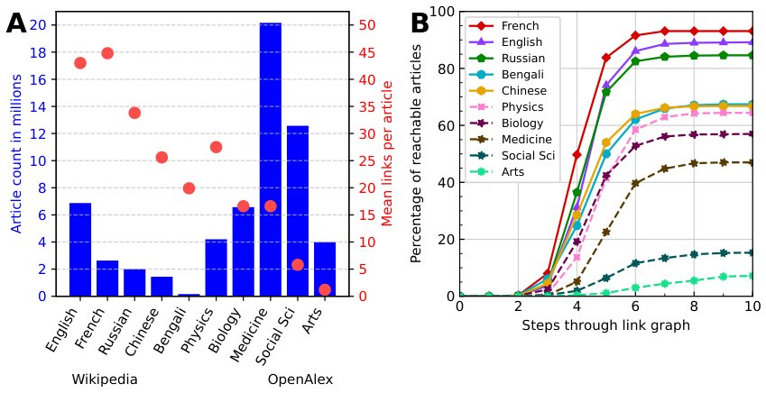

> *Generated by JarvisForResearchers Bot on 2026-10-14*

!!! tip "Why we featured this paper"
    Brand new preprint (2026) — accepted

## TL;DR
This work evaluates the navigational competence of sentence embedding models and Large Language Models (LLMs) within the Wikipedia Game, an information retrieval task executed on large, locally constructed graph datasets derived from Wikipedia and OpenAlex. We demonstrate that certain advanced LLMs can achieve success rates comparable to human performance, while also observing a clear correlation between model size and reliability.

## The Problem
The increasing reliance on language models to automate information retrieval from vast document collections necessitates rigorous evaluation of their navigational and inferential capabilities. Standard benchmarks often rely on API access or restricted subsets of data. The Wikipedia Game provides a necessary analogue for testing this capability: agents must navigate a large, interconnected graph structure—representing knowledge—from a source node to a target node using only the available internal links. This task tests not just semantic understanding, but the ability to perform multi-step, goal-directed traversal within a complex, real-world knowledge graph.

## Key Contributions
This research makes three primary contributions:
1. Construction of very large local graphs of Wikipedia pages and paper citations using OpenAlex.
2. Comparison of sentence embedding models and LLMs across five Wikipedia languages and five academic-literature datasets.
3. Evaluation of model performance against human and TF-IDF benchmarks within the Wikipedia Game format.

## How It Works


*Figure 1: Properties of the graphs that the language models will explore.
Shown here
is a comparison between the five different language versions of Wikipedia and the five different
topics of scientific literature included in the OpenAlex dataset. Panel A shows the overall size of
the dataset with t*

The methodology centers on the Wikipedia Game. Agents are tasked with finding a path from a starting article to a specified target article using only the existing hyperlinks within the graph. The agents employed are either specialized sentence embedding models or various configurations of LLMs.

### Wikipedia Graph
This forms the primary structure for the language-based evaluation. It is a directed graph where each node represents a Wikipedia article, and the edges are defined by the hyperlinks present within those articles.

### OpenAlex Graph
This provides a complementary, domain-specific testbed. It is a symmetric graph derived from academic metadata, where the edges explicitly represent citation or reference relationships between scholarly articles.

### Sentence Embedding Agent
This agent operates by leveraging a pre-trained sentence embedding model. At each step, given the current article and the target article, the agent evaluates all available outgoing links. It selects the link whose corresponding summary sentence exhibits the minimum cosine distance to the target article's summary sentence, effectively performing a nearest-neighbor search in the embedding space.

### LLM Agent (Non-Reasoning)
This agent relies on direct prompting. It is presented with a list of available next article titles from the current node. It is prompted to select the single most appropriate next title. Iterative prompting is permitted if the initial selection leads to a dead end or an incorrect path. To manage prompt context, the number of titles presented was constrained (500 for GPT models, 200 for others), and only titles, not summaries, were provided.

### LLM Agent (Reasoning)
This variant incorporates chain-of-thought (CoT) prompting. Before outputting the final chosen title, the model is instructed to generate an intermediate "thinking" block. This forces the model to articulate its reasoning process based on the current context and the goal, which is hypothesized to improve decision quality compared to direct selection.

### TF-IDF Benchmark
This serves as a statistical baseline. It assesses word importance by calculating term frequency-inverse document frequency (TF-IDF) scores based on a corpus sampled from 100,000 articles within the respective dataset. This provides a non-neural, statistical measure of relevance for comparison.

## Results
The comparative analysis across languages and datasets yielded several key observations regarding navigational success and efficiency.

| Metric | Value | Baseline | Source |
| :--- | :--- | :--- | :--- |
| Success Rate (English Wikipedia) | Comparable to humans | Human | Figure 2A |
| Highest Success Rate (English Wikipedia) | GPT-o3 mini (R) | N/A | Figure 2A |
| Efficiency (Steps) | GPT-4o can succeed in fewer steps for a greater proportion of games than E5-Small | E5-Small | Figure 3A |

## Why This Matters
The findings suggest that modern LLMs, particularly when augmented with reasoning capabilities, possess emergent navigational intelligence sufficient to perform complex information retrieval tasks analogous to human expertise. The ability of models like GPT-o3 mini (R) to match human success rates on the English Wikipedia graph indicates a significant step toward deploying these models for automated knowledge discovery in large, unstructured environments. Furthermore, the observed efficiency gains in certain LLMs over established embedding methods highlight the potential of generative reasoning over purely distance-based retrieval.

## Limitations & Open Questions
Several limitations must be acknowledged when interpreting these results. First, the human benchmark was not executed under strictly controlled experimental conditions, introducing potential variance. Second, the LLM agents are susceptible to failure modes beyond simple pathfinding; they can terminate by reaching a dead end, generating non-existent titles, or outright rejecting the prompt. Finally, the TF-IDF corpus construction relies on a sample of 100,000 articles, which may not perfectly capture the statistical distribution of the entire underlying dataset. Future work should investigate the robustness of these models when faced with adversarial or highly ambiguous graph structures.

---

## Citation

**Paper:** [2610.13948](https://arxiv.org/abs/2610.13948)

```bibtex
@article{261013948,
  title   = {Can Language Models Play the Wikipedia Game?},
  author  = {Alexander Hickey and Joanna Knight and James Bishop},
  journal = {arXiv preprint arXiv:2610.13948},
  year    = {2026},
  url     = {https://arxiv.org/abs/2610.13948}
}
```
