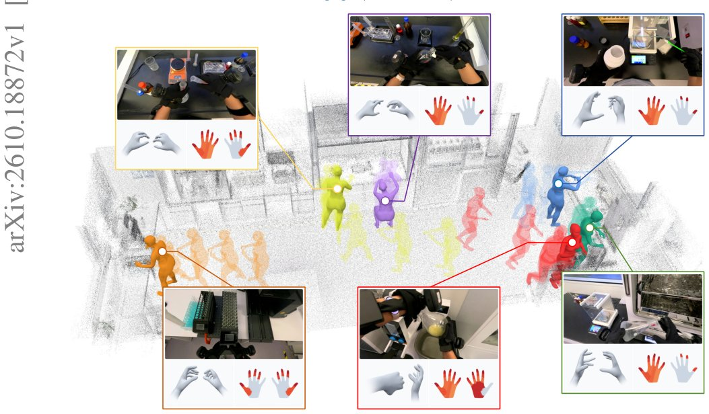

> *Generated by JarvisForResearchers Bot on 2026-10-15*

!!! tip "Why we featured this paper"
    Not yet indexed in S2 — assumed brand-new preprint

## TL;DR
EgoExplorer is a 100-hour vision-motion-touch observatory that captures human loco-manipulation by using a C3 pipeline to reconstruct whole-body motion from sparse wearable sensor data.

## The Problem
Learning effective humanoid loco-manipulation requires datasets that capture the complex, coordinated interplay between visual context, whole-body kinematics, and physical contact forces throughout continuous tasks. Current datasets suffer from fragmentation; they typically provide only partial views of this necessary multimodal coordination. Specifically, egocentric video captures rich visual context but leaves the body largely unobserved. Wearable body tracking provides motion data but often lacks fine-grained finger articulation or direct contact measurements. Conversely, hand-focused datasets offer high-fidelity hand motion and touch data but usually omit the accompanying whole-body movement context.

## Key Contributions
We introduce EgoExplorer, a vision-motion-touch dataset designed to achieve rich multimodal coverage and high-fidelity motion annotations for continuous human loco-manipulation using lightweight instrumentation. Furthermore, we present the C3 pipeline, a novel framework that decouples body-sensor calibration from motion inference and integrates temporal completion with layered constraints to robustly recover metric whole-body motion from sparse tracker inputs. Finally, we present experimental results demonstrating the improved annotation quality afforded by our design choices and provide an initial assessment of the recordings' utility for embodied learning research.

## How It Works


*Figure 1. A glimpse of EgoExplorer. It shows human loco-manipulation across workstations, with
reconstructed body motion overlaid on the scene point cloud. Each inset is linked to a corresponding
body pose along with synchronized egocentric view, finger articulation, and tactile observation.*

The C3 pipeline (Calibrate-Complete-Constrain) is designed to mitigate the inherent ambiguity when reconstructing full-body motion solely from sparse tracker poses. The process is sequential: first, we perform Protocol-guided calibration to establish a reusable participant-and-mount profile $\Phi = (\beta, s, \{A_i\}_{i=1}^5)$, effectively disentangling fixed body-sensor geometry from the time-varying motion itself. Second, Prior-guided motion completion leverages a temporal motion prior, extending existing methods like AvatarPoser, to generate an initial, plausible whole-body trajectory $X_0$ based on the five calibrated anchors. Finally, Layered constraints refine this initial proposal by enforcing consistency against multiple physical and measurement criteria: skeletal measurement agreement, participant-specific surface clearance, and body-ground consistency. This refinement step also fuses the high-fidelity finger articulation and tactile data captured by gloves as direct evidence of interaction.

### Five VIVE Ultimate Trackers
These trackers are used to locate the head, hands, and ankles. They operate via onboard cameras to provide 6-DoF inside-out tracking, serving as the primary sparse anchors for motion estimation.

### MANUS Metagloves
These gloves are employed specifically to measure the fine details of finger articulation, providing high-resolution kinematic data for the hands.

### Wuji gloves
These gloves serve the complementary role of recording tactile signals, providing direct evidence of physical contact during manipulation tasks.

### C3 Pipeline
This is the overarching Calibrate-Complete-Constrain framework. Its function is to systematically disentangle the static geometric relationship between the body and the sensors from the dynamic, time-varying motion of the human subject.

### Protocol-guided calibration
This component estimates the profile $\Phi = (\beta, s, \{A_i\}_{i=1}^5)$. The estimation is achieved by aligning a prescribed sequence of movements performed by the participant against a pre-existing reference motion library, thereby isolating the fixed sensor geometry parameters.

### Temporal motion prior
This prior is a model utilized during the completion phase. It takes the limited pose information derived from the five calibrated anchors and generates a complete, initial whole-body trajectory proposal, $X_0$, by leveraging learned temporal dynamics.

### Layered constraints
This final refinement stage takes the initial proposal $X_0$ and iteratively refines it. The constraints applied include enforcing agreement with the skeletal measurements, ensuring the reconstructed body maintains participant-specific surface clearance, and maintaining body-ground consistency throughout the trajectory.

## Results
The application of the C3 pipeline demonstrated significant improvements in motion reconstruction quality.

| Metric | Value | Baseline | Source |
| :--- | :--- | :--- | :--- |
| body-point error reduction | 71.9% | strongest baseline | Text |

## Why This Matters
The findings underscore that capturing complex human loco-manipulation necessitates a truly multimodal data acquisition strategy that integrates vision, motion tracking, and tactile sensing. Furthermore, the C3 pipeline provides a robust, generalizable framework for separating sensor mounting errors from actual biological articulation when working with sparse wearable tracking modalities. Ultimately, the EgoExplorer dataset offers a rich, synchronized resource across locomotion, posture, and object interaction, which is critical for advancing the state-of-the-art in embodied AI learning.

## Limitations & Open Questions
A primary limitation of the current methodology is its reliance on a specific calibration protocol that requires prescribed movements from the participant. Additionally, we note that the initial motion proposal generated by the temporal prior may not perfectly align with the calibrated anchor poses, and it can exhibit artifacts such as self-interpenetration or ground penetration prior to the application of the layered constraint refinement. Future work should investigate methods to reduce dependency on prescribed calibration movements and improve the robustness of the initial trajectory generation.

---

## Citation

**Paper:** [2610.18872](https://arxiv.org/abs/2610.18872)

```bibtex
@article{261018872,
  title   = {EgoExplorer: A Vision-Motion-Touch Observatory for Human Loco-Manipulation In Situ},
  author  = {Yunsong Zhou and Xuekun Jiang and Haiqi Shen and Hangxu Liu and Chaojian Shi and Yujie Liu et al.},
  journal = {arXiv preprint arXiv:2610.18872},
  year    = {2026},
  url     = {https://arxiv.org/abs/2610.18872}
}
```
