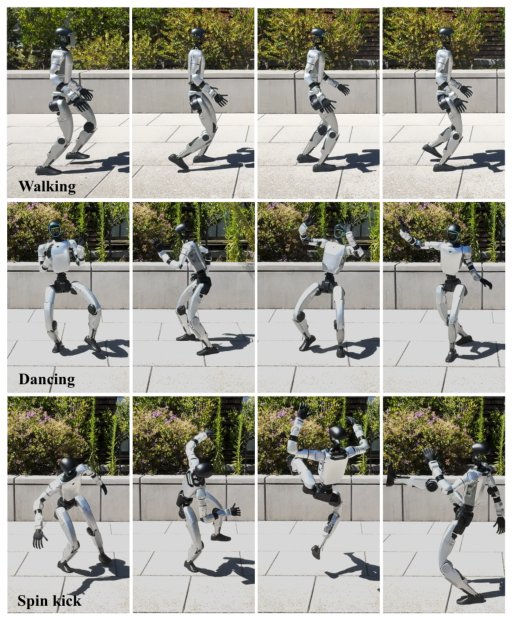

> *Generated by JarvisForResearchers Bot on 2026-10-16*

!!! tip "Why we featured this paper"
    Brand new preprint (2026) — accepted

## TL;DR
We introduce a latent diffusion framework, coupling a linear autoencoder with a Diffusion Transformer, to generate functional humanoid control networks directly in weight space and analyze the resulting weights to uncover a kinematic prior.

## The Problem
Humanoid control networks are typically obtained through conventional training procedures, with comparatively little attention given to directly modeling the distribution of their learned weights and generating functional networks in weight space. Furthermore, a systematic understanding of what humanoid control networks encode in their weights remains largely unexplored. Existing literature has largely neglected the generative modeling of these networks in weight space, and weight space analysis in robotics is limited, often focusing on weight importance (e.g., pruning) rather than the underlying structural encoding. Early generative approaches, such as hypernetworks or diffusion methods, have not been systematically applied to the weights of humanoid control networks.

## Key Contributions
Our work makes three primary contributions:
1. Adopting a latent diffusion framework that couples a linear autoencoder with a Diffusion Transformer to generate deployable humanoid control networks.
2. Identifying a structural principle in the first-layer weights that consistently reflects the robot’s kinematic prior across Reinforcement Learning (RL) and Imitation Learning (IL) training.
3. Demonstrating the feasibility of generative modeling in humanoid network weight space and providing initial insights into the information encoded by their learned weights.

## How It Works


*Fig. 1: Real-world deployment of networks with gener-
ated weights. Top: A walking motion. Middle: A dancing
motion. Bottom: A spin kick motion. For each motion, the
corresponding network weights are denoised by a motion-
specific diffusion model and subsequently deployed zero shot
in the real world*

The methodology centers on employing a latent diffusion framework. The process begins by compressing the parameters ($\theta$) of the actor network into a compact latent space ($z$) via a linear autoencoder. The encoder ($E$) utilizes single-layer encoders ($E1$ and $E2$) to map weight clusters into 1024-dimensional vectors, which are subsequently concatenated to form the 2048-dimensional latent representation $z$. This latent distribution is then modeled by a Diffusion Transformer (DiT), which is trained using the x-prediction loss ($L_{DiT}(\phi)$). During inference, the DiT performs denoising to yield $\hat{z}_0$, which is then passed through the decoder ($D$) to reconstruct the network parameters ($\hat{\theta}$), resulting in a deployable network $\pi_{\hat{\theta}}$.

### Linear Autoencoder
The Linear Autoencoder is responsible for mapping the high-dimensional actor network weights ($\theta$) into a low-dimensional, compact latent representation ($z$). This compression is achieved using single linear layers, deliberately omitting bias terms or activation functions to maintain linearity in the parameter mapping. The encoder ($E$) is structured such that $E1$ and $E2$ process aspects of the weights to produce two 1024-dimensional vectors, which are concatenated to form the final 2048-dimensional latent vector $z$.

### Diffusion Transformer (DiT)
The Diffusion Transformer (DiT) serves as the generative core of the framework. It is trained specifically to model the underlying latent distribution of the weights, utilizing the x-prediction loss ($L_{DiT}(\phi)$). By employing a transformer backbone, the DiT is capable of capturing complex, cross-layer, and global correlations inherent within the weight space representation $z$.

### Actor Network
The Actor Network is the target policy network whose weights are being modeled and generated. It is implemented as a three-layer multi-layer perceptron (MLP) featuring hidden dimensions of [128, 128] and utilizes ELU activations. This network is parameterized by $\theta$, which is the object of the generative process.

## Results
The generated networks demonstrate functional capability across various tasks.

| Metric | Value | Baseline | Source |
| :--- | :--- | :--- | :--- |
| Succ $\uparrow$ (Walking, DiT-mean) | $0.999\pm0.001$ | N/A | Table I |
| TE $\downarrow$ (Walking, DiT-mean) | $0.162\pm0.003$ | N/A | Table I |
| Succ $\uparrow$ (Walking, DiT-best) | $1.000$ | N/A | Table I |
| TE $\downarrow$ (Walking, DiT-best) | $0.161$ | N/A | Table I |
| Succ $\uparrow$ (Spin kick, Diffusion vs Noise, matched) | $0.943$ | $0.997$ (Noise $\sigma=0.01$) | Table III |

## Why This Matters
This work validates the feasibility of applying generative modeling techniques directly to the weight space of complex control policies. The ability to synthesize diverse, functional control networks allows for the exploration of the policy manifold in a manner not possible through standard sampling or fine-tuning. Furthermore, the observation that the learned weight structure exhibits a kinematic prior provides a significant theoretical insight: it suggests that fundamental physical knowledge required for locomotion is encoded robustly within the network weights, irrespective of whether the policy was learned via RL or IL.

## Limitations & Open Questions
The current analysis of weight space is primarily focused on the first layer of RL-trained actor networks. Future work must extend this analysis to deeper layers and investigate the influence of different network architectures on the encoded priors. Additional detailed results are available on the project website.

---

## Citation

**Paper:** [2610.20606](https://arxiv.org/abs/2610.20606)

```bibtex
@article{261020606,
  title   = {Modeling and Understanding Neural Weights of Humanoid Policies with Diffusion},
  author  = {Huixuan Cheng and Bike Zhang and Shankar Sastry and Koushil Sreenath},
  journal = {arXiv preprint arXiv:2610.20606},
  year    = {2026},
  url     = {https://arxiv.org/abs/2610.20606}
}
```
