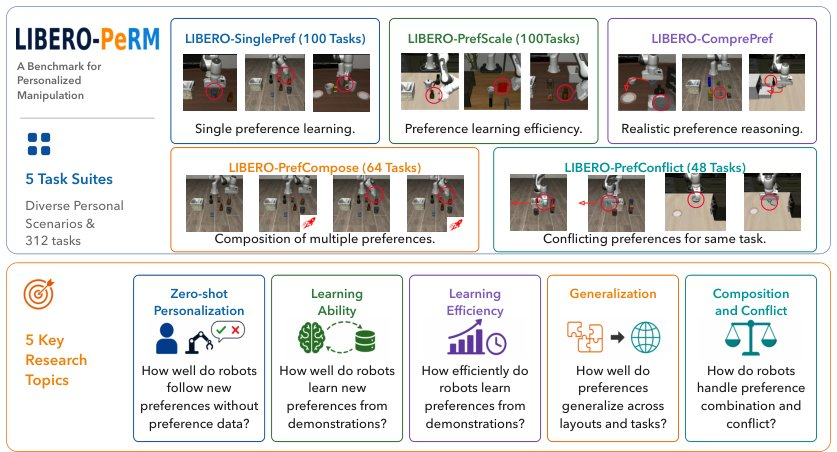

> *Generated by JarvisForResearchers Bot on 2026-10-17*

!!! tip "Why we featured this paper"
    Brand new preprint (2026) — accepted

## TL;DR
LIBERO-PeRM establishes a controlled benchmark for Personalized Robotic Manipulation (PeRM) by formalizing a taxonomy of observable preferences—Motion, Skill, and User Profile—and generating 312 preference-conditioned tasks across five distinct task suites. This framework moves beyond simple task success to enable rigorous evaluation of how well robotic policies satisfy fine-grained, user-specific execution preferences.

## The Problem
Personalized robotic manipulation (PeRM) currently suffers from a lack of a controlled benchmark capable of disentangling task completion from the satisfaction of user preferences. Existing evaluation protocols are often fragmented, focusing predominantly on high-level metrics such as task success or semantic selection, while neglecting the nuanced, fine-grained execution preferences that define a personalized interaction. Furthermore, prior work has not established a shared formulation or standardized evaluation protocol for PeRM, leaving significant gaps in the literature regarding preference-based learning in robotic settings.

## Key Contributions
We introduce three primary contributions to address these shortcomings:

1. **Controlled Formulation and Taxonomy:** We define a controlled formulation and a taxonomy of observable preferences within a simulation environment, explicitly categorizing them into Motion Preference, Skill Preference, and User Profile.
2. **Benchmark Construction:** We construct five distinct task suites—LIBERO-SinglePref, LIBERO-PrefScale, LIBERO-PrefConflict, LIBERO-PrefCompose, and LIBERO-ComprePref—totaling 312 preference-conditioned tasks.
3. **Procedural Pipeline:** We develop an extensible procedural pipeline capable of generating preference-conditioned demonstrations, associated rich metadata, and quantifiable preference-satisfaction metrics.

## How It Works


*Figure 1: Top: LIBERO-PeRM contains five procedurally generated task suites with pipeline-generated, human-
reviewed demonstrations. Bottom: we investigate five key research questions in personalized manipulation.*

LIBERO-PeRM leverages the existing LIBERO framework and extends it via a three-stage procedural pipeline. This pipeline systematically translates abstract preference specifications into executable, measurable robotic demonstrations.

### VLM
The Vision-Language Model (VLM) is employed in two critical stages. First, it is utilized to minimally modify the simulation layout based on the specific preference instance selected. Second, the VLM is responsible for generating both the baseline (no-preference) subtask plans and the corresponding preference-conditioned subtask plans.

### Preference-Conditioned Subtask and Trajectory Generation
Once the subtask plans are generated by the VLM, the actual trajectories are synthesized. This involves executing the plans using a combination of the Heuristic skill library and an OMPL planner. The OMPL planner is used to generate numerous successful trajectories for each heuristic skill by employing randomized initial state sampling.

### Heuristic skill library
This library comprises a set of pre-recorded manipulation skills. Crucially, the parameters of these skills are designed to be manually offset-adjusted or inherently affected by the preferences being tested. For instance, a preference might necessitate using a `pick_handle` skill instead of a standard `pick` skill.

### Task/Preference Prompt
The final input presented to the robotic policy is a composite prompt. This prompt is constructed by concatenating the language describing the required task ($\ell_{task}$) with the language specifying the desired preference ($\ell_{pref}$), resulting in the structure $\ell_{task} \parallel \ell_{pref}$.

### Satisfaction Metric Generation
The final stage constructs explicit, quantifiable metrics for evaluation. For Motion Preference, continuous scores are generated, often based on geometric properties such as distance. Skill Preference is evaluated via checks performed by the VLM. User Profile preferences are captured as discrete labels. This process yields paired demonstrations alongside comprehensive metadata necessary for rigorous evaluation.

## Results
The benchmark structure allows for systematic investigation into various aspects of personalization. Key findings regarding policy performance include:

| Metric | Value | Baseline | Source |
| :--- | :--- | :--- | :--- |
| Zero-shot personalization | Struggle | Current VLA policies | Abstract |
| Preference learnability | Learnable | N/A | Abstract |
| Mixed training performance | Improves no-preference task success relative to sequential adaptation and contextual-prompt task success and preference satisfaction relative to preference-only LoRA | Sequential adaptation / Preference-only LoRA | Abstract |

## Why This Matters
The introduction of LIBERO-PeRM shifts the research focus in robotic manipulation from merely achieving a goal to achieving a goal *in a manner preferred by the user*. By providing a structured, multi-faceted benchmark, we enable the community to systematically investigate the trade-offs between task efficacy and preference adherence. The framework's structure allows for targeted research into zero-shot generalization, learning efficiency, compositionality, and conflict resolution in personalized robotic systems.

## Limitations & Open Questions
Despite its utility, the current formulation presents inherent limitations. Specifically, the generalization, decomposition, and reliable execution of preferences when they enter into conflict remain challenging areas. Furthermore, the benchmark design does not currently incorporate modeling of implicit inference derived from interaction history, nor does it account for non-linguistic preference signals or open-ended preferences that lack a readily defined, automatic execution metric.

---

## Citation

**Paper:** [2610.22372](https://arxiv.org/abs/2610.22372)

```bibtex
@article{261022372,
  title   = {LIBERO-PeRM: Benchmarking Personalized Robotic Manipulation},
  author  = {Zhixu Li and Keqian Tang and Litian Gong and Jingyu Yao and Wenqian Zhang and Tianze Xu et al.},
  journal = {arXiv preprint arXiv:2610.22372},
  year    = {2026},
  url     = {https://arxiv.org/abs/2610.22372}
}
```
