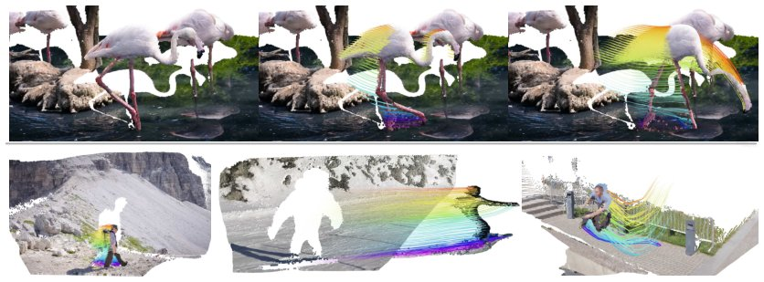

> *Generated by JarvisForResearchers Bot on 2026-10-18*

!!! tip "Why we featured this paper"
    Brand new preprint (2026) — accepted

## TL;DR
Gen4P converts a multi-step video generator into a single-step, feed-forward 4D perceiver. This architecture unifies the recovery of dense 3D tracks, point maps, depth maps, and camera poses from monocular video by leveraging scene tokens derived from a video-generator-based encoder and querying them via a continuous-time mechanism, enhanced by a frozen depth LoRA.

## The Problem
Recovering a unified 4D representation—encompassing scene geometry, depth, camera poses, and 3D point trajectories—from monocular video presents a significant challenge. The core difficulty lies in simultaneously and accurately modeling both the static geometric structure of the scene and the complex, time-varying dynamics of motion across multiple viewpoints.

Existing approaches exhibit specific limitations. Geometry Foundation Models (GFMs) provide robust geometric priors but lack an explicit mechanism to govern how points should evolve temporally in dynamic environments. While foundational generative models address 4D perception, they often rely on task-specific implementations. Furthermore, many generative models necessitate dense, frame-aligned supervision, which restricts their applicability to arbitrary spatiotemporal video inputs.

## Key Contributions
This work makes three primary contributions:
1. Repurposing a video generator into a feed-forward 4D perceiver that operates under sparse query supervision, providing a viable alternative to GFM-centric methodologies.
2. Introducing a continuous-time query mechanism coupled with on-demand decoding to ensure temporal and spatial flexibility when processing variable-length sequences.
3. Incorporating a frozen depth LoRA ($\Delta W_{Depth}$) as a plug-in geometry prior within a double-LoRA architecture, thereby enhancing overall 4D reconstruction fidelity without incurring additional trainable parameters.

## How It Works


*Figure 1: Gen4P repurposes a multi-step Video Generator into a single-step 4D Perceiver, enabling
unified feed-forward prediction of dense 3D tracks, point maps, depth maps, and camera poses from
a video input. Gen4P is able to track complex motion while maintaining the delicate structure of
in-the-*

Gen4P fundamentally shifts the paradigm from iterative denoising to direct regression of 4D attributes. It achieves this by transforming a pre-trained multi-step video generator into a single-pass, feed-forward 4D perceiver.

The process begins by encoding the input video $V$ into scene tokens $F$ using a video-generator-based encoder. These tokens are then queried by a lightweight cross-attention decoder. This decoder utilizes a continuous-time query mechanism to manage variable sequence lengths. Geometric priors are injected via a double-LoRA structure: a trainable 4D-LoRA ($\Delta W_{4D}$) interacts with a frozen video-depth LoRA ($\Delta W_{Depth}$). Finally, the decoder outputs the complete set of 4D attributes through an MLP prediction head $H$.

### Video Generative Encoder
This component is responsible for extracting high-level scene representations from the input video $V$. It comprises a frozen Wan VAE encoder (EVAE) and a DiT backbone (FDiT). The EVAE handles the initial latent space transformation, and the FDiT processes these latents to yield the set of scene tokens $F$.

### 4D-LoRA ($\Delta W_{4D}$)
This is a trainable rank-512 LoRA module specifically adapted to the DiT backbone. Its function is to learn the necessary priors required for accurate 4D perception during the reconstruction process.

### Depth-LoRA ($\Delta W_{Depth}$)
This component serves as a plug-in geometry prior. It is a frozen rank-512 LoRA, sourced from a pre-trained video depth estimation model (DVD). By keeping it frozen, it injects established geometric knowledge into the system without increasing the parameter count of the main model.

### Cross-Attention Query Decoder
This decoder is the core inference mechanism. It queries the scene tokens $F$ using query embeddings. These queries are constructed by combining information from continuous time queries, a 2D position embedding $\phi_{uv}(u, v)$, and an RGB patch embedding $\phi_{patch}(p_{u,v})$.

### Continuous Time Query
This mechanism provides the necessary temporal flexibility. It parameterizes the source time $t_{src}$ using the function $\alpha(t_{src}) = t_{src}/T-1$. This formulation allows the model to operate robustly across video sequences of varying lengths $T$.

### MLP Prediction Head (H)
This final component maps the processed query feature, $z_q$, to the complete set of desired 4D attributes. The predicted outputs include $\hat{X}_{3D}$ (3D tracks), $\hat{x}_{2D}$ (2D projections), $\hat{n}$ (normals), $\hat{d}$ (depth), $\hat{v}$ (velocities), and $\hat{c}$ (camera poses).

## Results
The performance of Gen4P is benchmarked against established methods across various metrics.

| Metric | Value | Baseline | Source |
| :--- | :--- | :--- | :--- |
| APD$\uparrow$ (ADT, All) | 91.37 | OpenD4RT (72.18) | Table 1 |
| EPE$\downarrow$ (ADT, All) | 0.121 | OpenD4RT (0.275) | Table 1 |
| APD$\uparrow$ (ADT, Dynamic) | 86.43 | OpenD4RT (74.22) | Table 1 |
| EPE$\downarrow$ (ADT, Dynamic) | 0.170 | OpenD4RT (0.309) | Table 1 |
| AbsRel $\downarrow$ (Bonn, Ours) | 0.074 | MonST3R (0.062) | Table 2 |
| AbsRel $\downarrow$ (Bonn, Ours-II) | 0.059 | MonST3R (0.062) | Table 2 |

## Why This Matters
The ability to unify the recovery of dense 3D tracks, depth maps, and camera poses from a single monocular video stream is a critical step toward robust, real-world robotic perception. By transforming a generative model into a feed-forward perceiver, Gen4P mitigates the computational overhead associated with iterative refinement processes common in prior art. Furthermore, the integration of frozen priors via LoRA demonstrates an effective strategy for injecting high-quality, task-specific knowledge into large models without the prohibitive cost of retraining the entire architecture.

## Limitations & Open Questions
The current implementation's performance is inherently bounded by the initial capabilities of the pretrained video generator it repurposes. Additionally, the training process relies on a composite loss function: $L = \lambda_{3D}L_{3D} + \lambda_{conf}L_{conf} + \lambda_{2D}L_{2D} + \lambda_{vis}L_{vis} + \lambda_{disp}L_{disp} + \lambda_{normal}L_{normal}$. Future work should investigate the sensitivity of the final reconstruction quality to the specific weighting hyperparameters ($\lambda$) within this composite loss.

---

## Citation

**Paper:** [2610.22371](https://arxiv.org/abs/2610.22371)

```bibtex
@article{261022371,
  title   = {Gen4P: Video Generators are 4D Perceivers},
  author  = {Yitong Xia and Zeren Jiang and Chuanxia Zheng},
  journal = {arXiv preprint arXiv:2610.22371},
  year    = {2026},
  url     = {https://arxiv.org/abs/2610.22371}
}
```
