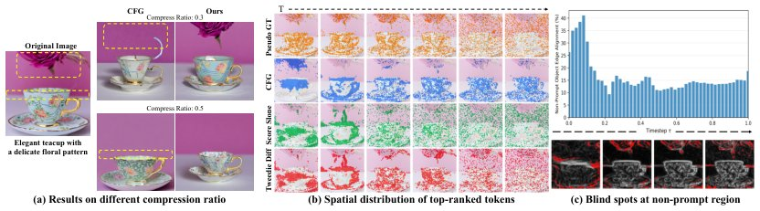

> *Generated by JarvisForResearchers Bot on 2026-10-19*

!!! tip "Why we featured this paper"
    Brand new preprint (2026) — accepted

## TL;DR
Dynamics-aware Token Merging (DaTMe) is a training-free framework that grounds token merging in diffusion dynamics by constructing a dynamics-aware importance map combining temporal evolution and structural saliency derived from the Tweedie denoised estimate.

## The Problem
Token merging in diffusion models is challenging because existing methods, such as those relying on classifier-free guidance (CFG), fail to adequately protect background objects and local details that are not explicitly mentioned in the prompt, leading to degraded structural coherence.

The limitations of current approaches are threefold. First, CFG fails to capture time-varying token importance, as high-ranked tokens remain anchored to foreground objects throughout all timesteps. Second, CFG is insensitive to prompt-independent structural importance, causing structurally salient boundaries in non-prompt regions to receive low scores and become vulnerable to merging. Third, early token merging methods, like ToMeSD, construct local merge candidate groups content-agnostically, causing content-relevant tokens to be selected as merge sources and leading to visual distortion.

## Key Contributions
We introduce three key contributions to address these limitations. First, we introduce a dynamics-aware importance map derived from the Tweedie estimate, jointly capturing the temporal evolution and structural saliency of each token. Second, we propose DaTMe, a training-free token merging framework leveraging temporal and spatial importance signals to identify safely mergeable tokens while preserving structurally critical regions. Finally, we validate DaTMe on DiT (PixArt-$\alpha$) and MM-DiT (FLUX), demonstrating strong preservation of image-wide details and state-of-the-art performance across most metrics.

## How It Works


*Figure 1: (a) Comparison under different compression ratios. CFG-based merging [9] often
overlooks background details and structures, whereas our method better preserves background
integrity. (b) Spatial distribution of top-ranked tokens over denoising timesteps. CFG-based
importance remains concent*

DaTMe operates by first constructing a dynamics-aware importance map from the Tweedie denoised estimate. This map integrates a temporal signal, defined as the inter-step difference $|\hat{x}_0(t) - \hat{x}_0(t-1)|$, which quantifies unresolved structure, and a structural signal, defined as $|\hat{x}_0(t) - \text{UpSample} \times_s (\text{DownSample} \times_s \hat{x}_0(t))|$, which highlights boundaries and fine details. Based on this map and a target compression ratio $r$, tokens are assigned roles: a conservative source set $S_{src}$ is formed from the lowest-$r$ fractions of tokens ranked by both signals, while a constraint set $S_{con}$ is formed from the top-$(1-r)$ fractions. The source budget is then completed using grid-based spatial sampling, and merging is performed via locality-constrained spatial matching.

### Tweedie denoised estimate ($\hat{x}_0(t)$)
This estimate is the posterior mean of the clean sample $x_0$ given the noisy observation $x_t$, calculated as $\hat{x}_0(t) \approx x_t - \frac{\sigma_t}{\alpha_t} \epsilon_\theta(x_t, t, c)$. This provides a noise-normalized view of the generation state, which is crucial for deriving stable dynamic signals.

### Temporal Importance Map ($M_{temp}$)
This map is defined as the inter-step residual in predicted clean-image space: $M_{temp}(t) = |\hat{x}_0(t) - \hat{x}_0(t-1)|$. This metric quantifies the rate of change or unresolved structure between consecutive denoising steps.

### Spatial Importance Map ($M_{spat}$)
This map is defined as the residual between $\hat{x}_0(t)$ and its coarse-scale approximation: $M_{spat}(t) = |\hat{x}_0(t) - \text{UpSample} \times_s (\text{DownSample} \times_s \hat{x}_0(t))|$. This highlights contours and boundaries by measuring the discrepancy between the high-resolution estimate and its downsampled/upsampled counterpart.

### Conservative Source Set ($S_{src}$)
$S_{src}$ is constructed as the intersection of the lowest-$r$ fractions of tokens ranked by both $M_{temp}$ and $M_{spat}$. These tokens are designated as potentially safe merge candidates because they exhibit low importance according to both temporal evolution and structural saliency.

### Constraint Set ($S_{con}$)
$S_{con}$ is formed from the intersection of the top-$(1-r)$ fractions of tokens on both $M_{temp}$ and $M_{spat}$. These tokens are designated as structural anchors and must be preserved during the merging process.

## Results
| Metric | Value | Baseline | Source |
| :--- | :--- | :--- | :--- |
| Visual Fidelity | Maintains visual fidelity across the entire image | Prior methods (implied) | Abstract |

## Why This Matters
The core insight here is that token importance in diffusion generation is not static or solely dictated by textual conditioning. By incorporating the dynamics of the denoising process—how the structure evolves over time ($M_{temp}$) and where fine details reside ($M_{spat}$)—DaTMe moves beyond prompt-centric metrics. This allows for a principled, training-free approach to token reduction that respects the underlying generative process, leading to superior preservation of image-wide details during compression.

## Limitations & Open Questions
The method relies on the Tweedie denoised estimate, which is inherently derived from the score function estimation of the diffusion model. Furthermore, the source completion step utilizes grid-based spatial sampling to prevent local collapse when the initial source set $S_{src}$ derived from the importance maps is insufficient to meet the target compression ratio $r$. Future work should investigate adaptive sampling strategies for source completion that are less reliant on fixed spatial grids.

---

## Citation

**Paper:** [2610.22370](https://arxiv.org/abs/2610.22370)

```bibtex
@article{261022370,
  title   = {Which Tokens to Merge? Diffusion Dynamics for Efficient Image Generation},
  author  = {SeungJu Cha and Ye-Chan Kim and HyunGee Kim and Sungho Koh and Dong-Jin Kim},
  journal = {arXiv preprint arXiv:2610.22370},
  year    = {2026},
  url     = {https://arxiv.org/abs/2610.22370}
}
```
