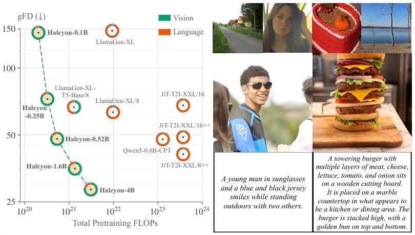

> *Generated by JarvisForResearchers Bot on 2026-10-21*

!!! tip "Why we featured this paper"
    Brand new preprint (2026) — accepted

## TL;DR
Halcyon, an early-fusion multimodal autoregressive model pretrained entirely from scratch on GPIC, demonstrates that strong text-to-image generation can be achieved without internet-scale language pretraining. This approach yields competitive generation quality with significantly reduced computational overhead compared to models relying on massive, pre-trained language models.

## The Problem
Modern text-to-image (T2I) systems exhibit a strong dependency on internet-scale language pretraining to effectively condition image generation on complex textual prompts. This reliance on large, pre-trained language models dominates the overall compute budget for building state-of-the-art T2I systems. However, the precise quantitative contribution of this extensive language pretraining to the final T2I generation quality remains poorly understood. Furthermore, the cost associated with this language pretraining is often omitted from comparative analyses, leading to an underestimation of the true resource requirements for deploying high-fidelity T2I models. Crucially, a robust demonstration of achieving strong T2I generation without this massive language pretraining step has been lacking.

## Key Contributions
We introduce Halcyon, a family of early-fusion multimodal autoregressive models that are pretrained entirely from scratch using the GPIC dataset. We systematically quantify the utility of language pretraining within the T2I pipeline by analyzing three experimental axes: performing full from-scratch pretraining, varying data composition and scheduling strategies, and conducting direct compute comparisons. Finally, we demonstrate that Halcyon achieves strong T2I generation without external language pretraining, and further show that the model can learn image captioning by substituting caption dropout with Image-to-Text (I2T) supervision.

## How It Works


*Figure 1: Text-to-image generation without internet-scale language pretraining. Left: Gener-
ation quality on GPIC (Chandrasegaran et al., 2026) (gFD, log scale) vs. total pretraining FLOPs
required to build each T2I system, including language model, image tokenizer, and image generator
pretraining.*

Halcyon is structured as a decoder-only Transformer. It operates by utilizing a joint text-image vocabulary, which allows it to model both text and image tokens as a single, continuous sequence. The core mechanism is next-token prediction across this unified sequence. A critical aspect of this design is that all constituent components—the text tokenizer, the image tokenizer, and the generative model itself—are trained from scratch. The model is designed to handle four distinct sequence formats during training: Text-only, Image-only (I), Image-to-Text (I2T), and Text-to-Image (T2I). The training objective is a weighted next-token cross-entropy loss, defined as $L = (L_{text} + \lambda_{img}L_{img})/M$, where $\lambda_{img}$ is set to $0.5$. The system's performance is rigorously evaluated across various data composition and scheduling strategies specifically designed to isolate and measure the impact of language pretraining.

### Halcyon
Halcyon is the overarching architecture, realized as a family of early-fusion multimodal autoregressive models. The early-fusion paradigm dictates that the text and image modalities are integrated into a single sequence representation early in the decoding process, allowing the model to learn cross-modal dependencies holistically rather than sequentially.

### Joint text–image vocabulary
The model employs a unified vocabulary of size 80,640. This vocabulary is partitioned into 16,384 tokens dedicated to text, 64,000 tokens dedicated to image representations, and 256 special tokens required for sequence control and padding. This unified space facilitates the direct autoregressive modeling of interleaved text and image tokens.

### Image tokenizer
The image tokenizer is trained specifically on the GPIC image set. It utilizes an encoder-decoder design coupled with Finite Scalar Quantization (FSQ). To manage dimensionality, images are downsampled by a factor of 8, and the resulting visual information is mapped into a codebook of size 64,000, producing discrete image tokens.

### Text tokenizer
The text tokenizer is a byte-level BPE tokenizer. It is trained from scratch on the GPIC captions dataset augmented with data from OpenWebText, resulting in a vocabulary size of 16,384 tokens.

## Results
The performance of Halcyon, trained from scratch, demonstrates competitive capabilities against established baselines while exhibiting substantial computational savings.

| Metric | Value | Baseline | Source |
| :--- | :--- | :--- | :--- |
| gFD | 48.0 | LlamaGen-XL/8 | Figure 1 |
| Total pretraining compute | 18.2$\times$ less | LlamaGen-XL/8 | Figure 1 |
| gFD | 35.3 | JiT-T2I-XXL/8++ | Figure 1 |
| Total pretraining compute | 275$\times$ less | JiT-T2I-XXL/8++ | Figure 1 |

## Why This Matters
The findings from this work provide a strong empirical argument against the necessity of internet-scale language pretraining for achieving high-quality T2I generation. The practitioner takeaway is clear: strong T2I systems can be trained entirely from scratch without incurring the massive computational debt associated with pre-training large language models on the entire internet. Furthermore, the results confirm that early-fusion architectures, when trained end-to-end, can achieve performance metrics competitive with late-fusion baselines while drastically reducing the required pretraining compute. This suggests that the utility of external, text-only pretraining for T2I generation is significantly limited when compared to a unified, multimodal training objective.

## Limitations & Open Questions
The current implementation exhibits lower reconstruction fidelity when dealing with inputs that consist of small amounts of text or when the target image contains fine glyphs. A primary limitation of the study is that the training and evaluation are strictly confined to the GPIC dataset, which comprises 100M image-text pairs. Future work must address the generalization capabilities beyond this specific dataset and explore how to mitigate the observed fidelity degradation in complex visual details.

---

## Citation

**Paper:** [2610.26863](https://arxiv.org/abs/2610.26863)

```bibtex
@article{261026863,
  title   = {Text-to-Image Generative Modeling Without Language Pretraining},
  author  = {Keshigeyan Chandrasegaran and Yue Zhao and Armin W. Thomas and Ehsan Adeli and Jiajun Wu and Juan Carlos Niebles et al.},
  journal = {arXiv preprint arXiv:2610.26863},
  year    = {2026},
  url     = {https://arxiv.org/abs/2610.26863}
}
```
