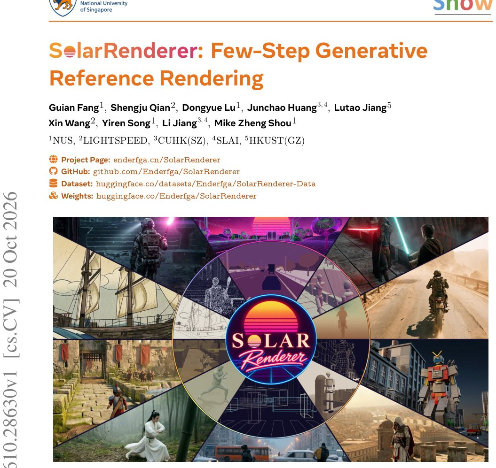

> *Generated by JarvisForResearchers Bot on 2026-10-22*

!!! tip "Why we featured this paper"
    Brand new preprint (2026) — accepted

## TL;DR
SolarRenderer is a structure-conditioned video renderer that adapts a frozen MiniMax-H3 33B backbone using lightweight LoRAs to render realistic video from arbitrary structural representations in few steps.

## The Problem
Current video rendering methodologies suffer from several limitations. Specifically, existing renderers are often coupled to a fixed representation format, such as white-box frames, semantic maps, or G-buffers. Furthermore, achieving high-fidelity output typically necessitates a high number of denoising steps, or requires costly distillation procedures. A critical issue is that the training conditions used for these models are frequently misaligned with the target videos they are intended to generate, and the available engine-paired datasets are often restricted to a single source engine.

## Key Contributions
We present a renderer capable of handling any structural representation using a single control LoRA via the native reference pathway, eliminating the need for type identifiers or auxiliary branches. We introduce structure-guided distribution matching, a technique used to post-train a pretrained four-step LoRA, enabling the model to render in just four steps while rigorously preserving its structural control. We constructed a frame-aligned paired corpus comprising 136K clips sourced from game engines, simulators, and YouTube videos, ensuring that every structural frame is precisely aligned with its target video frame. Finally, the system achieves state-of-the-art performance on an in-distribution test set and demonstrates strong generalization across a benchmark of 16 structural representations, including 11 that were unseen during training. Moreover, its causal variant is capable of rendering 768p video in real time.

## How It Works


*Figure 1 SolarRenderer renders structure of any kind into realistic video. Each wedge pairs a structure (inner ring)
with its rendering, and seven of the ten structure types are unseen in training. Readers can click and play the
animation using Adobe Acrobat.*

SolarRenderer operates by freezing the large, pretrained MiniMax-H3 33B backbone, which serves as the primary source of the appearance prior. We introduce two distinct, lightweight LoRAs: a control LoRA ($\phi$) and an acceleration LoRA ($\psi$). Structural video inputs are fed into the backbone's native reference pathway. Within this pathway, each structural latent is provided with the RoPE coordinates corresponding to its target frame, and the representations are described using untyped text prompts. The training process is bifurcated into two distinct stages. Stage 1 focuses on adapting $\phi$ using a flow-matching objective ($L_{FM}$) to instill the model's ability to follow structural guidance. Stage 2 adapts $\psi$ using structure-guided distribution matching ($\nabla\psi_{LDMD}$). In this second stage, the full-step Stage-1 model acts as the teacher, guiding the student model ($\psi$) toward a sharper target derived from the teacher's structural contribution, specifically $\hat{z}_0(C) + (w-1)(\hat{z}_0(C) - \hat{z}_0(C\emptyset))$.

### MiniMax-H3 33B backbone
This component is the frozen, pretrained video backbone. Its function is to provide the robust, high-fidelity appearance prior necessary for realistic video generation.

### Control LoRA ($\phi$)
This is a lightweight adapter specifically trained via a flow-matching objective. Its role is to interpret and faithfully follow the structural references provided to the model.

### Acceleration LoRA ($\psi$)
This lightweight adapter is initialized from a rank-128 four-step LoRA derived from DMAD. It is subsequently trained using structure-guided distribution matching to enable the model to achieve high-quality rendering in only a few steps.

### Native Reference Pathway
This pathway is the designated entry point for structural videos into the backbone. It is engineered to allow the control adapter ($\phi$) to leverage the backbone's pre-existing capability to process and interpret reference videos without requiring modifications to the core architecture.

### Frame-Aligned Positional Encoding
This mechanism ensures temporal and spatial correspondence between the structural input and the desired output. It operates by providing each reference token with the specific RoPE coordinates of the target token it is intended to describe.

## Results
| Metric | Value | Baseline | Source |
| :--- | :--- | :--- | :--- |
| Rendering Speed | four steps | 50-step sampling | Abstract |
| Speed Improvement | 12.3 times faster | 50-step sampling | Abstract |
| Generalization | 11 unseen representations | 16 structural representations (total benchmark) | Abstract |
| Causal Variant Output | 768p video in real time | N/A | Abstract |

## Why This Matters
The ability to decouple structural control from rendering speed is a significant advancement. By utilizing lightweight adapters and a native reference pathway, SolarRenderer bypasses the need for complex, architecture-altering modifications like adding ControlNet branches to accommodate diverse structural inputs. Furthermore, the decoupling of control learning (Stage 1) from acceleration learning (Stage 2) is crucial; it allows the model to achieve rapid sampling via $\psi$ without degrading the precise structural fidelity learned by $\phi$. Structure-guided distribution matching provides a principled way to distill the high-quality, full-step control into a fast, few-step inference path.

## Limitations & Open Questions
One noted limitation is that the acceleration adapter ($\psi$) was distilled solely for the backbone and has never been trained jointly with the control model ($\phi$). Additionally, the training regimen necessitates the availability of a large, frame-aligned corpus, specifically 136K clips, which represents a significant data acquisition requirement.

---

## Citation

**Paper:** [2610.28630](https://arxiv.org/abs/2610.28630)

```bibtex
@article{261028630,
  title   = {SolarRenderer: Few-Step Generative Reference Rendering},
  author  = {Guian Fang and Shengju Qian and Dongyue Lu and Junchao Huang and Lutao Jiang and Xin Wang et al.},
  journal = {arXiv preprint arXiv:2610.28630},
  year    = {2026},
  url     = {https://arxiv.org/abs/2610.28630}
}
```
