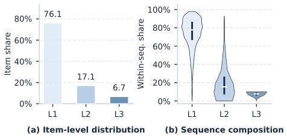

> *Generated by JarvisForResearchers Bot on 2026-10-23*

!!! tip "Why we featured this paper"
    Brand new preprint (2026) — accepted

## TL;DR
LoopRec introduces item-level adaptive recursion for sequential recommendation by using a shared backbone and a lightweight gate at each recursion boundary to dynamically determine the necessary computation depth for each item.

## The Problem
Existing sequential recommenders allocate a fixed computational budget to every item in a user's interaction history, which is suboptimal because items within the same sequence vary drastically in their computational need, with most converging early while a critical minority requires full depth. This fixed allocation strategy leads to wasted capacity on already-converged items and sacrifices overall recommendation quality by under-serving critical minority items that benefit from deeper computation.

## Key Contributions
We make three key contributions. First, we utilize two complementary diagnostics to reveal variation in item-level computational demand and the limitations of fixed-depth processing in sequential recommendation. Second, we propose LoopRec, which combines a shared recursive backbone with learned item-level stopping decisions to adapt computation depth within each interaction history. Third, we demonstrate consistent ranking improvements across three datasets and four backbones, with routing analyses revealing deeper computation for less frequent and more recent items.

## How It Works


*Figure 1: Item saturation depth ℓ★
𝑖on Office. (a) Item-level
distribution across the test set. (b) Per-sequence depth compo-
sition. Each violin shows the distribution of within-sequence
shares, with dots and bars marking medians and IQRs.*

LoopRec addresses fixed-depth inefficiency by recursively reusing a single weight-shared backbone block across multiple recursions ($R$). It employs a lightweight binary gate at each recursion boundary ($r \in \{1, \dots, R-1\}$) to make an independent stop-or-continue decision for every active position. This allows items whose representations have sufficiently matured to exit early, while others proceed to deeper recursions. Representation alignment is maintained because all recursions map through the same parameters. The training objective combines the standard cross-entropy loss ($L_{rec}$) with two regularizers: $L_{bal}$ to avoid depth collapse and $L_z$ to prevent premature gate saturation, optimizing $L = L_{rec} + \lambda_{bal}L_{bal} + \lambda_zL_z$.

### Shared Backbone Block $B(\cdot)$
This is a single weight-shared block reused across all recursions, ensuring that items exiting at any depth naturally produce representations in the same feature space.

### Depth Router
This is a lightweight gate at each recursion boundary that computes a routing score $s^{(r)}_i = g(h^{(r)}_i + \pi_r)$ and converts it into an exit probability $q^{(r)}_{i,exit} = 1 - \sigma(s^{(r)}_i)$ to decide if position $i$ stops or continues.

### Initial Context Encoding
This is the first pass where $H^{(1)} = B(X)$ is applied to the full sequence $X$ to obtain common contextualized states.

### Depth-Routed Recursion
This is the iterative process where only positions $A^{(r+1)}$ that continue are updated by re-applying the shared block: $H^{(r+1)}_{A^{(r+1)}} = B(H^{(r)}_{A^{(r+1)}})$.

### Depth-Specific Readout
This forms the final representation $\bar{z}_i = x_i + \omega_i h^{(d_i)}_i$ by combining the input token $x_i$ with the state $h^{(d_i)}_i$ at the selected depth $d_i$.

## Results
| Metric | Value | Baseline | Source |
| :--- | :--- | :--- | :--- |
| NDCG@20 gain | +7.1% | Fixed-depth | Table 1 |
| MRR@20 gain | +6.5% | Fixed-depth | Table 1 |
| HR@20 gain | +8.8% | Fixed-depth | Table 1 |
| Fixed-depth preferred in sequences | 4.6% | Flexible oracle | Table 1 |

## Why This Matters
When dealing with sequential data, assume computational needs are heterogeneous rather than uniform. Adaptive depth mechanisms, like LoopRec, can improve ranking quality while potentially reducing total computation. Furthermore, the necessity of regularization terms ($L_{bal}$ and $L_z$) highlights that controlling the routing mechanism's diversity and stability is a non-trivial aspect of implementing dynamic computation graphs.

## Limitations & Open Questions
The method requires a warm-up phase ($W_{router}$ epochs) where routing decisions are bypassed to stabilize the model before adaptive routing is enabled. Additionally, while the readout weight $\omega_i$ maintains differentiability despite selecting a hard depth $d_i$ for each position, the theoretical guarantees on the convergence properties of the combined objective function $L$ remain an area for further investigation.

---

## Citation

**Paper:** [2610.30128](https://arxiv.org/abs/2610.30128)

```bibtex
@article{261030128,
  title   = {Think Harder Where It Matters: Item-Level Adaptive Recursion for Sequential Recommendation},
  author  = {Zhanshuo Cao and Jiakai Tang and Yuqi Zhou and Sunhao Dai and Jun Xu},
  journal = {arXiv preprint arXiv:2610.30128},
  year    = {2026},
  url     = {https://arxiv.org/abs/2610.30128}
}
```
