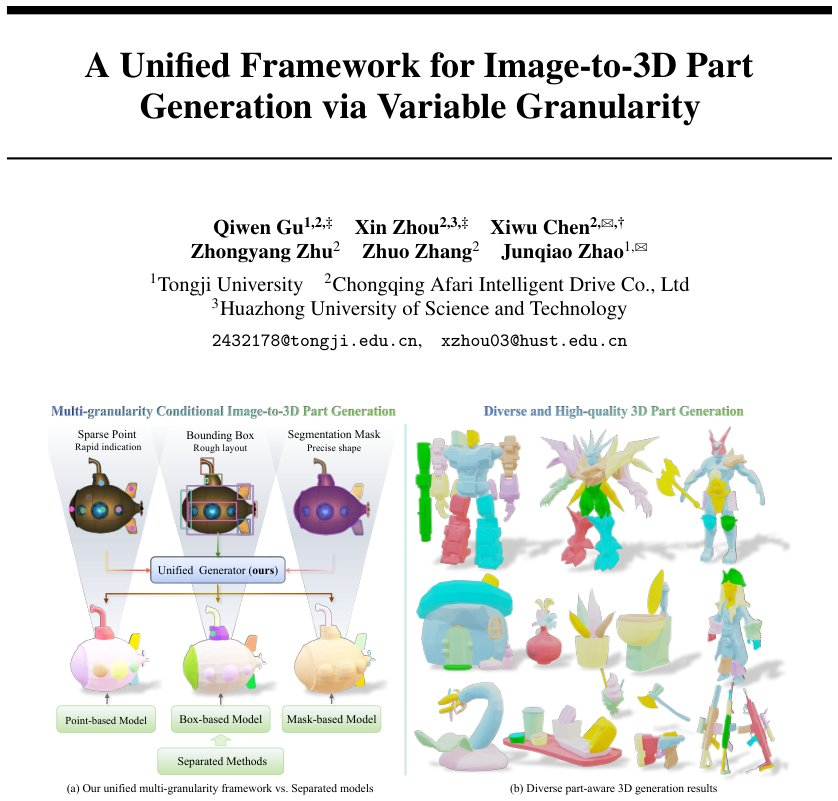

> *Generated by JarvisForResearchers Bot on 2026-10-24*

!!! tip "Why we featured this paper"
    Brand new preprint (2026) — accepted

## TL;DR
FlexPart introduces a unified Diffusion Transformer (DiT) framework capable of integrating sparse points, bounding boxes, and segmentation masks into a single generative model. This unification is achieved via Gated Adaptive Layer Normalization (Gated AdaLN) and an Asymmetric Geometric Guidance mechanism, which leverages dense priors to enhance the spatial reasoning of sparse inputs, thereby enabling flexible, controllable image-to-3D part generation.

## The Problem
Current methodologies for generating 3D parts from 2D images suffer from a lack of operational flexibility. These existing methods are typically engineered around a singular input modality—be it dense segmentation masks or sparse point clouds. This specialization imposes constraints on the user workflow, preventing seamless transitions between high-fidelity, fine-grained control (e.g., using masks) and lightweight, rapid interaction (e.g., using sparse points). Furthermore, pipelines that decouple 2D supervision from 3D reconstruction, such as projecting masks onto generated meshes, are prone to introducing geometric artifacts during the lifting process. Finally, methods that attempt to internalize part decomposition without explicit geometric guidance lack the necessary direct control over the resulting spatial boundaries.

## Key Contributions
We propose FlexPart, the first unified framework that integrates point, box, and mask prompts into a single DiT, thereby unlocking cross-modal synergy for controllable 3D part generation. We devise an Asymmetric Geometric Guidance mechanism designed to effectively transfer structural knowledge from dense priors to bolster the spatial reasoning capabilities of sparse inputs. Finally, we demonstrate that FlexPart achieves superior generation quality and enhanced geometric consistency when benchmarked against existing state-of-the-art approaches across various input modalities.

## How It Works


*Figure 1: (a) Our unified framework integrates variable-granularity geometric prompts from sparse
points to dense masks into one model for flexible part control. (b) The proposed method produces
high-fidelity, semantically coherent 3D parts across diverse object categories.*

FlexPart is fundamentally built upon a Diffusion Transformer (DiT) architecture. Heterogeneous geometric conditions—points, bounding boxes, and masks—are injected into the DiT via Gated Adaptive Layer Normalization (Gated AdaLN). Modality-specific encoders process the raw input data to generate distinct embeddings. These embeddings are subsequently aggregated and projected into a unified part-level conditioning vector, $c_i$, by a Fusion MLP $\psi(\cdot)$. The critical innovation, the Asymmetric Geometric Guidance mechanism, is employed to refine sparse point prompts. This mechanism utilizes differentiable partial optimal transport to align the features derived from sparse points (the "student") with features derived from dense priors (boxes/masks, the "teacher"), after projecting both into a shared visual space mediated by an Asymmetric Visual Bridge $B(\cdot)$. This process effectively transfers robust spatial priors from the dense modalities to the weaker point representations, allowing the model to support diverse prompt types at inference time without requiring model retraining.

### Unified Generator (ours)
This constitutes the core generative model, instantiated as a DiT. Its function is to synthesize the 3D part representation conditioned on the fused, multi-modal geometric information.

### Gated Adaptive Layer Normalization (Gated AdaLN)
This mechanism is responsible for injecting the learned conditioning information into the transformer blocks. It dynamically modulates the transformer hidden states $H$ by predicting scale ($\gamma$), shift ($\beta$), and a gating factor ($g$) from the unified condition vector $c$.

### Point Encoder
This component is responsible for encoding sparse point prompts. It employs Gaussian Fourier features followed by a standard Multi-Layer Perceptron (MLP) to transform the raw point coordinates into a meaningful embedding.

### Box/Mask Encoder
This component handles the encoding of structured geometric priors. For bounding boxes, it utilizes a learnable corner-type embedding. For segmentation masks, it employs a small Convolutional Neural Network (CNN) followed by global average pooling to derive a compact feature representation.

### Fusion MLP $\psi(\cdot)$
This is a learnable MLP whose role is to aggregate the effective prompt embeddings ($\tilde{e}_{point}^i, \tilde{e}_{box}^i, \tilde{e}_{mask}^i$) derived from the modality-specific encoders. It projects these disparate embeddings into a single, unified part-level conditioning vector $c_i$.

### Asymmetric Visual Bridge $B(\cdot)$
This component is implemented as a cross-attention mechanism. It serves to project both the student point prompts and the teacher box/mask prompts into a shared visual feature space, utilizing pre-computed image features $I_{enc}$ as the context.

### Partial Optimal Transport
This mechanism facilitates the alignment between the student (point) and teacher (box/mask) features. It operates via a differentiable transport plan, augmented with a dustbin mechanism to robustly handle instances where one or more conditioning modalities are absent during inference.

## Results
| Metric | Value | Baseline | Source |
| :--- | :--- | :--- | :--- |
| Part CD (Mask conditioning on PartVerseXL) | 0.2938 | TripoSG + SAM3D | Table 1 |
| Part CD (Mask conditioning on PartVerseXL) | 0.2938 | OmniPart | Table 1 |
| Part CD (Mask conditioning on PartVerseXL) | 0.2938 | TripoSG + SAM3D | Abstract |
| Part CD (Mask conditioning on PartVerseXL) | 0.2938 | OmniPart | Abstract |
| Mean CD (Whole Mesh, PartVerseXL) | 0.1418 | FullPart | Table 2 |

## Why This Matters
FlexPart addresses a critical limitation in current generative 3D modeling: the rigidity of input conditioning. By unifying point, box, and mask inputs into a single DiT structure, we enable a single model to serve multiple user interaction paradigms. The Asymmetric Geometric Guidance mechanism is particularly significant as it allows the model to leverage the high geometric fidelity of dense supervision (masks/boxes) to regularize and improve the output quality derived from inherently sparse supervision (points), all without requiring a complete architectural overhaul or retraining for each input type.

## Limitations & Open Questions
The framework currently exhibits two primary limitations. First, it is dependent on a pretrained 3D VAE, specifically TripoSG [16], to successfully obtain the necessary part latents. Second, the training procedure necessitates a two-stage strategy, which involves employing distinct dropout rates tailored to different parts and input modalities. Future work should investigate methods to decouple the reliance on external VAEs and explore unified, single-stage training regimes.

---

## Citation

**Paper:** [2610.31671](https://arxiv.org/abs/2610.31671)

```bibtex
@article{261031671,
  title   = {A Unified Framework for Image-to-3D Part Generation via Variable Granularity},
  author  = {Qiwen Gu and Xin Zhou and Xiwu Chen and Zhongyang Zhu and Zhuo Zhang and Junqiao Zhao},
  journal = {arXiv preprint arXiv:2610.31671},
  year    = {2026},
  url     = {https://arxiv.org/abs/2610.31671}
}
```
