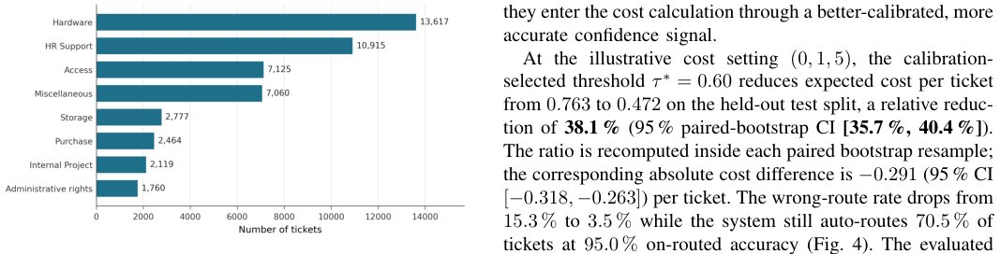

> *Generated by JarvisForResearchers Bot on 2026-10-25*

!!! tip "Why we featured this paper"
    Brand new preprint (2026) — accepted

## TL;DR
This work establishes a framework for cost-aware abstention in LLM-based IT ticket classification. By deriving routing thresholds ($\tau$) from an explicit cost model—where the cost of misrouting ($c_{wrong}=5$) significantly exceeds human triage cost ($c_{triage}=1$)—we demonstrate that selecting $\tau$ based on asymmetric costs can substantially reduce expected operational costs compared to standard accuracy-driven routing.

## The Problem
In operational settings, the consequence of an incorrect automated routing decision for an IT support ticket is not uniformly weighted. A misclassification can incur a cost significantly higher than the cost of deferring the ticket to a human triage agent. Standard evaluation metrics, such as accuracy or macro-F1, are inherently symmetric and fail to capture this critical asymmetry in operational risk. Furthermore, Large Language Models (LLMs) are frequently deployed with high confidence scores that do not correlate reliably with actual predictive accuracy, exacerbating the risk when coupled with naive routing policies. Existing literature rarely evaluates automated routing systems under explicit, asymmetric cost models, nor does it systematically integrate abstention based on calibrated uncertainty.

## Key Contributions
We present a comparative study evaluating four trained non-LLM classifiers against eight different prompted LLM conditions on a public IT ticket corpus. We provide a detailed calibration analysis for these models, reporting Expected Calibration Error (ECE), Area Under the ROC Curve (AUROC), and Tie-Aware Area Under the Risk-Coverage Curve (AURC). Crucially, we implement a calibration-selected, paired-bootstrap cost analysis utilizing three distinct rejection scores: top-probability, probability-margin, and entropy.

## How It Works


*Fig. 2.
Class distribution of the 47,837-ticket corpus across the eight
categories.*

The core methodology treats cost-aware abstention as an empirical readiness test governed by predefined cost assumptions: $c_{ok}=0$, $c_{triage}=1$, and $c_{wrong}=5$. The system employs a policy-wrapped decision mechanism that either routes the output of the base classifier or abstains ($\perp$), deferring the ticket to a human triager. The objective is to select a routing threshold ($\tau$) on calibration data that minimizes the expected per-ticket cost, $E[c] = P(\perp)c_{triage} + P(\text{correct}, \neg\perp)c_{ok} + P(\text{wrong}, \neg\perp)c_{wrong}$. For LLMs, the optimal break-even threshold is analytically derived from this cost equation: $p_{cok} + (1 - p)c_{wrong} \le c_{triage}$, where $p$ is the predicted probability of the correct class. The framework cleanly separates the predictor, the confidence estimator, the abstention policy, and the cost model.

### Base Classifier $h: X \rightarrow Y$
This component is responsible for the primary classification task, mapping an input ticket $X$ to one of $K$ predefined downstream queues $Y$. The performance of this component is the foundation upon which the entire routing decision rests.

### Policy-wrapped Decision $d: X \rightarrow Y \cup \{\perp\}$
This is the decision layer that supersedes the base classifier's output. It determines whether the ticket should be routed to a specific queue $Y$ or if it should be flagged for human review by outputting the abstention symbol ($\perp$).

### Cost Model
The Cost Model quantifies the economic implications of each possible outcome. It defines three parameters: $c_{ok}$ (the cost incurred when the classifier is correct and routes automatically), $c_{triage}$ (the cost associated with human intervention), and $c_{wrong}$ (the cost incurred when the classifier is incorrect and routes automatically).

### Confidence Estimator
This component generates the necessary probabilistic or ranking signals required by the abstention policy. For instance, it might output the maximum class probability from the classifier, or for LLMs, it might utilize a specific confidence field derived from the prompt structure.

### Abstention Policy
This policy dictates the final routing action based on the input from the Confidence Estimator and the derived threshold $\tau$. Common policies include $\text{threshold}@\tau$ (route if $\text{conf} \ge \tau$, defer otherwise) or deterministic policies like $\text{always\_route}$ or $\text{always\_defer}$.

## Results
The application of cost-aware abstention yielded measurable operational improvements.

| Metric | Value | Baseline | Source |
| :--- | :--- | :--- | :--- |
| Test Cost Reduction (TF-IDF + LR) | 0.472 | 0.763 | Abstract |
| Relative Cost Reduction (TF-IDF + LR) | 38.1 % | N/A | Abstract |
| Wrong Routes Reduction (TF-IDF + LR) | 3.5 % | 15.3 % | Abstract |
| Accuracy (Strongest Prompted LLM) | 0.477 | 0.879 (DistilBERT fine-tuned) | Abstract |

## Why This Matters
This research moves the discussion of model deployment beyond simple predictive accuracy. By formalizing the operational cost structure, we provide a rigorous mechanism to determine the optimal trade-off between automation efficiency and risk mitigation. The findings suggest that for high-stakes routing tasks where errors are expensive, a threshold derived from economic necessity ($\tau$) is superior to one derived purely from maximizing classification accuracy.

## Limitations & Open Questions
The current findings are inherently scoped by the specific dataset utilized, the particular prompt engineering strategies employed for LLMs, the chosen model endpoints, and the illustrative cost parameters ($c_{ok}, c_{triage}, c_{wrong}$). Furthermore, while Isotonic recalibration can reduce ECE, the study indicates it does not guarantee an improvement in ranking discrimination. It is important to note that this work establishes an evaluation framework; it does not propose a novel abstention algorithm or serve as a universal certification standard for deployment.

---

## Citation

**Paper:** [2610.31657](https://arxiv.org/abs/2610.31657)

```bibtex
@article{261031657,
  title   = {Cost-Aware Abstention for LLM-Based IT Ticket Classification},
  author  = {Sachin Gupta},
  journal = {arXiv preprint arXiv:2610.31657},
  year    = {2026},
  url     = {https://arxiv.org/abs/2610.31657}
}
```
