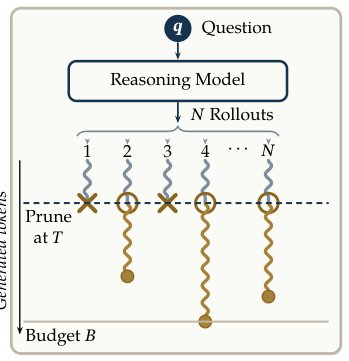

> *Generated by JarvisForResearchers Bot on 2026-10-26*

!!! tip "Why we featured this paper"
    Brand new preprint (2026) — accepted

## TL;DR
PKTP (Pass@k Thought Pruning) reframes test-time pruning as a direct optimization of $\text{Pass}@k$ by modeling the joint distribution of rollout outcomes via a latent Gaussian structure. This allows for the derivation of a submodular surrogate for the failure probability, enabling an efficient greedy selection procedure that inherently balances quality and diversity.

## The Problem
Test-time scaling in complex reasoning models necessitates the generation and evaluation of numerous candidate solutions (rollouts). To manage computational load, test-time pruning—the selection of a fixed, small set of partial rollouts—is required. The core difficulty is that existing pruning methodologies are bifurcated: they are either purely quality-based (assigning a score to a partial solution) or purely diversity-based (selecting trajectories that cover distinct reasoning paths). Crucially, there is a lack of prior work that directly optimizes the desired objective, $\text{Pass}@k$, which requires balancing the selection of high-quality candidates (exploitation) against the selection of diverse candidates (exploration). Pure exploitation methods risk selecting highly correlated, redundant rollouts, leading to shared failure modes, while pure exploration methods ignore intrinsic quality, wasting computational budget on weak trajectories.

## Key Contributions
We make three primary contributions:
1. We cast the pruning problem as maximizing the $\text{Pass}@k$ of the retained set, explicitly modeling how correlated rollouts contribute to joint failure.
2. We derive a closed-form, submodular approximation of $\text{Pass}@k$ that effectively bridges the gap between quality-focused methods (like Linear Probe) and diversity-focused methods (like RepExp).
3. We demonstrate empirically that PKTP achieves performance gains over existing pruning strategies across eight distinct reasoning models, particularly when targeting moderate values of $k$.

## How It Works


*Figure 1: Test-time pruning. Only k of the N rollouts (ringed) continue past the cutoff T, up to
the budget B.*

PKTP addresses the quality-diversity trade-off by formulating the selection process as maximizing $\text{Pass}@k$ directly. This is achieved by modeling the joint distribution of the outcomes across all generated rollouts using a latent Gaussian framework.

### Representation Vector $h_i$
For each rollout $i$, we first generate a representation vector $h_i$. This vector serves as a compact embedding of the reasoning process up to a specific token $T$. In practice, $h_i$ is often realized as an exponential moving average (EMA) computed over the transformer hidden states generated during the rollout.

### Learnable Mapping $Q_\theta: \mathbb{R}^d \to \mathbb{R}$
To quantify the inherent quality of a rollout, we employ a learnable mapping, $Q_\theta$. This function, often instantiated as a simple linear model $Q_\theta(h) = \theta^\top h + \theta_0$, predicts a scalar quality score $q_i$ based on the representation vector $h_i$.

### Latent Score $Z_i$
The core innovation lies in modeling the latent score $Z_i$ for rollout $i$. This score is defined as $Z_i = q_i + h_i^\top f + m_i$. Here, $q_i$ is the quality prediction, $h_i^\top f$ introduces a shared random effect $f$ that captures the correlation structure across rollouts, and $m_i$ represents rollout-specific noise. This structure allows the model to account for how similar rollouts might fail together.

### Correctness $C(y^{(i)})$
The binary correctness outcome, $C(y^{(i)})$, is derived directly from the latent score $Z_i$ via a thresholding mechanism. Specifically, $C(y^{(i)}) = 2 \times 1\{Z_i \ge 0\} - 1$. This maps the continuous latent score into a discrete success/failure indicator.

### Selection Surrogate $\log \tilde{e}_{L}(S)$
The objective is to select a set $S$ of size $k$ that minimizes the failure probability $L(S)$. Since the exact objective is intractable (it involves a mixed-integer program), we derive a second-order surrogate approximation, $\log \tilde{e}_{L}(S)$, for the failure probability $\log L(S)$. Crucially, this surrogate is proven to be submodular. This submodularity allows us to employ an efficient greedy selection procedure to find the set $S$ that minimizes the approximated failure probability.

## Results
| Metric | Value | Baseline | Source |
| :--- | :--- | :--- | :--- |
| Performance Improvement | Outperforms existing quality-based and diversity-based pruning strategies | Existing pruning methods | Abstract |

## Why This Matters
PKTP provides a principled mechanism for test-time pruning that moves beyond the simplistic dichotomy of quality versus diversity. By embedding the selection problem within a latent Gaussian framework, we can model the dependency structure between rollouts. The resulting submodular surrogate transforms an NP-hard selection problem into a tractable greedy optimization. Furthermore, the framework offers a degree of control over the exploration-exploitation balance; by modulating the correlation strength $\rho$ within the latent model, one can smoothly transition the behavior from pure quality exploitation (approaching Linear Probe) to pure diversity exploration (approaching RepExp).

## Limitations & Open Questions
The primary limitation is that the method relies on a second-order surrogate approximation of the true $\text{Pass}@k$, meaning the optimization is not solving the exact objective function. While the greedy procedure derived from this surrogate is guaranteed to achieve at least a $(1 - e^{-1})$ fraction of the optimal value, this remains an approximation. Future work should investigate methods to tighten this surrogate bound or explore non-greedy optimization techniques that might leverage the underlying structure more fully.

---

## Citation

**Paper:** [2610.31667](https://arxiv.org/abs/2610.31667)

```bibtex
@article{261031667,
  title   = {Direct Pass@$k$ Optimization for Thought Pruning: Balancing Quality and Diversity in Test-Time Reasoning},
  author  = {Mahdi Salmani and Adel Javanmard and Devansh Gupta and Meisam Razaviyayn},
  journal = {arXiv preprint arXiv:2610.31667},
  year    = {2026},
  url     = {https://arxiv.org/abs/2610.31667}
}
```
