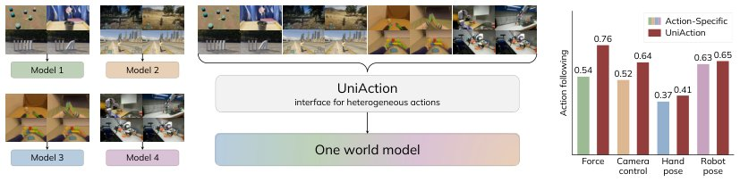

> *Generated by JarvisForResearchers Bot on 2026-10-27*

!!! tip "Why we featured this paper"
    Brand new preprint (2026) — accepted

## TL;DR
UniAction establishes a unified action-conditioning framework by encoding heterogeneous actions as sparse sets of elements, each defined by a discrete semantic identity and a continuous spatiotemporal grounding coordinate. These elements condition a shared world model via native positional geometry and are processed using cardinality-calibrated attention to normalize the influence of varying action token counts.

## The Problem
World models conditioned on actions must accommodate highly heterogeneous control signals, such as continuous force vectors, discrete camera control parameters, complex hand poses, and robot joint configurations. The prevailing paradigm necessitates building separate action-conditioned world models for each distinct action type. This approach leads to significant fragmentation of scarce, action-annotated datasets and severely restricts the potential for knowledge transfer across different action modalities.

## Key Contributions
We introduce UniAction, a unified action-conditioning framework that represents heterogeneous actions via action semantics and spatiotemporal grounding, embedding action coordinates directly into the pretrained video model’s native positional geometry. Furthermore, we propose cardinality-calibrated attention to mitigate the inherent bias introduced by varying numbers of action tokens, ensuring that representation granularity does not disproportionately affect conditioning strength. Finally, we demonstrate through evaluation across four distinct action forms—force, camera control, hand pose, and robot pose—that a single, jointly trained model significantly outperforms specialized, action-specific expert models.

## How It Works


*Figure 1: One world model for heterogeneous actions. Instead of training a separate model per
action type (left), UniAction conditions a single world model (middle) on heterogeneous actions and
outperforms the action-specific experts across all four action forms (right).*

UniAction models the conditional video generation objective, $p_\theta(V | I_0, T, A)$, by abstracting any action $A$ into a sparse set of action elements, $\left\{(s_i, p_i)\right\}_i^N$. Each element is characterized by a discrete semantic identity $s_i$, which is mapped to a dense action token $a_i$ via a shared semantic codebook $E$. The continuous grounding coordinate $p_i = (t_i, y_i, x_i)$ specifies the action's temporal and spatial locus and is projected into the backbone's native positional geometry using the mapping $\Phi_B$. Action tokens and video tokens then interact through the backbone's inherent self-attention mechanism. To address the bias introduced by the variable number of action tokens, $N$, we apply cardinality-calibrated attention, which modifies the logits as $\hat{\ell}_{a_i} = \ell_{a_i} + \log N_{ref}/N$, effectively normalizing the attention scale across all actions.

### Action Element
The fundamental unit of action representation is the Action Element, defined as the pair $(s_i, p_i)$. $s_i$ serves as the discrete semantic identifier, while $p_i$ is the continuous coordinate specifying the action's precise location within the video's spatiotemporal domain.

### Shared Discrete Semantic Vocabulary $S$ and Codebook $E$
To achieve modality independence, UniAction employs a shared vocabulary $S$. This vocabulary allows the model to distinguish semantic roles across disparate action types. The Codebook $E \in \mathbb{R}^{|S|\times d}$ maps each semantic identity $s_i \in S$ to a fixed-dimensional action token $a_i = E[s_i]$.

### Spatiotemporal Grounding $p_i$
The continuous coordinate $p_i = (t_i, y_i, x_i)$ provides the necessary spatio-temporal context for the action. This coordinate is not merely concatenated but is explicitly mapped into the pretrained video model's native positional geometry via the function $\Phi_B$, ensuring native integration into the transformer's attention mechanism.

### Cardinality-Calibrated Attention
This mechanism is critical for stabilizing the conditioning process when $N$ varies. It adjusts the raw attention logits $\ell_{a_i}$ by adding a term proportional to $\log N_{ref}/N$. This scaling factor ensures that the influence of an action token is normalized relative to a fixed reference cardinality, $N_{ref}$, thereby mitigating the bias that arises from token count differences.

### Backbone (Wan2.2)
The system is instantiated upon a latent video transformer, specifically Wan2.2, which incorporates 3D RoPE. The action tokens are integrated into the sequence by concatenation following the latent video token sequence: $[v_1, \dots, v_M, a_1, \dots, a_N]$.

## Results
| Metric | Value | Baseline | Source |
| :--- | :--- | :--- | :--- |
| Action Following (Force) | 0.7630 | VACE | Table 1 |
| Action Following (Force) | 0.7630 | Cross Attention | Table 1 |
| Action Following (Camera Control) | 0.6371 | VACE | Table 1 |
| Action Following (Camera Control) | 0.6371 | Cross Attention | Table 1 |
| Action Following (Hand Pose) | 0.4119 | VACE | Table 1 |
| Action Following (Hand Pose) | 0.4119 | Cross Attention | Table 1 |
| Action Following (Robot Pose) | 0.6521 | VACE | Table 1 |
| Action Following (Robot Pose) | 0.6521 | Cross Attention | Table 1 |

## Why This Matters
The ability to unify heterogeneous control signals under a single, geometrically grounded representation is a significant step toward building general-purpose world models. By decoupling the action's *semantics* (via $S$ and $E$) from its *location* (via $p_i$ and $\Phi_B$), UniAction enables the model to learn shared representations of *how* actions affect the environment, rather than learning separate mappings for each action type. This unified structure is crucial for maximizing data efficiency when action annotations are sparse and modality-specific.

## Limitations & Open Questions
The primary limitations noted are that the mathematical derivation supporting the cardinality-calibrated attention is relegated to Supplementary B, and the precise details concerning the VAE compression and tokenization used to map the action location $p_i$ to the latent coordinates $\text{plat}_i$ are referenced but not fully elaborated within the main text. Future work should focus on providing a complete, self-contained derivation of the attention calibration and further exploring the generalization capabilities of the shared semantic codebook across entirely novel action modalities.

---

## Citation

**Paper:** [2610.32977](https://arxiv.org/abs/2610.32977)

```bibtex
@article{261032977,
  title   = {UniAction: Unified Action Conditioning for World Models},
  author  = {Bowen Xue and Zizhang Li and Hong-Xing Yu and Jiajun Wu},
  journal = {arXiv preprint arXiv:2610.32977},
  year    = {2026},
  url     = {https://arxiv.org/abs/2610.32977}
}
```
