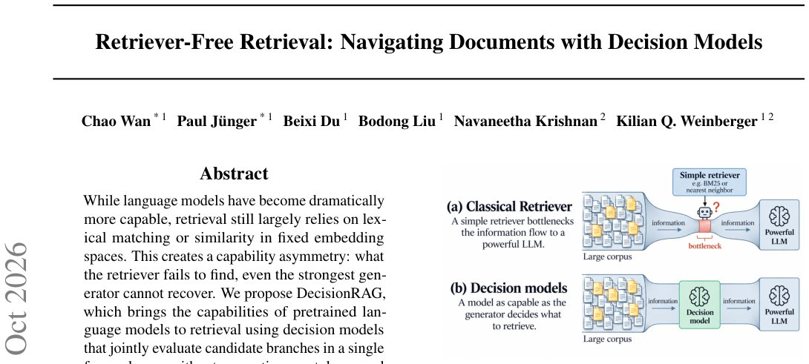

> *Generated by JarvisForResearchers Bot on 2026-10-28*

!!! tip "Why we featured this paper"
    Brand new preprint (2026) — accepted

## TL;DR
DecisionRAG replaces traditional vector-based retrieval with a structural navigation approach. It leverages a decision model to traverse a corpus organized as a tree, making hierarchical choices in a single, token-free forward pass. This circumvents the capability asymmetry where the generator is constrained by the recall of a separate retriever.

## The Problem
The current paradigm for Retrieval-Augmented Generation (RAG) suffers from a fundamental bottleneck in the retrieval stage. Conventional methods, whether relying on lexical matching (e.g., BM25) or nearest neighbors within fixed embedding spaces, fail to capture the nuanced semantic relationships required for high-fidelity information retrieval. This results in a capability asymmetry: the generative model, despite its advanced reasoning capabilities, is fundamentally limited by the quality and recall of the information provided by the retriever.

The existing solutions to this limitation have their own drawbacks. Agentic approaches that use Large Language Models (LLMs) to navigate the corpus are prohibitively slow and expensive because they require token generation at every decision step. Furthermore, even when using rerankers, their effectiveness is capped by the initial recall achieved by the first-stage retrieval mechanism.

## Key Contributions
We introduce DecisionRAG, a novel framework that shifts the retrieval paradigm from searching to structured navigation. Our primary contributions are:

1.  **Decision-Based Retrieval:** We propose DecisionRAG, which retrieves information by intelligently navigating the inherent hierarchical structure of the corpus rather than performing a flat search.
2.  **Token-Free Evaluation:** We utilize decision models to jointly evaluate candidate branches within a single forward pass, critically avoiding the computational overhead associated with autoregressive token generation during the selection process.
3.  **Contextualized Comparison:** We demonstrate that framing candidate evaluation within a shared context allows the decision model to generate relevance estimates that are comparable across different candidates, leading to more robust selection.

## How It Works


*Figure 1. Capability asymmetry: a simple retriever bottlenecks a
powerful LLM (a); decision models level the playing field (b).*

DecisionRAG models the entire corpus as a tree structure. The leaves of this tree correspond to the atomic passages, while internal nodes aggregate passages at increasing levels of semantic granularity (e.g., grouping passages into topics, which are then grouped into documents). Retrieval is executed as a hierarchical decision process. At each level of the hierarchy, a decision model evaluates the available candidate branches. This evaluation is performed either via parallel binary judgments or multiple-choice judgments against a shared context. Crucially, this entire evaluation occurs within one forward pass. Once a branch is not selected, it and all its descendants are pruned from further consideration. This iterative pruning process efficiently narrows the search space from the broadest categories down to the most relevant passages without requiring a separate, pre-trained retriever or task-specific fine-tuning.

### Corpus Tree
The corpus is conceptualized as a tree structure. The terminal nodes (leaves) represent the individual passages. The internal nodes serve as organizational groupings, reflecting increasing levels of abstraction, such as topic clusters or entire documents. This structure allows the search to proceed from high-level concepts down to fine-grained evidence.

### Decision Model (e.g., Jev)
The core of the decision-making process is a pretrained language model, such as Jev. This model is employed not for text generation, but for classification and scoring. Its function is to evaluate the relevance of candidate branches against a shared context without engaging in autoregressive token generation, thereby maintaining computational efficiency.

### Parallel Binary Judgments (Equation 2)
When employing binary judgments, the decision model evaluates a set of predefined binary questions ($Q$) against the shared context ($s$). For each question $Q_i$, the model outputs a probability $p_{bin}^i = P(\text{Yes} | s, Q_i)$ in a single forward pass. This allows for parallel assessment of multiple binary criteria simultaneously.

### Multiple-Choice Judgments (Equation 3)
Alternatively, the model can perform multiple-choice judgments. Given a question $Q$ and a set of candidate answer options $A = \{a_1, \dots, a_m\}$, the model produces a probability distribution $p_{mul}^i = P(a_i | s, Q, A)$, where the sum of probabilities across all options equals one ($\sum_{i=1}^m p_{mul}^i = 1$).

### Hierarchical Traversal (Algorithm 1)
The retrieval process follows an iterative traversal defined by Algorithm 1. Starting at the root ($\ell=1$), the decision model uses the judgments to select the top $k_\ell$ children nodes. The branches that are not selected are immediately pruned, meaning their descendants will never be evaluated for the current query. This process repeats for $\ell=2$ up to $L-1$, progressively refining the search until the leaf passages are reached.

## Results
The performance of DecisionRAG demonstrates competitive retrieval capabilities against established baselines.

| Metric | Value | Baseline | Source |
| :--- | :--- | :--- | :--- |
| R@1 points on MultiDoc2Dial | 13.8 | dense retrieval with an 8B reranker | Abstract |
| Hit@1 points on Natural Questions | 17.4 | dense retrieval with an 8B reranker | Abstract |
| Improvement in R@1 on MultiDoc2Dial (with task-trained model) | 60.7 | best compared published task-trained retriever | Abstract |
| Improvement in R@1 on MultiDoc2Dial (shared context vs. separate) | 7.7 points | independent judgments | Section 6.1 |

## Why This Matters
DecisionRAG provides a pathway to overcome the inherent limitations of vector-space retrieval in RAG systems. By structuring the knowledge base hierarchically and employing a token-free decision mechanism, we achieve high retrieval accuracy while maintaining computational tractability. The ability to scale to corpora containing $10^9$ passages, with latency dictated by the shallow depth of the hierarchy rather than the total volume, is a significant engineering advance for enterprise-scale RAG deployments. Furthermore, the shared context mechanism ensures that relevance is judged comparatively, leading to superior selection quality compared to independent scoring.

## Limitations & Open Questions
A primary limitation is the irreversibility of the pruning step. If a branch is discarded at an upper level due to a suboptimal judgment, it cannot be revisited, which introduces a potential information loss risk. Additionally, the multiple-choice judgment mechanism imposes a practical constraint on the number of answer options that can be evaluated simultaneously, which is currently limited to 255 when using Jev. Future work should investigate adaptive pruning strategies or alternative mechanisms to mitigate the impact of irreversible decisions.

---

## Citation

**Paper:** [2610.35868](https://arxiv.org/abs/2610.35868)

```bibtex
@article{261035868,
  title   = {Retriever-Free Retrieval: Navigating Documents with Decision Models},
  author  = {Chao Wan and Paul Jünger and Beixi Du and Bodong Liu and Navaneetha Krishnan and Kilian Q. Weinberger},
  journal = {arXiv preprint arXiv:2610.35868},
  year    = {2026},
  url     = {https://arxiv.org/abs/2610.35868}
}
```
