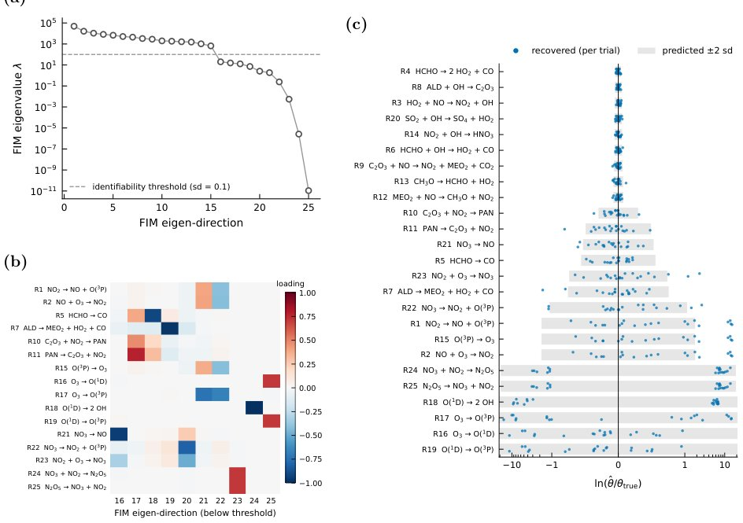

> *Generated by JarvisForResearchers Bot on 2026-10-29*

!!! tip "Why we featured this paper"
    Brand new preprint (2026) — accepted

## TL;DR
KPPax translates Kinetic Pre-Processor (KPP) mechanisms into differentiable, just-in-time compiled, and vectorisable chemistry code in JAX. This enables the direct integration of established atmospheric chemistry models into machine learning workflows for tasks like parameter estimation, circumventing the limitations imposed by traditional, non-differentiable simulation environments.

## The Problem
Atmospheric chemical mechanisms are conventionally specified using the Kinetic Pre-Processor (KPP) language. These mechanisms define complex reaction networks governing atmospheric composition. However, the computational structures inherent to KPP—typically compiled into Fortran or C code—are fundamentally incompatible with the requirements of modern differentiable programming frameworks utilized in machine learning. This incompatibility severely restricts the ability to employ gradient-based optimization techniques for tasks such as parameter estimation or developing hybrid physics–machine-learning models that require sensitivity analysis. Existing tools, such as pykpp, PyBox, PyCHAM, MUSICA, EMAC, and TChem-atm, are optimized for efficient forward simulation but lack the necessary native differentiability for seamless ML integration. Critically, no existing tool, to our knowledge, provides a mechanism to generate differentiable code directly from KPP language specifications.

## Key Contributions
KPPax addresses this gap through several key contributions:
1. It generates differentiable, just-in-time compiled, and vectorisable chemistry code in JAX directly from KPP mechanisms.
2. It evaluates the rate law using sparse operations in log space to rigorously maintain differentiability.
3. It integrates the stiff ODE system with the implicit solvers and the forward- and reverse-mode adjoints provided by the `diffrax` library, thereby obtaining exact sensitivities without requiring manual derivation of adjoint code.

## How It Works


*Figure 1: Identifiability analysis and estimation of the 25 POLLU rate coefficients. (a) Eigenvalues of the
Fisher information matrix in descending order, where the dashed line marks λ = 100, which corresponds
to a Cramér–Rao standard deviation of 0.1 along the eigenvector. (b) Loadings of the ten e*

The KPPax pipeline operates by first parsing the KPP mechanism definition. Stoichiometric coefficients are then mapped into sparse array literals using the Coordinate List (COO) format. The central challenge—the non-differentiable scatter-multiplication inherent in chemical rate laws—is resolved by reformulating the rate law in log space: $\log \omega_j = \log k_j + \sum_i s^{-}_{i,j} \log y_i$. This transformation replaces the non-differentiable scatter-multiplication with a differentiable scatter-addition operation (`segment_sum`) within JAX. The resulting stiff Ordinary Differential Equation (ODE) system is then integrated using the implicit solvers available in the `diffrax` library, specifically leveraging the Kvaerno family of solvers. Exact sensitivities are subsequently derived by applying reverse-mode automatic differentiation through the solver's internal steps, utilizing a recursive checkpoint adjoint mechanism to ensure the memory cost remains sub-linear with respect to the number of integration steps.

### KPP Language
This component serves as the input specification. It is the established syntax for describing kinetic reaction systems, containing structured sections detailing the chemical species and the reactions themselves, including associated rate coefficient expressions.

### pykpp parsing module
This module is responsible for the initial ingestion of the KPP language input. It parses the mechanism definition and transforms it into an internal representation, yielding a structured list of reactions, each defined by its constituent reactants, products, and the associated rate coefficient expressions.

### Sparse Array Literals (COO format)
To efficiently represent the stoichiometry, the stoichiometric coefficients ($S^-$ and $S^+$) are stored not as dense matrices, but as sparse array literals adhering to the COO format. This format separates the indices (row and column) from the corresponding values, allowing for memory-efficient representation of the sparse reaction network structure.

### Algorithm 2 (Sparse evaluation in log space)
This is the core computational innovation. It dictates the reformulation of the rate law. By transforming the rate law into the logarithmic domain ($\log \omega_j = \log k_j + \sum_i s^{-}_{i,j} \log y_i$), the multiplication operation involving stoichiometric coefficients is converted into a summation operation (`segment_sum`) in JAX. This substitution is crucial as it ensures the entire rate law evaluation remains fully differentiable.

### diffrax library
This component provides the numerical integration backbone. It is a JAX-native library offering a suite of differentiable ODE solvers. KPPax specifically utilizes the implicit Kvaerno family of solvers, which are necessary for accurately integrating the stiff nature of atmospheric chemistry systems while maintaining differentiability.

### Recursive Checkpoint Adjoint
This technique is employed by `diffrax` to compute the exact discrete gradient of the numerical solution. It achieves this by managing the adjoint calculation through recursive checkpointing, which is essential for keeping the memory overhead sub-linear relative to the total number of integration steps taken.

## Results
| Metric | Value | Baseline | Source |
| :--- | :--- | :--- | :--- |
| Identifiable rate coefficients prediction | Predicts which of the 25 rate coefficients a flow-tube-like design can identify, before any fit. | N/A | Section 3 |
| Uncertainty confirmation | Noisy synthetic estimation confirms the predicted uncertainties of the nine identifiable rate coefficients to within about 30%. | N/A | Abstract |
| Biogenic correction error reduction | Reduces the error of the biogenic correction by a factor of 2.4–5. | Offline two-step approach | Abstract |

## Why This Matters
KPPax provides a critical bridge between established, validated atmospheric chemistry models (expressed in KPP) and the modern computational paradigms of machine learning (implemented in JAX). The ability to integrate these models directly into ML frameworks unlocks powerful new avenues for scientific inquiry. Specifically, it allows researchers to leverage gradient-based optimization techniques to perform rigorous parameter estimation on complex chemical systems. Furthermore, the methodology for obtaining exact sensitivities without manual adjoint derivation significantly lowers the barrier to entry for applying advanced sensitivity analysis to stiff, large-scale chemical models.

## Limitations & Open Questions
One significant limitation is the requirement imposed by the log-space rate law: the concentrations ($y$) must remain strictly positive throughout the entire integration trajectory. If concentrations approach or cross zero, the $\log(y_i)$ term becomes undefined or complex, breaking the differentiability guarantee. Additionally, while the recursive checkpoint adjoint maintains sub-linear memory cost, the overhead associated with checkpointed recomputation can introduce a computational penalty compared to a hand-derived discretize-then-optimize adjoint approach, particularly when dealing with extremely large chemical mechanisms. Future work should investigate robust handling of near-zero concentrations and explore optimizations for the adjoint computation in the largest possible mechanistic systems.

---

## Citation

**Paper:** [2610.37655](https://arxiv.org/abs/2610.37655)

```bibtex
@article{261037655,
  title   = {KPPax: preprocess differentiable kinetic ODE for machine learning in atmospheric chemistry},
  author  = {Wenqing Peng and Michael Boy and Zhi-Song Liu},
  journal = {arXiv preprint arXiv:2610.37655},
  year    = {2026},
  url     = {https://arxiv.org/abs/2610.37655}
}
```
