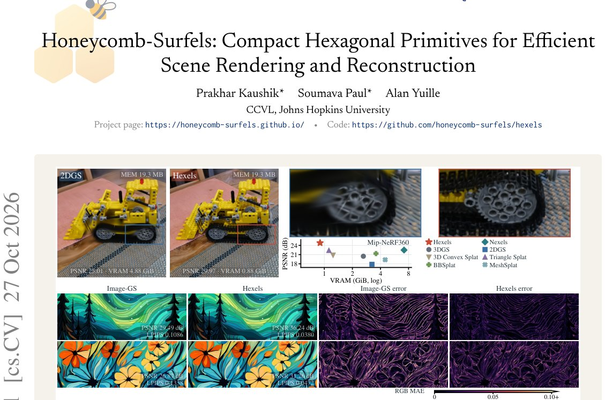

> *Generated by JarvisForResearchers Bot on 2026-10-30*

!!! tip "Why we featured this paper"
    Brand new preprint (2026) — accepted

## TL;DR
Hexels introduce compact, planar hexagonal surface elements equipped with a first-order spatial color field. This primitive achieves superior quality-efficiency trade-offs across 3D scene rendering, surface reconstruction, and 2D image representation compared to existing splatting methods, by efficiently encoding local geometry and appearance without relying on heavy textures or neural decoders.

## The Problem
Novel view synthesis and 3D reconstruction methods, such as radiance fields and splatting, face limitations due to high memory and computational demands. This necessitates the development of a universal primitive that is simultaneously efficient, expressive, and capable of retaining high geometric fidelity, particularly when deployed in resource-constrained environments.

Existing approaches exhibit specific deficiencies. Conventional Gaussian and triangle splats often suffer from significant overdraw because spatial variation is approximated through numerous overlapping elements, each carrying only a single view-conditioned color. Furthermore, advanced methods like BBSplat, NeST, and Nexels attempt to increase per-element capacity by incorporating textures or neural appearance fields. However, this strategy merely shifts complexity into increased memory requirements, training state overhead, and computational load. Consequently, current methods struggle to address the efficiency problem holistically across all critical axes: storage footprint, training VRAM usage, primitive count, rendering Frames Per Second (FPS), and final reconstruction quality.

## Key Contributions
We present three primary contributions to address these limitations:

1. **Introduction of Hexels:** We introduce Hexels, which are compact, self-contained surface primitives. These primitives integrate an efficient hexagonal support structure with a first-order local color field, achieving this without recourse to external textures, feature grids, neural decoders, or pre-baking processes.
2. **Demonstration of Strong Quality-Efficiency Trade-offs:** Under matched primitive budgets, Hexels demonstrate superior performance over 2DGS. Specifically, they achieve a PSNR improvement of $2.08\text{–}4.74 \text{ dB}$ while utilizing $2\times$ less learned storage per primitive. Furthermore, they require up to $7\times$ lower peak training VRAM and deliver up to $2.31\times$ higher rendering throughput.
3. **General Applicability:** The Hexel representation is designed for broad utility, enabling its consistent application across novel-view synthesis, surface reconstruction tasks, and 2D image representation.

## How It Works


*Figure 1. Hexels capture finer details using less memory. Hexels are planar surface elements that combine hexagonal support
with a first-order spatial color field and capitalize on structural redundancy. Top: At the same model memory (MEM), Hexels shows
a gain of 4.96 dB over 2DGS with 5.51× less pe*

Hexels are fundamentally planar hexagonal surface elements designed to exploit the inherent local planarity and smooth appearance variation characteristic of natural scenes.

### Hexel
The Hexel is the core primitive. It is defined by a set of geometric and appearance parameters. It combines a soft hexagonal support function with a first-order spatial color field to model local surface properties efficiently.

### Center $\mathbf{p}_i$
This parameter specifies the precise 3D location of the Hexel within the scene volume.

### Tangent Directions $\mathbf{t}_{u,i}, \mathbf{t}_{v,i}$
These two vectors define an orthonormal local coordinate system anchored at the Hexel's center. They dictate the primary axes along which the local surface variation is parameterized.

### Tangent Scales $s_{u,i}, s_{v,i}$
These positive scalar values control the spatial extent or size of the Hexel's support footprint in the local $(u, v)$ plane.

### Hexagonal Support $K_i(u, v)$
The support is defined based on the hexagonal domain $d(u, v) = \max \{|v|, |\sqrt{3}/2 u + 1/2 v|, |\sqrt{3}/2 u - 1/2 v|\} - 1$. This domain is converted into a smooth weight function $K_i(u, v) = \sigma(-\beta_i d(u, v))$, where $\sigma$ is a suitable smoothing function and $\beta_i$ controls the sharpness of the transition.

### First-Order Color Field $\mathbf{c}_{sp,i}(u, v)$
Appearance is modeled using a first-order Taylor expansion around the Hexel's center in the local coordinate system. The color is given by $\mathbf{c}_{sp,i}(u, v) = \mathbf{c}_{0,i} + u g_{u,i} + v g_{v,i}$. Here, $\mathbf{c}_{0,i}$ represents the base color, and $\mathbf{g}_{u,i}$ and $\mathbf{g}_{v,i}$ are the respective RGB gradients along the $u$ and $v$ axes.

### V2 Variant Residual $\mathbf{r}_i(\mathbf{d}_i)$
For view-dependent rendering, the V2 variant introduces compact view dependence. This is achieved by adding a linear residual term $\mathbf{r}_i(\mathbf{d}_i) = A_i\mathbf{d}_i$, where $\mathbf{d}_i$ is the normalized direction vector from the camera center to the Hexel center, and $A_i$ is a learned transformation matrix.

## Results
The empirical evaluation demonstrates the efficiency and quality gains of the Hexel representation across various benchmarks.

| Metric | Value | Baseline | Source |
| :--- | :--- | :--- | :--- |
| PSNR (Mip-NeRF360, Matched Model Memory) | 29.97 dB | 2DGS | Figure 1 |
| VRAM (Mip-NeRF360, Matched Model Memory) | 0.88 GiB | 2DGS | Figure 1 |
| PSNR (Mip-NeRF360, Matched Model Memory) | 4.53–7.38 dB improvement | 2DGS | Abstract |
| PSNR (Mip-NeRF360, Matched Primitive Budgets) | up to 4.74 dB improvement | 2DGS | Abstract |
| Rendering FPS (Mip-NeRF360, Matched Primitive Budgets) | up to 2.31$\times$ faster | 2DGS | Abstract |
| Mean Chamfer distance (DTU scans, Surface Reconstruction) | 0.978 mm | 1.375 mm (2DGS) | Abstract |
| Mean F1 (Tanks and Temples, Surface Reconstruction) | 34.38% | 31.72% (2DGS) | Abstract |
| PSNR (Image-GS, Linear Color, 10K primitives) | 35.82 dB | Image-GS | Table 1 |

## Why This Matters
The practitioner takeaways highlight the practical impact of this work. Hexels provide a unified primitive capable of handling the diverse requirements of 3D novel view synthesis, surface reconstruction, and 2D image representation without requiring fundamental architectural shifts between tasks. For deployment in resource-constrained systems, the reduction in peak training VRAM and overall model size compared to current state-of-the-art splatting methods is significant. Fundamentally, the combination of a hexagonal support and a first-order color field allows Hexels to efficiently exploit the local geometric and appearance structure of natural scenes, thereby mitigating the primitive redundancy inherent in many existing methods.

## Limitations & Open Questions
The current analysis is constrained by the evaluation methodology; specifically, the reported runtime figures do not account for any post-quantization or compression applied to the model, which could further improve deployment efficiency. Additionally, while the V3 variant is mentioned—which replaces the linear residual with degree-three spherical harmonics—detailed performance results for this specific architectural evolution are not provided in the scope of this summary.

---

## Citation

**Paper:** [2610.37668](https://arxiv.org/abs/2610.37668)

```bibtex
@article{261037668,
  title   = {Honeycomb-Surfels: Compact Hexagonal Primitives for Efficient Scene Rendering and Reconstruction},
  author  = {Prakhar Kaushik and Soumava Paul and Alan Yuille},
  journal = {arXiv preprint arXiv:2610.37668},
  year    = {2026},
  url     = {https://arxiv.org/abs/2610.37668}
}
```
