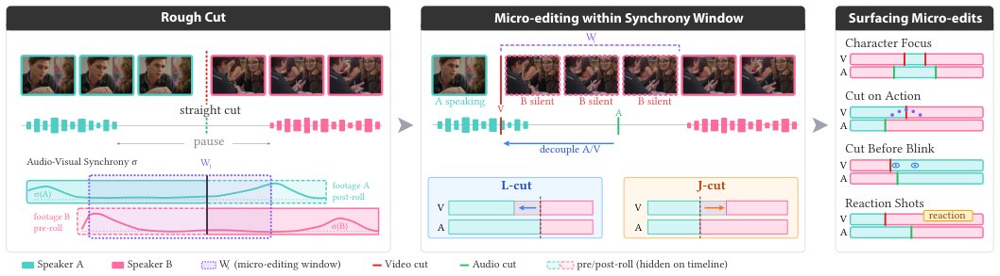

> *Generated by JarvisForResearchers Bot on 2026-11-01*

!!! tip "Why we featured this paper"
    Brand new preprint (2026) — accepted

## TL;DR
We formalize fine-scale film edits, termed micro-edits, as continuous optimization problems constrained by audio-visual synchrony. This framework allows computational tools to efficiently explore creative decisions—such as rhythm control or directing visual attention—by moving beyond coarse, shot-level adjustments prevalent in prior art.

## The Problem
The process of achieving nuanced timing and directing visual attention in film—operations known as micro-edits—is currently a manual, tedious endeavor. These small, detailed adjustments require editors to map high-level, abstract narrative goals onto low-level, frame-by-frame temporal and visual parameters. Existing tools often operate at the word or shot level, failing to provide the necessary frame-level refinement. Furthermore, commercial systems frequently simplify pacing to uniform temporal compression or treat splits as mere mechanical offsets, which fails to capture the expressive nature of dramatic editing, particularly the significance of silence. A critical gap remains in supporting complex multi-clip dialogue scenarios involving multiple speakers and camera angles while allowing for interactive exploration of alternatives via audio-video decoupling.

## Key Contributions
This work makes three primary contributions:
1. We formally derive the structure of micro-edits by synthesizing findings from formative studies, distinguishing between 'rhythm edits' (timing/pacing) and 'view edits' (visual attention).
2. We formalize the entire micro-editing process as a continuous optimization problem, subject to strict audio-visual synchrony constraints within defined windows.
3. We design novel interactive tools that leverage this optimization framework and AI to facilitate the efficient exploration of micro-edits guided by specific creative objectives, such as implementing cut-on-action, cut-before-blink, or structuring reaction shots.

## How It Works


*Figure 1: After a rough cut via macro-level clip selections yielding straight cuts with coupled audio-video (left), editors refine cuts through
micro-edits (center): rhythm edits adjust timing (e.g., pauses), while view edits redirect visual attention. We formalize micro-edits as continuous
optimiza*

The system operates on a foundation built upon a pre-existing macro-edit. The process begins with a **Rough Cut R**, which is an ordered sequence of source clips derived from higher-level editorial decisions. Micro-editing then refines this structure by manipulating the continuous parameters defining the start and end points of existing cuts, or by introducing new cuts entirely. The search space for these micro-edits is inherently continuous. This space is governed by two primary sets of constraints: synchrony constraints, which mandate when audio and video streams must remain coupled, and continuity constraints. By formalizing the problem this way, the system supports two design goals: DG1) More Efficient Exploration, by minimizing the 'gulf of execution' between a desired creative change and the necessary sequence of Non-Linear Editor (NLE) operations, and DG2) Useful Defaults & Suggestions, by identifying discrete, high-probability editing decisions within the continuous space.

### Source Media M
The input is defined as a set $M = \{M_\emptyset, M_1, ...\}$ of available source clips, where $M_\emptyset$ represents the null or empty clip.

### Narrative Sequence S
The high-level intent is captured by the **Narrative Sequence S**, which is an ordered list $S = [s_1, s_2, ...]$. Each element $s_i$ describes a segment of the narrative, and the relationship $s_i \subset M_j$ specifies which source media clip $M_j$ portrays that narrative segment.

### Rough Cut R
The initial structure is the **Rough Cut R**, defined as an ordered sequence of source clips $R = [M_r(1) (s_1), M_r(2) (s_2), ... , M_r(|S|) (s_{|S|})]$. Crucially, the cuts within this initial structure are restricted to straight cuts.

### Edited Tracks {V, A}
The final output is the pair of **Edited Tracks $\{V, A\}$**. These tracks are sequences, $V = [V_1, . . . ,V_N]$ and $A = [A_1, . . . ,A_N]$, where each individual track $X$ is composed of a sequence of cuts $X_i = \{x_i^{out}, x_i^m, x_i^{in}\}$. These parameters define the precise temporal boundaries of the cuts.

## Results
| Metric | Value | Baseline | Source |
| :--- | :--- | :--- | :--- |
| Reduction in mechanical effort and support for broader exploration of micro-edits | Not quantified | Not specified | Section 6 |

## Why This Matters
By shifting the paradigm from discrete, mechanical adjustments to continuous optimization, this work provides a formal mechanism to bridge the gap between abstract creative intent and concrete frame-level editing decisions. The decomposition into rhythm and view edits allows for targeted computational assistance. The resulting tools aim not merely to automate, but to augment the editor's decision-making process by efficiently navigating the complex, continuous space of possible edits and surfacing perceptually relevant alternatives.

## Limitations & Open Questions
The definition of the narrative elements $[s_1, s_2, ...]$ within the **Narrative Sequence S** is intentionally kept loose to maintain generality in the initial formulation. Furthermore, the current implementation focuses primarily on adjusting the temporal parameters of existing cuts. The subsequent integration of entirely new cuts, such as those required for explicit reaction shots, remains an area for future development.

---

## Citation

**Paper:** [2610.40653](https://arxiv.org/abs/2610.40653)

```bibtex
@article{261040653,
  title   = {Micro-Edits: Computational Support for Fine-Scale Edits in Film},
  author  = {Nhan Tran and Hijung Valentina Shin and Abe Davis and Mackenzie Leake},
  journal = {arXiv preprint arXiv:2610.40653},
  year    = {2026},
  url     = {https://arxiv.org/abs/2610.40653}
}
```
