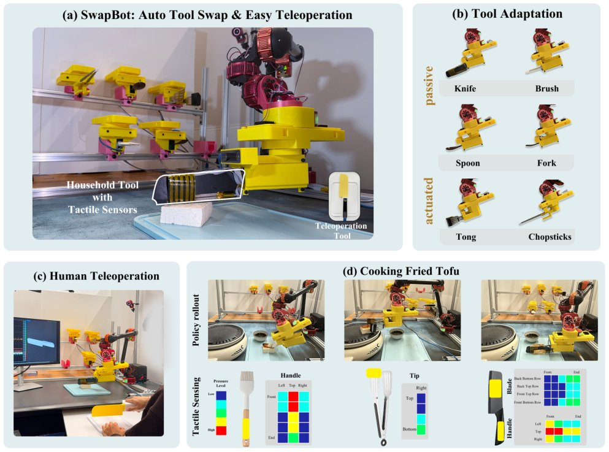

> *Generated by JarvisForResearchers Bot on 2026-11-02*

!!! tip "Why we featured this paper"
    Brand new preprint (2026) — accepted

## TL;DR
SwapBot presents a modular, tool-centric end effector system designed for robust, long-horizon manipulation of diverse household tools. By integrating low-cost, compact piezoresistive tactile sensors and an intuitive teleoperation interface, the system addresses the limitations of high-cost anthropomorphic hands and the limited interaction capabilities of standard grippers in contact-rich tasks.

## The Problem
Many practical, real-world manipulation tasks, even those seemingly simple within a household context, necessitate tool-centric interaction. These interactions are inherently contact-rich, demanding nuanced physical engagement—examples include the forceful application of a knife for cutting or the delicate pressure required for brushing. Current robotic end-effector designs face a dichotomy: either they employ highly complex, anthropomorphic hands, which introduce prohibitive costs in maintenance, sensing infrastructure, and control complexity, thereby impeding scalable data collection; or they rely on parallel jaw grippers, which fundamentally lack the necessary capability to manage nuanced physical interactions like spreading or precise cutting. Existing approaches often fail because they either inherit the complexity burden of full hands or critically omit the necessary tactile sensing at the tool-object interface required for successful contact-rich task execution.

## Key Contributions
This work introduces three primary contributions. First, we present a unified, low-cost, modular tool-centric end-effector system capable of supporting rapid autonomous tool swapping and accommodating a variety of household tools, including articulated implements. Second, we have integrated compact tactile sensing directly into the tool adapters, a feature that demonstrably improves both the fidelity of teleoperation performance and the success rate of imitation learning in contact-rich scenarios. Third, we developed an intuitive teleoperation interface specifically designed for collecting demonstrations, which enhances operator precision and facilitates the acquisition of high-quality training data.

## How It Works


*Fig. 1: SwapBot is a modular, tool-centric end effector system. (a) It supports autonomous tool swapping, integrates tactile
sensors, and enables intuitive teleoperation. (b) Low-cost 3D-printed tool adapters convert everyday household tools to robot
end effectors. (c) Human teleoperation with visua*

SwapBot operates on a hierarchical policy learning structure built upon a modular hardware foundation. The system leverages a unified adaptation interface, allowing low-cost, 3D-printed tool-side adapters to be rapidly attached. These adapters incorporate compact piezoresistive tactile sensors. Tool exchange is managed autonomously via a self-aligning electromagnetic coupling, achieving a swap time of approximately 10 seconds. For data acquisition, an intuitive teleoperation interface streams real-time, visualized tactile feedback to the human operator, allowing for precise demonstration capture. The policy execution is hierarchical: a high-level tool-selection policy, $\pi_{sel}$, determines the appropriate tool for the current sub-goal. Subsequently, a low-level, tool-specific control policy, $\pi_{\tau\text{tool}}$, executes the required skill. This low-level policy is conditioned on a fusion of visual observations ($O_t$), the current tool state ($T_t$), and the tactile sensor readings ($s_t$), enabling the composition of skills necessary for long-horizon tasks such as pan-frying tofu.

### Modular and Interchangeable End-Effectors
The physical foundation of SwapBot relies on a modular design. Tool adapters and the coupling mechanism are fabricated using accessible materials such as 3D-printed PLA, TPU, and Silicone. The core of the interchangeability lies in a self-aligning electromagnetic hub, which interfaces with a kinematic gear system. This design permits the rapid, autonomous swapping of different tools onto the robot arm, ensuring the system is adaptable to a wide array of household implements.

### Compact Tactile Sensing
To address the need for nuanced interaction data, we integrated tool-specific piezoresistive tactile sensors. These sensors employ a three-layer structure, consisting of a Velostat material sandwiched between conductive fabric electrodes. This configuration allows for the acquisition of real-time normal force pressure information directly at the tool-object contact point, providing the necessary high-fidelity feedback for contact-rich manipulation.

### Teleoperation Interface
The data collection pipeline is supported by an intuitive teleoperation interface. This interface maps the 6-DoF pose and actuation commands from a leader device directly onto the robot's tool. The system synchronizes this control loop at a frequency of 20 Hz, integrating multi-view RGB imagery alongside the tactile signals. Crucially, the interface provides the operator with visualized tactile feedback, allowing for direct perception of the forces being exerted during demonstration.

### Policy Learning Framework
The intelligence of the system is structured hierarchically. The high-level policy, $\pi_{sel}$, is implemented using a ResNet backbone feeding into an MLP, and its function is to select the appropriate tool from the available set. The low-level control policy, $\pi_{\tau\text{tool}}$, is implemented as a U-net based diffusion policy. This policy generates the necessary end-effector actions conditioned on the fused state vector, which includes the visual observation ($O_t$), the current tool configuration ($T_t$), and the tactile sensor readings ($s_t$).

## Results
The integration of tactile sensing and modularity yields measurable performance gains in complex tasks.

| Metric | Value | Baseline | Source |
| :--- | :--- | :--- | :--- |
| Task Success Rate Improvement (Tofu Cooking) | 60% | 35% | Section III.B |
| Policy Performance Improvement (Tactile vs RGB-only) | 15–25 percentage points | RGB-only policies | Abstract |

## Why This Matters
The SwapBot architecture shifts the paradigm from building monolithic, highly complex robotic hands to creating adaptable, tool-centric manipulation platforms. By democratizing the sensing hardware through low-cost, modular adapters, we enable the application of advanced robotic control to a much broader spectrum of real-world, contact-intensive tasks that were previously inaccessible due to cost or complexity constraints. The demonstrated improvement in task success rates, particularly in the tofu cooking task, validates the hypothesis that high-fidelity, localized tactile feedback is a critical missing component for robust, long-horizon manipulation in unstructured environments.

## Limitations & Open Questions
Currently, the implementation requires that the sequence of subgoal images for long-horizon tasks be manually specified prior to execution. This limits the system's ability to autonomously decompose complex goals. Furthermore, while larger tactile electrodes offer superior sensitivity, they introduce signal processing challenges, specifically generating non-smooth signals and risking saturation of the 10-bit Analog-to-Digital Converter. Future work must focus on developing robust, low-latency signal conditioning for higher-resolution tactile data and exploring autonomous subgoal discovery mechanisms.

---

## Citation

**Paper:** [2610.40646](https://arxiv.org/abs/2610.40646)

```bibtex
@article{261040646,
  title   = {SwapBot: Tool-Centric Robot Manipulation via Interchangeable End-Effectors and Tactile Sensing},
  author  = {Yunchu Zhang and Ray Song and Junhan Jiao and Liyiming Ke and Yuchen Yang and Ruihan Gao et al.},
  journal = {arXiv preprint arXiv:2610.40646},
  year    = {2026},
  url     = {https://arxiv.org/abs/2610.40646}
}
```
