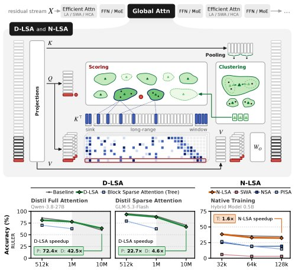

> *Generated by JarvisForResearchers Bot on 2026-11-03*

!!! tip "Why we featured this paper"
    Brand new preprint (2026) — accepted

## TL;DR
Latent Sparse Attention (LSA) achieves subquadratic attention complexity for ultra-long contexts by mapping keys into a learned latent space and allowing queries to score cluster centroids rather than individual keys. We introduce Distilled-LSA (D-LSA) for adapting pre-trained models and Native-LSA (N-LSA) for native training, demonstrating performance up to 10M tokens.

## The Problem
Standard self-attention mechanisms scale quadratically with the sequence length, $O(T^2)$, where $T$ is the context size. This quadratic complexity renders full attention prohibitively expensive when $T$ exceeds $10^6$ tokens. While various sparse attention techniques exist, they often fail to achieve true subquadratic scaling across the entire context range. Specifically, existing indexers in sparse attention schemes frequently retain quadratic cost during the prefill phase or exhibit only linear scaling during decoding, and semantic sparse methods often lack rigorous evaluation at the ultra-long context scale ($T > 1M$).

## Key Contributions
We introduce Latent Sparse Attention (LSA), a mechanism that clusters keys in a learned latent space, enabling queries to interact with cluster hierarchies instead of all individual keys. We propose two practical implementations: Distilled-LSA (D-LSA), which allows adaptation of existing large models via knowledge distillation, and Native-LSA (N-LSA), which is trained end-to-end using only the next-token loss. These methods are empirically validated on GLM-5.3-FLASH (QWEN-3.8-27B) across RULER and PaperTrail benchmarks up to 10M tokens.

## How It Works


*Figure 1. D-LSA and N-LSA overview. Top: one attention layer.
The keys are pooled and clustered into buckets. A query ( ) scores
the bucket centroids ( ) and attends only to the selected long-range
keys (plus sink and window). Bottom: accuracy and performance
(P: prefill, D: decode, T: training) for*

LSA fundamentally reframes the attention lookup from a dense key-query interaction to a hierarchical, sparse retrieval process. Instead of computing $\text{softmax}(Q K^T)$, we first compress the keys $K$ into a set of representative centroids within a latent space. The query $Q$ is then used to efficiently search this compressed structure.

### Index Key Normalisation
The initial step involves normalizing every index key $k^{(idx)}_j$ to unit length: $k^{(idx)}_j \leftarrow k^{(idx)}_j / \|k^{(idx)}_j\|_2$. This ensures that subsequent similarity measures are based purely on angular distance, which is appropriate for cosine similarity used in attention.

### Pooling
To manage the sheer volume of keys, consecutive index keys are aggregated into pool keys, $k^{(idx)}_{pool}$, via summation. This reduces the effective number of items over which clustering must occur from $T$ to $T/n_{pool}$, providing an initial computational efficiency gain before the clustering phase.

### Clustering
The pool keys are subjected to bottom-up clustering using Ward's method. This process partitions the pool keys into $m$ distinct buckets, where $m = n_{cluster}/\bar{n}_b$. Each bucket represents a localized semantic cluster in the latent space.

### Bucket Cache $B^{(idx)}_{cache}$
The system maintains a Bucket Cache, $B^{(idx)}_{cache}$. For each bucket $b$, this cache stores its centroid, $c_b$, and an index table mapping back to the original positions of the keys belonging to that bucket. This cache is the core structure that replaces the full key matrix.

### Query Normalisation
Similarly, the incoming index query $q^{(idx)}_i$ is L2 normalized: $q^{(idx)}_i \leftarrow q^{(idx)}_i / \|q^{(idx)}_i\|_2$. This aligns the query vector with the unit-norm centroids stored in the cache.

### Scoring
The retrieval process involves scoring the query against the centroids. The similarity score between the query and a bucket centroid is calculated as $s_{i,b} = c_b \cdot q^{(idx)}_i$. We then select the top-$p$ buckets based on these scores, effectively pruning the search space from $T$ keys down to $p$ cluster representations.

### Expansion
Once the top-$p$ buckets are identified, the system performs an expansion step. All keys belonging to these $p$ selected buckets are retrieved from the index table. These retrieved keys are then combined with a fixed set of $n_{sink}$ sink keys and $n_w$ window keys to form the final set of $k$ 'long-range' keys used in the attention calculation.

### Tree Search (Beam Search)
For the Tree variant of LSA, the search does not rely on a flat top-$p$ selection. Instead, it employs a beam search that descends the hierarchical structure of the clusters. By scoring against node bucket centroids at each level of the hierarchy, this method achieves an indexer prefill cost complexity of $O(\log T)$.

D-LSA introduces trainable projections ($W^{(idx)}_K, W^{(idx)}_Q$) and uses KL divergence distillation to transfer knowledge from a teacher model. N-LSA, conversely, trains natively by optimizing the next-token prediction loss (NTP loss) without introducing dedicated index projections, making it parameter-efficient during training.

## Results
| Metric | Value | Baseline | Source |
| :--- | :--- | :--- | :--- |
| Speedup (Prefill) | $22.7\times$ ($72.4\times$) | original sparse attention (full attention) | Abstract |
| Speedup (Decode) | $4.6\times$ ($42.5\times$) | original sparse attention (full attention) | Abstract |
| Training Speedup (per layer) | $1.6\times$ | full attention | Abstract |

## Why This Matters
LSA provides a concrete architectural pathway toward achieving subquadratic attention complexity, which is necessary for practical deployment of models on ultra-long context windows, such as 10M tokens. The dual approach—D-LSA for rapid adaptation of existing large models and N-LSA for parameter-efficient native training—offers flexibility in deployment scenarios. The demonstrated speedups in both prefill and decode phases confirm the efficiency gains of replacing dense key lookups with latent space centroid scoring.

## Limitations & Open Questions
A primary limitation of the Tree variant is that its prefill complexity is $O(T \log T)$, which is asymptotically worse than the quadratic complexity of the flat search, although it is superior to linear scaling methods in certain contexts. Furthermore, the implementation of LSA introduces a trade-off where context parallelism requires every processing rank to replicate the entire bucket cache, which impacts communication overhead. Future work should investigate methods to mitigate this cache replication cost.

---

## Citation

**Paper:** [2610.42147](https://arxiv.org/abs/2610.42147)

```bibtex
@article{261042147,
  title   = {Latent Sparse Attention: Towards Subquadratic Ultra-Long Context Attention},
  author  = {Ales Kubicek and Andrea Caciolai and Liangzu Peng and Sukrit Sumant and Benjamin Hoover and Fraser Greenlee et al.},
  journal = {arXiv preprint arXiv:2610.42147},
  year    = {2026},
  url     = {https://arxiv.org/abs/2610.42147}
}
```
