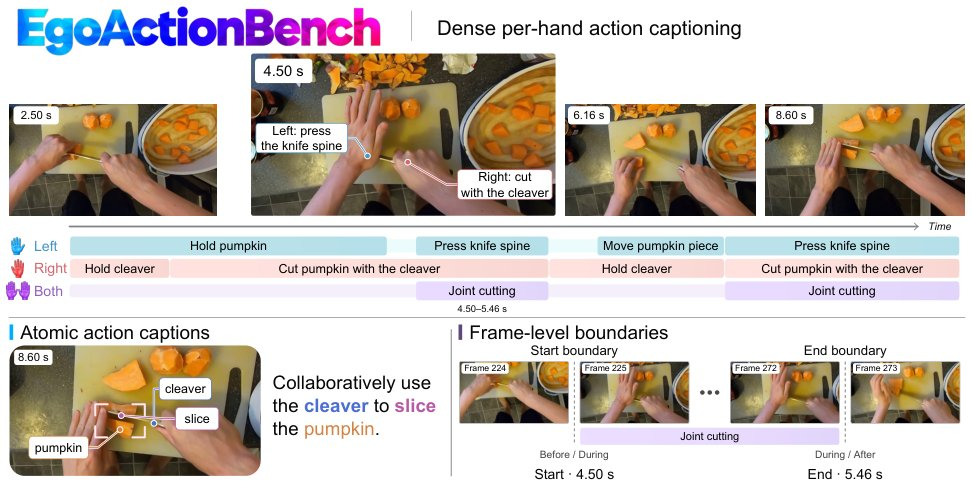

> *Generated by JarvisForResearchers Bot on 2026-11-04*

!!! tip "Why we featured this paper"
    Not yet indexed in S2 — assumed brand-new preprint

## TL;DR
EgoActionBench introduces a benchmark for dense per-hand action captioning in egocentric videos, requiring models to localize and describe atomic actions tied to the left, right, or both hands. We propose a progressive evaluation protocol and adapt Qwen3-VL-4B and LLaVA-OneVision-2-8B via SFT and RL, demonstrating significant improvements in action understanding.

## The Problem
Existing benchmarks for video understanding suffer from limitations concerning action atomicity, temporal precision, and the explicit association between actions and specific hands when analyzing egocentric data. Standard action recognition typically operates on coarse, predefined video segments, while video captioning often provides descriptions at the clip level, failing to capture the fine-grained, moment-to-moment manipulation inherent in egocentric observations. Critically, current formulations do not jointly address the requirements of dense per-hand action captioning, the necessity of action atomicity, precise temporal localization, and explicit hand-action assignment.

## Key Contributions
We introduce EgoActionBench, a dataset comprising 1,407 episodes and 41,132 human-refined action annotations, designed to evaluate dense per-hand action captioning. We propose a progressive evaluation protocol that first filters temporally eligible predictions, selects the best candidate based on content agreement, and subsequently scores semantic fidelity and temporal overlap. Furthermore, we benchmark 20 baseline models and adapt two large vision-language models, Qwen3-VL-4B and LLaVA-OneVision-2-8B, using a pipeline involving supervised fine-tuning followed by reinforcement learning.

## How It Works


*Figure 1 Overview of EgoAction. Continuous egocentric video is represented as temporally localized atomic actions on
left-hand, right-hand, and both-hands tracks (top). The bottom-left example highlights the action verb, manipulated
object, and tool. Adjacent frames illustrate the start and end boun*

EgoActionBench formalizes dense per-hand action captioning: the task requires models to temporally localize and semantically describe atomic hand actions, explicitly assigning each action to the left hand, right hand, or both hands, across an entire egocentric video clip. The dataset structure distinguishes atomic actions—the smallest coherent unit of manipulation—from broader, encompassing actions.

### EgoActionBench
This benchmark is constructed to represent continuous human manipulation by segmenting it into temporally localized atomic actions. These actions are explicitly associated with the anatomical hands: the left hand, the right hand, or both hands acting in coordination.

### Left/Right/Both Tracks
The annotation schema utilizes three distinct tracks to capture hand involvement. The 'Left' and 'Right' tracks correspond directly to the actions performed by the respective anatomical hands, while the 'Both' track is reserved for instances where coordinated manipulation involving both hands is observed.

### Progressive Evaluation Protocol
The evaluation methodology is structured in stages to enforce strict adherence to temporal and semantic correctness. First, the protocol retrieves all predictions that are temporally eligible within the ground truth span. Second, among these candidates, a single prediction is selected based on maximizing content agreement with the annotation. Finally, this selected candidate is scored based on two criteria: semantic fidelity and temporal overlap. Action precision and recall are calculated independently using one-to-one matching.

### Qwen3-VL-4B
Qwen3-VL-4B serves as one of the two foundational backbones subjected to adaptation. Its fine-tuning process involves an initial supervised fine-tuning stage, followed by reinforcement learning, utilizing automatically annotated training episodes derived from the dataset.

### LLaVA-OneVision-2-8B
LLaVA-OneVision-2-8B is the second backbone model utilized in this study. Similar to Qwen3-VL-4B, it undergoes adaptation via supervised fine-tuning followed by reinforcement learning on the automatically annotated training episodes.

## Results
| Metric | Value | Baseline | Source |
| :--- | :--- | :--- | :--- |
| EgoActionScore improvement | 15.9 points | N/A | Text |
| EgoActionScore improvement | 23.2 points | N/A | Text |

## Why This Matters
For the field of embodied AI, achieving robust, fine-grained action understanding necessitates the ability to capture action atomicity, maintain high temporal precision, and correctly associate actions with specific anatomical hands. The introduction of EgoActionBench and the associated evaluation protocol provides a necessary, rigorous standard for assessing these capabilities. The successful adaptation of large VLMs like Qwen3-VL-4B and LLaVA-OneVision-2-8B demonstrates that targeted supervision at the atomic action granularity can yield substantial improvements in complex action understanding tasks.

## Limitations & Open Questions
Current models exhibit substantial limitations in accurately capturing action atomicity. Furthermore, both action atomicity and temporal precision remain significant challenges. Finally, the explicit hand-action association remains a weak point across current state-of-the-art models.

---

## Citation

**Paper:** [2611.03646](https://arxiv.org/abs/2611.03646)

```bibtex
@article{261103646,
  title   = {EgoActionBench: Benchmarking Dense Action Captioning for Egocentric Human Videos},
  author  = {Yujiao Shen and Jiahe Song and Haitian Li and Jingkang Yang and Ziwei Liu},
  journal = {arXiv preprint arXiv:2611.03646},
  year    = {2026},
  url     = {https://arxiv.org/abs/2611.03646}
}
```
