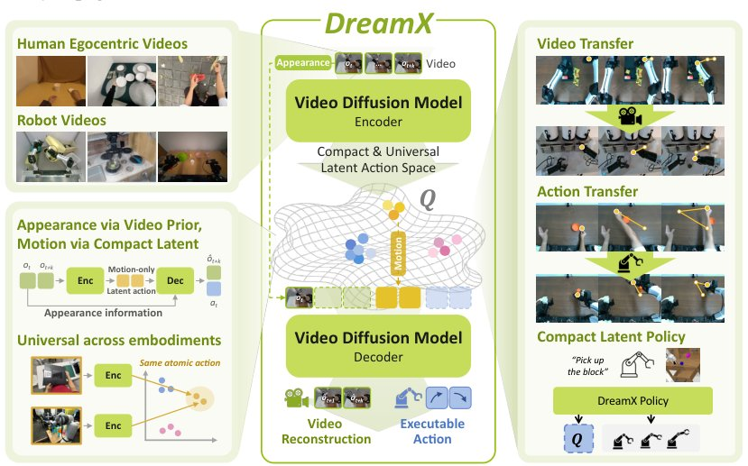

> *Generated by JarvisForResearchers Bot on 2026-11-05*

!!! tip "Why we featured this paper"
    Brand new preprint (2026) — accepted

## TL;DR
DreamX leverages the generative priors of a pretrained video diffusion model to derive universal, compact latent actions. This approach disentangles motion dynamics from visual appearance, enabling effective cross-embodiment and human-to-robot action transfer without requiring paired source-target training data.

## The Problem
Current methodologies for learning latent actions frequently suffer from representation entanglement. Specifically, the learned latent representations often conflate the underlying kinematic or dynamic action with irrelevant, transient visual variations present in the observation. This entanglement severely constrains the utility of the learned representations, particularly when attempting to transfer learned behaviors across different physical embodiments (e.g., from a human demonstration to a robotic agent). Furthermore, the reliance on embodiment-specific action supervision means that action labels are inherently tied to the specific sensorimotor setup that generated them, precluding direct sharing across heterogeneous systems. A related limitation in prior work is the tendency to train encoders solely on local visual transitions, which fails to capture the persistence and global dynamics of motion across extended temporal sequences.

## Key Contributions
We introduce DreamX, a novel framework that harnesses the inherent spatiotemporal and generative priors embedded within a large, pretrained video diffusion model to learn a set of universal latent actions. We demonstrate that the resulting latent space facilitates robust any-to-any video transfer and, critically, human-to-robot action transfer, all without the necessity of paired source-target training data. Finally, we show that this shared, compact latent interface significantly reduces the computational complexity associated with training downstream policies based on video-diffusion models.

## How It Works


*Figure 1: DreamX learns a shared action interface from egocentric human videos and robot
videos. Compact, embodiment-agnostic latent actions extracted from a pretrained video diffusion
model capture motion consistently across changes in embodiment and scene appearance. The same
representation enable*

DreamX operates by adapting a pre-trained video diffusion backbone, specifically Cosmos-Predict2.5. The core mechanism involves augmenting the input video token sequence ($V$) with a set of learnable query tokens ($q$). These queries are processed through the backbone's inherent spatiotemporal attention mechanisms to distill the observed dynamics into a set of compact latent actions, denoted as $Q$. This process effectively condenses a high-dimensional sequence of 1,200 frame tokens into a much smaller set of 4 latent-action tokens, achieving a $300\times$ dimensionality reduction. The training objective enforces that these latent actions supervise the model's ability to reconstruct future frames, conditioned on the initial frame ($V_0$) and the sequence of latent actions ($Q_{0:N-1}$). This reconstruction constraint compels $Q$ to encode the underlying motion dynamics independently of the scene's visual appearance. This shared, disentangled latent space is the foundation for facilitating motion transfer and serves as the input target for a lightweight policy trained via a variational bottleneck compression.

### Cosmos-Predict2.5
This component serves as the foundational backbone. It is a video diffusion transformer that has been pretrained on large-scale video data. It is utilized both for the encoding of the input video sequence and for the subsequent decoding process that reconstructs future frames. Its pretraining provides the necessary rich spatiotemporal priors required for effective action representation learning.

### Learnable Query Tokens ($q$)
These tokens are strategically appended to the standard video token sequence ($V$) fed into the diffusion backbone. Their function is to act as dynamic probes, allowing the backbone to read out and summarize the salient spatiotemporal information across the entire video sequence. The output of these queries, after contextualization, forms the latent actions ($Q$).

### Latent Action Group ($Q_g$)
This represents the feature vector derived from a specific group of $K$ query tokens ($q_g$) after they have been processed and contextualized by the surrounding video tokens within the backbone. $Q_g$ constitutes a single, coherent latent-action representation summarizing a particular aspect of the observed dynamics.

### Encoder ($\mathcal{E}_\phi$)
The Encoder is the functional unit responsible for mapping the input query tokens ($q$) and the video tokens ($V$) into the latent action representation $Q$. Mathematically, $Q = \mathcal{E}_\phi(q; V, \ell)$. This component learns the mapping that extracts the motion dynamics from the raw visual input, conditioned on the query structure and any provided instruction $\ell$.

### Decoder ($\mathcal{D}_\theta$)
The Decoder is responsible for the generative task. It takes the sequence of learned latent actions ($Q_{0:N-1}$) and the initial frame ($V_0$) as conditioning inputs to synthesize the subsequent frames of the video. This generative capacity is what enforces the temporal coherence and dynamic consistency of the learned latent actions.

### Variational Bottleneck
In the context of downstream policy learning, the latent actions $Q$ possess a high dimensionality, inherited from the backbone width $D$. The Variational Bottleneck introduces a mechanism to compress each latent-action token into a significantly lower-dimensional code $Z$, where $d \ll D$. This compression step is crucial for creating an efficient, low-overhead target representation for the policy network.

### DreamX Policy ($\pi(\cdot)$)
This is the final control layer. The DreamX Policy is designed to operate in the compact latent space. It takes the current observation ($V_0$) and the task instruction ($\ell$) as input to predict the compressed latent codes ($Z$). Furthermore, it utilizes a separate Diffusion Transformer (DiT) action head to predict the low-level control actions ($A$) corresponding to the desired dynamics encoded in $Z$.

## Results
| Metric | Value | Baseline | Source |
| :--- | :--- | :--- | :--- |
| Avg. Latent actions from video (Action regression) | 68.03 | DiLA (Zhang et al., 2026) | Table 1 |
| Avg. Latent actions from video (Action classification) | 72.72 | DiLA (Zhang et al., 2026) | Table 1 |
| Avg. Latent actions from video (Action regression) | 65.90 | DiLA (Zhang et al., 2026) | Table 1 |
| Avg. Latent actions from video (Action classification) | 69.49 | DiLA (Zhang et al., 2026) | Table 1 |

## Why This Matters
The ability to learn universal latent actions that are disentangled from visual appearance is a significant step toward general-purpose robotic intelligence. By decoupling *what* is happening (the action) from *how* it looks (the appearance), DreamX enables the transfer of learned behaviors across vastly different visual domains and physical platforms without requiring expensive, paired data collection for every new robot or environment. Furthermore, by compressing the rich, high-dimensional representations from the diffusion backbone into compact codes ($Z$), we provide a computationally tractable target for training efficient, low-latency control policies for real-world deployment.

## Limitations & Open Questions
The current implementation is intrinsically coupled to the architecture of the pretrained video diffusion backbone, specifically Cosmos-Predict2.5. This reliance means that the performance ceiling is partially constrained by the inductive biases and representation capacity of that specific model. Additionally, the policy learning pipeline necessitates the explicit training of a variational bottleneck to achieve the desired dimensionality reduction from the backbone's native width $D$ to the compact code $Z$. Future work should investigate alternative, more direct methods for achieving this compression or explore the generalization of the latent space across diffusion model architectures.

---

## Citation

**Paper:** [2611.05377](https://arxiv.org/abs/2611.05377)

```bibtex
@article{261105377,
  title   = {DreamX: Video Diffusion Model is a Universal Latent Action Learner},
  author  = {Jisoo Kim and Chaehyun Kim and Junsu Kim and Jiho Park and Seongchan Kim and Eunbeen Hong et al.},
  journal = {arXiv preprint arXiv:2611.05377},
  year    = {2026},
  url     = {https://arxiv.org/abs/2611.05377}
}
```
