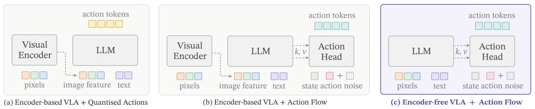

> *Generated by JarvisForResearchers Bot on 2026-11-06*

!!! tip "Why we featured this paper"
    Not yet indexed in S2 — assumed brand-new preprint

## TL;DR
NEO-VLA introduces a structurally encoder-free vision-language-action framework. It replaces fixed visual encoders with a lightweight pixel-to-token embedder, allowing raw pixels to evolve jointly with language within a shared backbone. This design enables a flow-matching action expert to access visual representations at various computational depths via a configurable layer map $M$, leading to robust embodied control.

## The Problem
Existing vision-language-action (VLA) models typically compress visual input via pretrained vision encoders. This abstraction hides the intrinsic visual hierarchy of the input. Consequently, this fixed, high-level visual endpoint can constrain embodied control, as precise manipulation tasks often depend on fine-grained visual signals that are lost during the initial encoding stage.

The gaps in prior work are threefold:
1. Most existing VLAs rely on a fixed visual endpoint derived from pretrained vision encoders (e.g., CLIP, SigLIP, DINOv2).
2. The separation between visual encoding and action reasoning limits the ability to exploit evolving visual representations within the backbone.
3. Prior work either focuses solely on modifying the action side or introduces a secondary visual pathway, rather than fundamentally altering the visual pathway integration while maintaining consistency with the action expert and training data.

## Key Contributions
We introduce NEO-VLA, a structurally native VLA policy. This framework integrates a lightweight pixel-to-token embedder, a shared vision-language backbone, and a flow-matching action expert capable of configurable access to backbone layers. Furthermore, we present a systematic empirical study demonstrating that accessing early visual representations is highly effective for control, even when the backbone is frozen. Our evaluation across various backbone families and manipulation benchmarks confirms strong performance on LIBERO, LIBERO-plus, and RoboTwin 2.0.

## How It Works


*Figure 1: Three VLA designs: encoder-based vs. encoder-free backbones, and discrete vs. continuous
actions. (a) A separate visual encoder converts pixels into image features, which are consumed by the language
backbone together with text tokens; actions are generated as discrete tokens. (b) The same*

NEO-VLA fundamentally reframes the visual input pipeline. Instead of pre-encoding images, we use a lightweight two-stage convolutional embedder to map raw pixels directly into the token space of the shared backbone. This allows image patches and instruction words to be processed jointly from the outset. The backbone employs modality-aware multimodal attention: text tokens adhere to causal attention, while visual tokens interact bidirectionally within their respective visual blocks. The action expert then operates by reading cached keys and values from a configurable subset of backbone layers, denoted by the layer map $M = (m_1, \dots, m_d)$. This explicit layer map $M$ allows the expert to draw from early, late, or multiple stages of visual computation, making visual readout depth an explicit policy choice.

### Lightweight two-stage convolutional embedder
This component is responsible for the initial projection. It maps raw images directly into the backbone token space. Specifically, it generates one visual token for every $32 \times 32$ image region, maintaining an overall stride of 32.

### Shared vision-language backbone
This is the core processing unit. It processes the image patches and instruction words concurrently. The attention mechanism is structured such that text tokens follow causal attention patterns, ensuring sequential language processing, whereas visual tokens interact bidirectionally within each visual block, allowing for rich spatial context aggregation.

### Native Rotary Position Embedding (t/h/w RoPE)
To handle the diverse nature of the input sequences (images, videos, and interleaved multimodal sequences), we employ a factorization of positional encodings. This involves decoupling the rotary frequencies across temporal ($t$), height ($h$), and width ($w$) coordinates, enabling a unified treatment across different data modalities.

### Action expert
This is a separate, narrow network responsible for action prediction. It does not process the entire backbone state. Instead, it jointly attends to cached prefix keys and values retrieved from the selected backbone layers defined by $M$, alongside its own action-token keys and values. This interaction allows the expert to condition its velocity field prediction on specific, relevant visual features extracted at various depths.

### State MLPs
These modules handle the integration of robot state information. They jointly encode the measured values from the robot's proprioception (covering Arm 0, Arm 1, and the shared body) along with their corresponding validity masks.

## Results
| Metric | Value | Baseline | Source |
| :--- | :--- | :--- | :--- |
| LIBERO success rates | Consistently higher | Qwen3-VL-2B and Gemma-3-4B | Section 3.1 |

## Why This Matters
The ability to access intermediate visual computation stages, rather than being restricted to the final encoder output, is critical for achieving high performance in fine-grained robotic control. By adopting a structurally native architecture that integrates pixel processing directly into the backbone, we establish a robust foundation for action learning. Crucially, this design formalizes the depth of visual readout (the layer map $M$) as an explicit, tunable architectural hyperparameter, allowing practitioners to empirically determine the optimal level of visual abstraction for a given task.

## Limitations & Open Questions
We observe that while full fine-tuning improves performance, it does not entirely eliminate the performance gap observed when comparing the native NEO-VLA approach against established encoder-based counterparts. Furthermore, increasing the model scale alone has been insufficient to recover the performance differential seen between native and encoder-based architectures. This suggests that the structural integration of visual processing is a fundamental factor in the observed performance disparity, rather than merely a capacity issue.

---

## Citation

**Paper:** [2611.06918](https://arxiv.org/abs/2611.06918)

```bibtex
@article{261106918,
  title   = {From Pixels to Actions - Towards Native Vision-Language-Action Policies},
  author  = {Weichen Fan and Haiwen Diao and Penghao Wu and Siyuan Hu and Ziqi Huang and Tianqi Liu et al.},
  journal = {arXiv preprint arXiv:2611.06918},
  year    = {2026},
  url     = {https://arxiv.org/abs/2611.06918}
}
```
