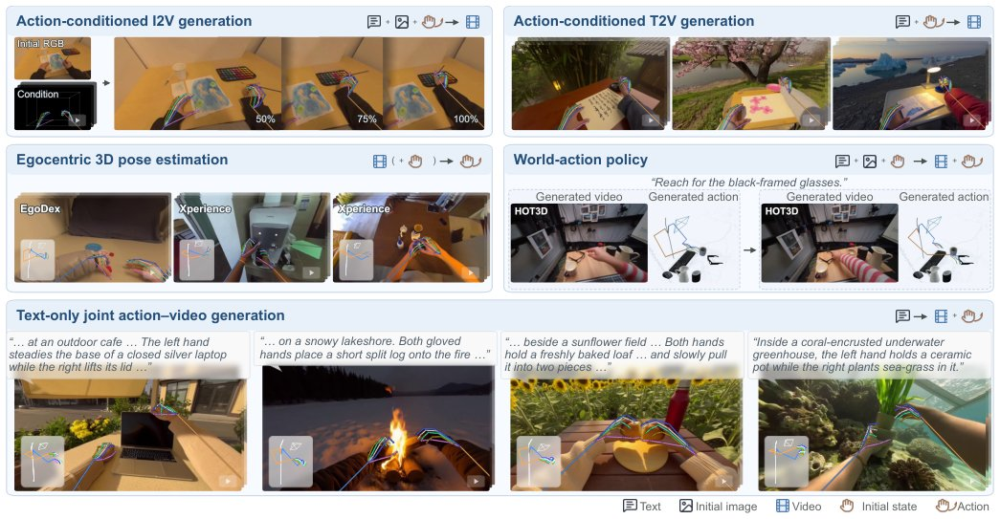

> *Generated by JarvisForResearchers Bot on 2026-11-07*

!!! tip "Why we featured this paper"
    Brand new preprint (2026) — accepted

## TL;DR
EgoGeneralist unifies action-conditioned egocentric video generation, 3D pose estimation, and joint action-video synthesis by adapting pretrained video generators. It achieves this through role-adaptive action rendering and cross-stream action-video coupling, allowing the framework to leverage strong visual priors while modeling metric 3D human motion within a video-native paradigm.

## The Problem
Modern video generation models possess robust visual priors derived from massive datasets. However, these models fundamentally lack native representation of human action within a metric 3D space. Furthermore, existing attempts to unify egocentric tasks suffer from architectural limitations. Specifically, prior methods for action-conditioned egocentric video generation often modify the pretrained computation path using embedding-based or spatially aligned techniques, which risks degrading the utility of the original visual prior. In the domain of egocentric 3D pose estimation, prior work frequently necessitates external supervision, such as scene geometry or stereo-temporal inputs, diverging from a unified video generation approach. Finally, existing unified models for egocentric action-video learning are often restricted to modeling only hand motion, relying on task-specific encoders or conditioning networks, and failing to jointly model the necessary metric information across upper-body, hand, and camera motion.

## Key Contributions
We introduce a unified framework for egocentric action-video learning, reframing action-conditioned video synthesis, metric action recovery, and joint action-video generation as a single, cohesive video-based problem. A core contribution is the implementation of role-adaptive rendering coupled with cross-stream action-video coupling. This mechanism integrates action representations into the pretrained model's native latent space via shared attention and target-specific low-rank updates. Collectively, these contributions yield a unified capability set that achieves performance competitive with specialized, task-specific baselines, even when adaptation is restricted to controlled laboratory recordings.

## How It Works


*Figure 1. Five capabilities of EgoGeneralist. Our framework unifies action-conditioned ego video generation, egocentric 3D pose
estimation, and joint action–video generation, defining six inference modes across the five tasks illustrated above. Reusing the pretrained
video prior enables generalizati*

EgoGeneralist operates by adapting a pretrained video generator. Action information is not injected as an auxiliary feature but is instead rendered into a video-native format via a role-adaptive action renderer. This renderer produces one of two outputs: an Ego-view action map, which serves as a conditioning signal, or a Multiview Posegrid, which facilitates metric readout. These resulting video and action latents are processed independently through separate streams that feed into a shared denoiser. The critical mechanism for integration is cross-stream action-video coupling, where each stream attends to the keys and values of the other stream within the self-attention layers, thereby preserving the integrity of the pretrained visual prior. Modality-specific denoising is managed via target-gated adaptation implemented using attention LoRA adapters, which are only activated when the modality is designated as a generation target, enabling the framework to support six distinct inference modes across five defined tasks.

### Role-adaptive action renderer
This component dictates the representation of the action input based on the required downstream task. It dynamically selects between generating an Ego-view action map, suitable for conditioning the video synthesis process, or generating a Multiview Posegrid, which is necessary for the explicit metric readout required in pose estimation tasks.

### Ego-view action map
This representation projects the action data onto the egocentric image plane. Crucially, it is augmented with a sparse, fixed-size 3D anchor cage. This cage serves the specific function of encoding the necessary camera motion information directly into the action representation used for conditioning.

### Multiview Posegrid
This structure is designed for metric readout. It constructs a $2 \times 2$ video canvas that integrates three distinct orthographic skeleton projections—front, side, and top—alongside the primary egocentric view. This composite structure allows for the extraction of precise, metric 3D pose information.

### Shared frozen video VAE
This component is responsible for encoding both the rendered action and the corresponding video frames into two distinct latent streams, denoted $z_v$ and $z_a$. The VAE backbone remains frozen to preserve the general visual knowledge learned during its initial pretraining.

### Shared DiT
The Shared DiT processes the packed video and action latents ($z_v$ and $z_a$). Its architecture is designed to facilitate cross-stream interaction; specifically, the attention mechanism allows information flow between the video and action latent spaces, enabling the model to learn the correspondence between visual appearance and underlying motion dynamics while respecting the pretrained visual prior.

### Attention LoRA adapters
These are modality-specific low-rank matrices. They are employed to learn the necessary modality-specific denoising functions required for the target task. These adapters are gated and activated only when the specific modality is designated as the generation target, providing fine-grained control over adaptation without retraining the entire backbone.

## Results
| Metric | Value | Baseline | Source |
| :--- | :--- | :--- | :--- |
| PSNR | 19.67 | Removing the 3D anchor at inference | Section 4.3 |
| PSNR | 23.18 | Zhang et al. [56] | Table 1 |

## Why This Matters
The ability to unify disparate tasks—video generation, 3D pose estimation, and joint action synthesis—within a single, video-native framework represents a significant step toward general-purpose embodied AI. By avoiding the need to retrain large generative models from scratch for each task, EgoGeneralist maximizes the utility of massive pretraining efforts. The mechanism of cross-stream coupling ensures that the model learns meaningful action-video correspondences without catastrophically forgetting the rich visual representations embedded in the frozen backbone. This paradigm shift moves away from modular, task-specific pipelines toward a cohesive, adaptable generative system.

## Limitations & Open Questions
One primary limitation is that the framework's training regimen is confined to controlled laboratory recordings. While the model demonstrates generalization capabilities to unseen scenes, the reliance on controlled data for fine-tuning remains a constraint. Additionally, the text conditioning mechanism, denoted $p_\tau$, defaults to an empty prompt when no textual input is provided, which is a necessary operational detail but limits the scope of zero-shot text-guided control. Future work should investigate robust adaptation strategies for deployment in unstructured, real-world environments.

---

## Citation

**Paper:** [2611.08477](https://arxiv.org/abs/2611.08477)

```bibtex
@article{261108477,
  title   = {EgoGeneralist: Unifying Egocentric Action-Video Tasks through Video-Native Modeling},
  author  = {Yanlin Jin and Bowen Yang and Cheng Zhang and Yifan Yang and Zhe Li and Jianfei Cai et al.},
  journal = {arXiv preprint arXiv:2611.08477},
  year    = {2026},
  url     = {https://arxiv.org/abs/2611.08477}
}
```
