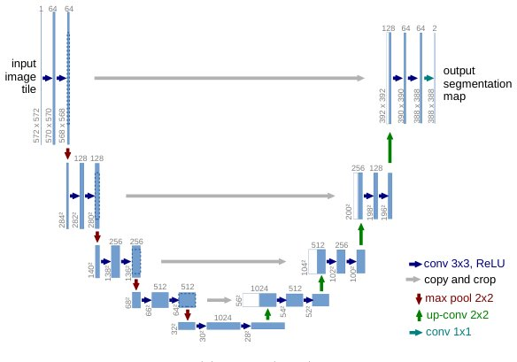

> *Generated by JarvisForResearchers Bot on 2026-11-08*

!!! tip "Why we featured this paper"
    Brand new preprint (2026) — accepted

## TL;DR
This study retrospectively analyzed 371 motivation and framework figures from 200 papers to quantify how generative AI-assisted revisions affect visual communication and design, concluding that while AI can improve clarity, it may degrade aesthetic coherence, underscoring the necessity of researcher-led design control.

## The Problem
The integration of generative AI into the creation of scientific figures introduces a critical ambiguity: how does AI assistance impact the explanatory clarity and purposeful visual expression of scientific communication? While AI offers novel means to realize visual choices, the mere visual appearance of a figure is insufficient to determine its communicative efficacy or its production provenance. Existing evaluation methodologies often rely on aggregate quality scores, which obscure nuanced trade-offs between improved clarity and potential declines in organizational coherence or aesthetic quality. A significant gap exists in the literature regarding a multidimensional assessment framework that can decouple the *how* (production provenance) from the *what* (visible design properties) of a scientific illustration.

## Key Contributions
This work makes three primary contributions. First, we constructed a traceable corpus and illustrated atlas comprising 371 figures sourced from 200 papers. This corpus retains evidence of both the original and the AI-generated revisions, allowing for the distinction between the main sample and a purposive contrast sample. Second, we evaluated the original figures alongside 369 study-generated revisions that successfully passed fidelity checks across six distinct dimensions. This evaluation preserved repeated judgments, enabling us to report both dimension-level tradeoffs and instances of fidelity failure. Third, we developed practical guidance for researcher-led figure design by connecting the observed dimensional tradeoffs directly to critical decisions regarding visual narrative construction, typographic hierarchy, information selection, and maintenance of scientific fidelity.

## How It Works


*Fig. 1. U-net architecture (example for 32x32 pixels in the lowest resolution). Each blue
box corresponds to a multi-channel feature map. The number of channels is denoted
on top of the box. The x-y-size is provided at the lower left edge of the box. White
boxes represent copied feature maps. The ar*

The methodology employed a combined retrospective analysis and a source-constrained revision study on the corpus of 371 figures. A single multimodal judge was utilized to assess six dimensions of communication and design for both the original and revised versions. The corpus was stratified into a quota-based main sample of 160 papers, spanning four temporal periods, and a purposive style-contrast sample of 40 papers. Crucially, all 371 figures underwent source-constrained revisions, with 369 of these revisions meeting predefined fidelity criteria. The core analysis involved comparing the ratings assigned to the original figures against the ratings assigned to their AI-assisted revisions across the six dimensions to quantitatively measure the impact of AI assistance on clarity and coherence.

### Motivation Figures
These figures are defined as those intended to introduce a problem, expose a limitation within the current state of knowledge, or communicate a novel insight derived from the research. They are central to establishing the narrative impetus of the paper.

### Framework Figures
These figures serve the function of presenting the organizational structure of a proposed method or system. They are concerned with mapping out the components and flow of the research apparatus.

### Multimodal Judge
This component represents the evaluator tasked with assessing the figures. The judge applied a standardized protocol to score six specific dimensions related to both the communicative effectiveness and the design quality of the visual material.

## Results
The quantitative comparison between original and revised figures yielded several key findings across the six assessed dimensions.

| Metric | Value | Baseline | Source |
| :--- | :--- | :--- | :--- |
| Mean Clarity Ratings | increase by 0.428 points | Original figures | Section 5.3 |
| Aesthetic Coherence Ratings | decrease by 0.111 points | Original figures | Section 5.3 |
| Six-dimension average gain | larger for main-sample motivation figures than for frameworks | N/A | Section 5.3 |

## Why This Matters
The findings suggest that generative AI assistance is not a neutral tool; it induces specific, measurable shifts in visual communication. The observed increase in Mean Clarity Ratings indicates that AI can effectively assist in making complex information more immediately accessible. However, the concurrent decrease in Aesthetic Coherence Ratings signals a potential trade-off where the pursuit of clarity might inadvertently compromise the overall visual integrity or organizational elegance of the figure. This necessitates a shift in research practice: while AI is valuable for rapid prototyping and exploring design alternatives, the ultimate responsibility for defining the figure's explanatory purpose, composition, and the precise scientific relationships it conveys must remain firmly with the human researcher. Furthermore, evaluation protocols must evolve to differentiate between superficial visual polish, the history of the figure's creation, and its actual communicative power.

## Limitations & Open Questions
The current study is subject to limitations. Specifically, the correspondence between the scores generated by the fixed evaluation protocol and the actual, subjective human understanding or preference of a broad audience remains an area requiring further empirical validation. Moreover, detailed case analyses revealed that while AI-assisted explanation can successfully clarify specific comparisons within a figure, it does not inherently resolve underlying issues related to typographic hierarchy or visual economy. Future work must address whether these unresolved structural issues are inherent limitations of the AI generation process or artifacts of the initial prompt engineering.

---

## Citation

**Paper:** [2611.08486](https://arxiv.org/abs/2611.08486)

```bibtex
@article{261108486,
  title   = {Do You Miss the Nights We Spent Crafting Figures? Rethinking Teaser and Framework Figures in the Age of Generative AI},
  author  = {Xiaoqi Zhao and Youwei Pang and Kailai Zhou},
  journal = {arXiv preprint arXiv:2611.08486},
  year    = {2026},
  url     = {https://arxiv.org/abs/2611.08486}
}
```
