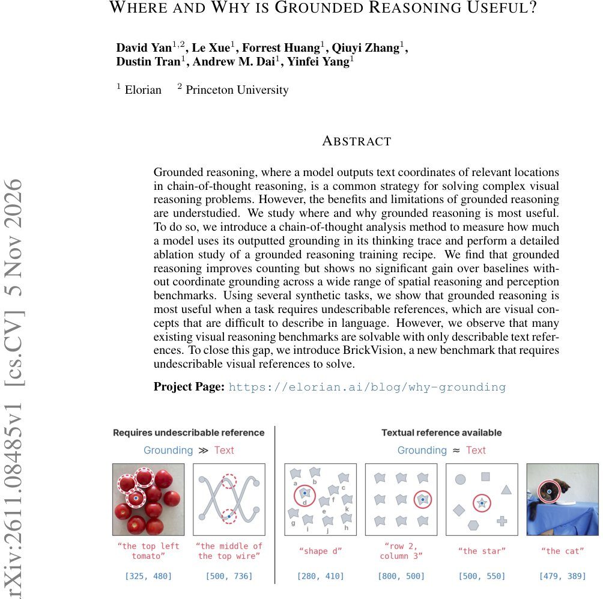

> *Generated by JarvisForResearchers Bot on 2026-11-09*

!!! tip "Why we featured this paper"
    Brand new preprint (2026) — accepted

## TL;DR
Grounded reasoning exhibits utility primarily in tasks demanding references that are inherently difficult to articulate linguistically, such as precise counting. However, for general spatial reasoning and perception benchmarks, the performance gain over sophisticated text-only reasoning methods is often marginal.

## The Problem
A persistent ambiguity exists regarding the precise conditions under which incorporating visual grounding enhances reasoning capabilities. Prior empirical observations have suggested scenarios where purely text-based reasoning approaches can achieve performance parity or even surpass models that incorporate explicit visual grounding signals. Furthermore, existing methodologies for interpreting Chain-of-Thought (CoT) processes lack the specificity to quantify reliance on generated spatial coordinates. A significant practical hurdle is that many established visual reasoning benchmarks are constructed using concepts that are readily describable in natural language, thereby failing to probe the unique advantages of grounded reasoning.

## Key Contributions
We introduce a novel technique to quantify the actual utilization of grounding coordinates within existing reasoning models, revealing that many contemporary models fail to leverage their own generated spatial outputs during inference. We present a comprehensive ablation study of the grounding training methodology, demonstrating that grounded reasoning demonstrably outperforms natural language reasoning on tasks necessitating visual references that resist linguistic description, specifically counting and object tracking. Finally, we introduce BrickVision, a novel and challenging benchmark specifically engineered to evaluate a model's capacity to reason effectively using undescribable visual references.

## How It Works


*Figure 1: Visual grounding is useful as an undescribable reference. When objects in a task are
uniquely identifiable in text (e.g. through a label, descriptor, or position), we say that a textual ref-
erence is available. When textual references are available, grounded reasoning performs no better
t*

The methodology integrates a decode-time Grounding Randomization technique to empirically measure the dependency of a model's reasoning trajectory on its emitted grounding points during inference. This is achieved by systematically randomizing the coordinates outputted within the CoT sequence and simultaneously resetting the Key-Value (KV) cache. To investigate the efficacy of different training paradigms, we construct high-quality Supervised Fine-Tuning (SFT) datasets. These datasets are synthesized using point annotations derived from Gemini 3.5 Flash, focusing on the SpatialMQA and MultihopSpatial datasets, resulting in 6,368 samples. Models are subsequently trained using both grounded and ungrounded recipes, followed by Reinforcement Learning (RL) incorporating rewards structured around format adherence, correctness, and grounding fidelity. The comparative advantage between the grounded and ungrounded training regimens is quantified via the mean performance delta ($\overline{\Delta}$).

### Decode-time Grounding Randomization
This technique serves as our primary diagnostic tool for assessing grounding reliance. During inference, we intercept the CoT generation process. The coordinates generated by the model are subjected to randomization before being fed into the subsequent reasoning steps. Crucially, the KV-cache is reset concurrently with this randomization. This procedure allows us to isolate the performance degradation attributable solely to the absence of the model's own spatial anchors, providing a direct measure of grounding utility.

### High-quality SFT Datasets
The foundation of our training comparison rests on these datasets. They are meticulously constructed by leveraging point annotations generated by Gemini 3.5 Flash. The selection criteria focused on tasks within the SpatialMQA and MultihopSpatial domains. The resulting corpus comprises 6,368 samples, ensuring a high standard of annotation quality necessary for fine-grained comparison between grounded and ungrounded training paths.

### Appended Reasoning Template
This template represents a baseline strategy for injecting grounding information. When the model references a relevant object within its reasoning trace, the corresponding grounding coordinates are explicitly appended to the text. This tests the utility of simply providing the coordinates alongside the linguistic description.

### Reflection Reasoning Template
This template represents a more proactive strategy. Instead of merely appending coordinates, the reasoning trace is augmented with a specific reflection phrase, such as "Let's look at [coordinate]". This structure aims to force the model to actively incorporate and utilize the provided spatial information during the subsequent reasoning steps, rather than just acknowledging its presence.

## Results
The analysis of grounding usage via randomization showed a measurable impact. The change in mean performance after randomization when comparing our approach against the Appended template was $-1.64 \pm 0.31$ (% acc). When evaluating the impact of the SFT recipe, the Performance Delta ($\overline{\Delta}$) on CountQA was $+3.6 \pm 2.4$ compared to the Ungrounded baseline. Conversely, on SMQA, the Performance Delta ($\overline{\Delta}$) was $-1.0 \pm 2.1$ against the Ungrounded baseline. Finally, on the novel BrickVision benchmark, the GPT-6 Astra score achieved was $68.7\%$, surpassing all other existing models.

| Metric | Value | Baseline | Source |
| :--- | :--- | :--- | :--- |
| Change in mean performance (% acc) after randomization (Ours - Appended) | $-1.64 \pm 0.31$ | N/A | Table 1 |
| Performance Delta ($\overline{\Delta}$) after SFT (CountQA) | $+3.6 \pm 2.4$ | Ungrounded | Table 3 |
| Performance Delta ($\overline{\Delta}$) after SFT (SMQA) | $-1.0 \pm 2.1$ | Ungrounded | Table 3 |
| GPT-6 Astra score on BrickVision | $68.7\%$ | All other existing models | Abstract |

## Why This Matters
The findings provide a necessary refinement to the discourse surrounding multimodal reasoning. The evidence suggests that the utility of grounding is not universally applicable across all visual reasoning tasks. Specifically, the positive $\overline{\Delta}$ on CountQA, contrasted with the neutral or negative delta on SMQA, indicates a functional specialization: grounded reasoning provides a measurable advantage when the task demands the resolution of ambiguity inherent in concepts that defy concise linguistic description. Furthermore, the comparative performance of the Reflection Reasoning Template versus the Appended Template suggests that the *manner* of integrating grounding information—i.e., prompting active engagement—is as critical as the presence of the coordinates themselves.

## Limitations & Open Questions
A primary limitation remains the inherent bias of current benchmarks; many existing visual reasoning tasks are constructed such that they are solvable using only linguistically describable references, which artificially constrains the demonstration of grounded reasoning's maximal potential. Additionally, we observed that the application of RL training following SFT can induce performance regressions on certain spatial reasoning benchmarks. Future work must address the stability of performance across the RL fine-tuning phase and develop benchmarks that rigorously test the limits of linguistic description versus the necessity of explicit spatial grounding.

---

## Citation

**Paper:** [2611.08485](https://arxiv.org/abs/2611.08485)

```bibtex
@article{261108485,
  title   = {Where and Why is Grounded Reasoning Useful?},
  author  = {David Yan and Le Xue and Forrest Huang and Qiuyi Zhang and Dustin Tran and Andrew M. Dai et al.},
  journal = {arXiv preprint arXiv:2611.08485},
  year    = {2026},
  url     = {https://arxiv.org/abs/2611.08485}
}
```
