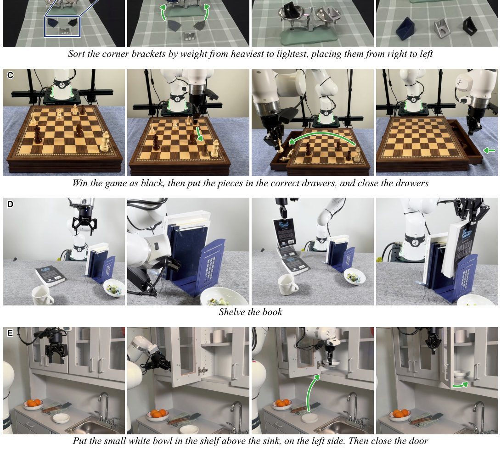

> *Generated by JarvisForResearchers Bot on 2026-11-10*

!!! tip "Why we featured this paper"
    Brand new preprint (2026) — accepted

## TL;DR
Agentic Manipulation Policies (AMPs), exemplified by AMP1, demonstrate superior zero-shot generalization and robustness in robot manipulation tasks compared to specialist policies like VLAs and WAMs.

## The Problem
Current state-of-the-art approaches in robot manipulation heavily rely on specialist policies, such as Vision-Language Actions (VLAs) and World Model Agents (WAMs). These methods are fundamentally constrained because they are trained or fine-tuned specifically on a set of robot demonstrations. This reliance on demonstration data severely limits their ability to generalize to novel environments or tasks. A core technical hurdle preventing broader adoption of generalist frontier models in direct manipulation is their limited inherent spatial cognition, which restricts their capacity to reason about physical interactions dynamically.

## Key Contributions
We present three primary contributions to this domain. First, we provide a systematic analysis of agentic manipulation policies (AMPs) across various underlying models and harness configurations, establishing a comparative baseline. Second, we introduce AMP1, a reference harness that achieves state-of-the-art zero-shot performance on established benchmarks, specifically RoboLab-120 and CaP-Gym. Third, we demonstrate the emergence of complex, high-level behaviors within AMPs, such as autonomously searching for occluded objects or utilizing environmental objects as tools, purely through agentic reasoning.

## How It Works


*Fig. 1. Zero-shot real-world manipulation with AMP1. AMP1 solves diverse, long-horizon manipulation tasks directly in the real world
from a natural language instruction without task-specific fine-tuning or predefined skills. It devises complex strategies, such as (A) searching
for hidden objects, (B*

AMP1 functions as an Agentic Manipulation Policy (AMP) by leveraging a generalist AI model to issue direct commands to a manipulator. This architecture fundamentally differs from skill-based or offline synthesis methods because it permits the agent to dynamically revise its planned actions as the task state evolves. The AMP1 reference harness provides the necessary interface, supplying visual observations, enabling arbitrary code execution, and facilitating direct control over manipulator motion. The agent autonomously develops task strategies—for instance, deciding to search for a hidden object or performing camera calibration—without requiring task-specific training data. Furthermore, we introduce an augmentation to this harness, the Persistent Memory Store, which allows the agent to encode and recall salient observations, successful strategies, and useful code snippets after reflecting on episode outcomes, thereby accumulating knowledge across episodes without necessitating expert demonstrations or gradient updates.

### AMP1
AMP1 serves as the foundational reference harness. It is designed to be agnostic to the specific manipulation paradigm, running consistently across single-arm, bimanual, and mobile manipulation setups. Its operational scope includes ingesting visual observations, executing arbitrary code for planning or simulation, and issuing direct, low-level control signals to the manipulator hardware.

### Generalist AI Model
This is the computational core of the AMP. Unlike traditional controllers that execute pre-defined trajectories or skills, the Generalist AI Model is responsible for interpreting the current state (visual input) and generating the next action command for the manipulator. Its defining characteristic is its capacity for in-loop adaptation; it can modify its strategy mid-execution based on sensory feedback, a capability absent in fixed-policy systems.

### Persistent Memory Store
This component augments the base AMP1 harness. It functions as an episodic memory mechanism. Following an episode, the agent reflects on its performance—identifying successful sub-routines or critical failures. This reflection allows the agent to serialize and store relevant state-action pairs, observations, or code blocks within the Persistent Memory Store. This stored knowledge is then retrieved and utilized in subsequent, unrelated episodes, enabling knowledge accumulation without the need for external expert demonstrations or fine-tuning the underlying model weights.

## Results
The empirical evaluation demonstrates a clear advantage for AMPs over established baselines.

| Metric | Value | Baseline | Source |
| :--- | :--- | :--- | :--- |
| Success Rate (RoboLab-120, zero-shot) | 85.6% | 49.2% (leading VLA) | Section 2A.1 |
| Failure Rate Reduction (RoboLab-120) | 20x | Strong VLA baseline | Section 2A.1 |
| Failure Rate Reduction (RoboLab-120) | 15x | Strong WAM baseline | Section 2A.1 |
| Failure Rate Reduction (RoboDojo bimanual, with memory) | 4.6x | Zero-shot deployment | Section 1 |
| Success Rate (RoboLab-120, Opus 5.5) | 82.8% | N/A | Section 2A.1 |
| Success Rate (LIBERO-PRO, zero-shot, Gemini 4 Argon) | 95.2% | 18.2% (CaP-Agent0) | Section 2A.2 |

## Why This Matters
The findings indicate that shifting from specialized, demonstration-dependent policies to agentic frameworks provides a substantial leap in the robustness and generalizability of robotic manipulation. The ability of AMPs to revise their strategy mid-task, coupled with the experience accumulation afforded by the Persistent Memory Store, addresses the brittleness inherent in current VLA/WAM approaches. Furthermore, the observed emergence of complex behaviors validates the hypothesis that generalist models, when granted sufficient control authority and reflective capabilities, can develop sophisticated problem-solving heuristics autonomously.

## Limitations & Open Questions
Despite these advancements, the current implementation of AMPs faces practical limitations. A primary bottleneck is the latency introduced by the reasoning cycle; the robot often spends a significant portion of each episode waiting for the generalist model to produce a coherent action plan. Secondly, the performance of the AMPs is highly sensitive to the quality of sensory input; specifically, sensory impairment, such as the absence of depth information or accurate camera calibration, demonstrably degrades the performance of weaker underlying models. Future work must focus on optimizing the reasoning loop latency and developing more resilient perception pipelines for these agentic systems.

---

## Citation

**Paper:** [2611.09892](https://arxiv.org/abs/2611.09892)

```bibtex
@article{261109892,
  title   = {On Agentic Manipulation Policies},
  author  = {Chen Chen and Omid Bagherieh and Naveen Nikamanth Appiah Balaji and Jesse T. Gonzalez and Negin Heravi and Fahad Islam et al.},
  journal = {arXiv preprint arXiv:2611.09892},
  year    = {2026},
  url     = {https://arxiv.org/abs/2611.09892}
}
```
