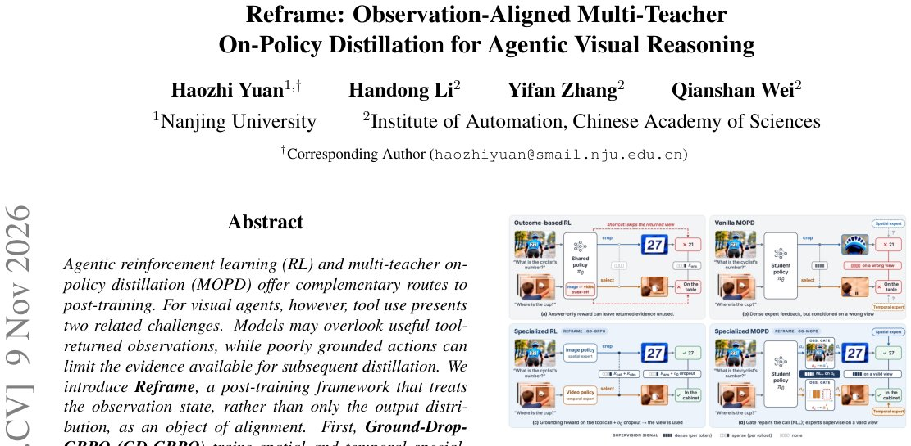

> *Generated by JarvisForResearchers Bot on 2026-11-11*

!!! tip "Why we featured this paper"
    Brand new preprint (2026) — accepted

## TL;DR
Reframe is a two-stage post-training framework designed to mitigate observation neglect in agentic visual reasoning. It achieves this by first enforcing observation necessity using Ground-Drop-GRPO (GD-GRPO) and subsequently ensuring observation validity via Observation-Gated-MOPD (OG-MOPD).

## The Problem
In the context of agentic visual reasoning, a significant challenge is observation neglect. This occurs when the reasoning model fails to adequately utilize useful observations returned by external tools. Furthermore, if the actions taken by the agent are poorly grounded in the visual evidence, the subsequent distillation process may be limited by an insufficient or invalid set of acquired observations. Existing literature has several gaps: most prior work is modality-specific, existing paradigms typically refine supervision without altering the rollout trajectory, and token-level feedback on a continuation cannot retroactively recover evidence missed by a preceding, flawed action.

## Key Contributions
We introduce Reframe, the first tool-use Model-based Policy Distillation (MOPD) framework capable of unifying image and video agentic reasoning. Specifically, we address observation neglect through GD-GRPO, which enforces observation necessity by integrating input dropping and observation-specific rewards. Additionally, we developed the Reframe-100K dataset to provide the necessary scaffolding for both training stages.

## How It Works


*Figure 1.
Overview of Reframe: visual agents should pro-
duce reliable intermediate results and truly look at them.
(a) Outcome-based RL without explicit grounding rewards can
permit observation neglect.
(b) Vanilla MOPD may supervise
trajectories conditioned on a poorly grounded observation state.
*

Reframe operates sequentially across two complementary stages. The initial stage, Ground-Drop-GRPO (GD-GRPO), focuses on training the spatial and temporal specialists. This is achieved by augmenting the standard observation-based rewards and stochastically removing the original visual input ($o_0$). This forcing mechanism compels the agent to rely on observations returned by the tools. The second stage, Observation-Gated-MOPD (OG-MOPD), intervenes mid-rollout. When a tool action is deemed deficient, OG-MOPD replaces it with a canonical action derived from grounding annotations. The distillation process is then resumed from this repaired observation, ensuring that the observations used for cross-modal consolidation are both necessary and valid.

### Ground-Drop-GRPO (GD-GRPO)
GD-GRPO trains the spatial and temporal specialists by employing evidence-aware rewards. Crucially, it incorporates stochastic removal of the original visual input ($o_0$). This input dropping mechanism acts as a regularization technique, forcing the agent to derive necessary information from the observations provided by the tools rather than relying on the initial, potentially redundant, visual context.

### Observation-Gated-MOPD (OG-MOPD)
OG-MOPD functions as a mid-rollout correction mechanism. If the agent executes a tool action that results in a deficient observation, OG-MOPD intercepts this. It substitutes the deficient action with a canonical action, which is derived from pre-existing grounding annotations. By resuming the distillation process from this repaired observation, OG-MOPD guarantees the validity of the evidence stream used for downstream policy refinement.

### Reframe-100K
Reframe-100K is the curated dataset supporting the entire framework. It comprises 63K image QA pairs and 37K video QA pairs. This dataset was constructed using a rigorous five-step cascaded data construction pipeline to ensure high fidelity and relevance for tool-use training.

## Results
The empirical evaluation demonstrates the effectiveness of the proposed framework:

| Metric | Value | Baseline | Source |
| :--- | :--- | :--- | :--- |
| Observation Dependence | 75.53 | Mix-RL and vanilla MOPD | Table 1 |
| Tool Gain | +5.23 | Mix-RL and vanilla MOPD | Table 1 |

## Why This Matters
The findings underscore a critical principle for agentic systems: focusing solely on the final output distribution supervision is insufficient; the alignment and necessity of the observation state are paramount. The success of the two-stage approach—first forcing reliance via GD-GRPO, and second ensuring validity via OG-MOPD—provides a robust methodology for unified reasoning across modalities. Furthermore, the construction of Reframe-100K highlights the necessity of rigorous, evidence-based data curation when training complex tool-use agents.

## Limitations & Open Questions
Currently, the framework's scope is constrained by the toolset, which is restricted to two fundamental vision tools: CropImage and SelectFrames, for the sake of initial simplicity. Additionally, the entire process necessitates complex data construction pipelines that demand multiple rounds of evidence auditing and verification, which represents a significant engineering overhead. Future work should investigate scaling the toolset and automating the evidence auditing phase.

---

## Citation

**Paper:** [2611.12886](https://arxiv.org/abs/2611.12886)

```bibtex
@article{261112886,
  title   = {Reframe: Observation-Aligned Multi-Teacher On-Policy Distillation for Agentic Visual Reasoning},
  author  = {Haozhi Yuan and Handong Li and Yifan Zhang and Qianshan Wei},
  journal = {arXiv preprint arXiv:2611.12886},
  year    = {2026},
  url     = {https://arxiv.org/abs/2611.12886}
}
```
