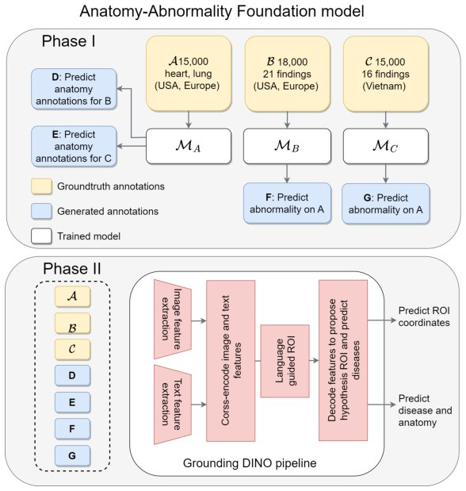

> *Generated by JarvisForResearchers Bot on 2026-11-12*

!!! tip "Why we featured this paper"
    Brand new preprint (2026) — accepted

## TL;DR
We introduce EM-FM, a multi-domain foundation detection model built by extending EM-DETR. The core innovation is a student-teacher training strategy that unifies heterogeneous anatomical and abnormality datasets, mitigating catastrophic forgetting. This allows the model to learn fine-grained, example-driven detection across diverse medical modalities, achieving SOTA performance gains.

## The Problem
The development of robust Deep Learning-based Computer-Aided Diagnostic (CAD) systems is significantly impeded by two primary issues in medical imaging: the scarcity of comprehensive, standardized annotations, and the inherent heterogeneity across existing datasets. Traditional CNN-based detection models exhibit poor generalization when encountering data from different modalities or out-of-distribution (OOD) scenarios, largely because obtaining high-quality, universally applicable annotations is exceedingly difficult. Furthermore, unlike natural image domains where extensive image-text paired datasets are available for Vision-Language (VL) model training, the medical domain lacks such resources. A critical challenge arises when attempting to merge multiple, non-overlapping medical datasets—specifically those annotated for distinct anatomical structures versus pathological abnormalities—as this often induces catastrophic forgetting, given the shared visual characteristics between these categories.

## Key Contributions
Our work makes three primary contributions:
1. We propose a student-teacher training strategy designed to effectively integrate anatomical and abnormality datasets, which possess heterogeneous label spaces, while simultaneously mitigating the risk of catastrophic forgetting.
2. We extend the EM-DETR framework to construct a multi-domain, example-based foundation detection model (EM-FM) capable of learning fine-grained, example-driven detection across various medical modalities.
3. We demonstrate state-of-the-art (SOTA) performance, evidenced by image-level AUC scores surpassing previous SOTA by 1 percentage point and leading mAP50 metrics in both Chest X-rays (CXRs) and mammography.

## How It Works


*Fig. 1. Overview of the student-teacher training process to create a foundation model
with GDINO [14]. A GDINO model is trained on each dataset with all available classes
and used to generate weak annotations on remaining sets. A final model is trained in
phase II with both gold-standard and generat*

The methodology proceeds in two distinct stages. The initial stage focuses on creating an Anatomy-Abnormality Foundation Model (AAFM) utilizing a student-teacher paradigm. In this phase, domain-specific models (MA, MB, MC) are employed to generate weak annotations for classes missing in other datasets, thereby unifying the label space across the heterogeneous data. The second stage adapts the EM-DETR framework to realize the EM-FM. EM-DETR builds upon GDINO, leveraging "class-specific exemplar embeddings" ($q_k$). These embeddings are derived from selected tokens ($X_k, P_k$) via a trainable Transformer module ($F$). These $q_k$ embeddings are then stored in a "memory bank" ($e_k$) and interleaved with text embeddings to facilitate example-based search. The training stability is maintained through the application of $L_{contrast}$ and $L_{feat}$ losses.

### GDINO
GDINO serves as the foundational open-vocabulary object detector. It is architecturally built upon the GLIP framework and is responsible for aligning local image features with semantic textual or referring expressions.

### Swin [15] Transformer image backbone
This component is responsible for processing the input image. It extracts shifted window patch embeddings ($X'$) and corresponding positional encodings ($P'$) from the input image.

### Class-specific exemplar embedding ($q_k$)
This is the representative feature embedding prototype for a specific class. It is generated by the trainable Transformer module $F$ using the formula: $q_k = F(\text{concat}(c_{tk}, c_{ek}, H_k)) + c_{tk} + c_{ek}$.

### Memory bank ($e_k$)
The memory bank functions as a repository for the model's learned exemplars. It stores a moving average of the $q_k$ embeddings, which are subsequently used to guide the detection process during inference.

### AAFM
The Anatomy-Abnormality Foundation Model (AAFM) is the intermediate model trained via the student-teacher strategy. Its purpose is to synthesize a unified representation by combining strong and weak annotations derived from the disparate anatomical and abnormality datasets.

### EM-FM
The EM-FM is the final EM-DETR Foundation Model. It is trained iteratively across all available radiology datasets. A crucial refinement step involves using per-class background-versus-foreground data to further optimize the model weights.

## Results
| Metric | Value | Baseline | Source |
| :--- | :--- | :--- | :--- |
| Image-level AUC (Consolidation) | 0.943* | 0.926 | Table 2 |
| Image-level AUC (Atelectasis) | 0.974* | 0.959 | Table 2 |
| Image-level AUC (Average) | 0.972* | 0.959 | Table 2 |
| mAP50 (Consolidation in CXRs) | 0.596* | 0.450 | Table 3 |
| mAP50 (Average in CXRs) | 0.567* | 0.369 | Table 3 |
| mAP50 (Mass in Mammography) | 0.721* | 0.583 | Table 3 |

## Why This Matters
The findings confirm that student-teacher training provides a viable mechanism for unifying heterogeneous medical annotations (anatomical versus abnormality) while effectively preventing catastrophic forgetting. Furthermore, adapting example-based detection frameworks like EM-DETR enables models to leverage specific visual characteristics for fine-grained, example-driven detection across diverse medical modalities. The resulting foundation models demonstrate substantial practical value, achieving significant performance uplifts—for instance, an average mAP50 increase of 19.9 percentage points in CXRs compared to single-dataset baselines.

## Limitations & Open Questions
We observe that the gains achieved in atelectasis detection are somewhat limited, which we attribute to inherent labeling ambiguity stemming from clinical overlap with conditions such as consolidation and distalectasis. Additionally, the performance gap observed in AAFM on atelectasis and pleural effusion, relative to the baseline, can be traced to the classification-optimized confidence thresholds employed during the student-teacher training and variability inherent in GDINO's contrastive learning mechanism.

---

## Citation

**Paper:** [2611.14518](https://arxiv.org/abs/2611.14518)

```bibtex
@article{261114518,
  title   = {Toward Foundation Detection Models via Example-Based Grounding in EM-DETR},
  author  = {Sheethal Bhat and Bogdan Georgescu and Awais Mansoor and Florin C. Ghesu and Sasa Grbic and Andreas Maier},
  journal = {arXiv preprint arXiv:2611.14518},
  year    = {2026},
  url     = {https://arxiv.org/abs/2611.14518}
}
```
