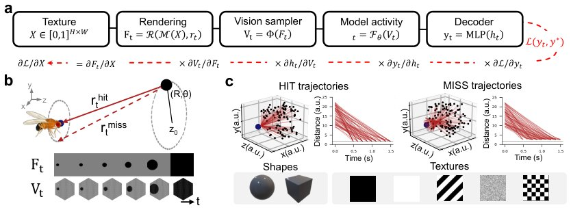

> *Generated by JarvisForResearchers Bot on 2026-11-13*

!!! tip "Why we featured this paper"
    Brand new preprint (2026) — accepted

## TL;DR
This work benchmarks the robustness and efficiency of a connectome-constrained fly visual system model (FlyNet) against artificial networks under adversarial and perceptual illusions on a collision-detection task. We find that while FlyNet exhibits superior robustness per unit of compute against common video corruptions, it is not immune to adversarial attacks, which specifically target the disruption of the Hassenstein–Reichardt correlation.

## The Problem
A fundamental question in computational neuroscience and AI is whether biological neural architectures, constrained by evolved wiring diagrams, offer inherent advantages in robustness or efficiency over purely artificial neural networks when solving perception tasks. Furthermore, it is unknown whether the failure modes observed in biologically specialized systems mirror those in artificial systems designed for the same function. Specifically, there is a gap in understanding how perceptual illusions relate to adversarial vulnerabilities within the same computational framework, and how the structural constraints of biological wiring contribute to overall robustness versus computational economy.

## Key Contributions
We present three primary contributions:
1. A differentiable 3D rendering pipeline enabling adversarial attacks to optimize object textures within a 3D scene space for differentiable motion-perception models.
2. A direct comparative analysis between gradient-based adversarial attacks and the reverse-phi illusion when applied to the connectome-constrained, task-optimized model of the fly visual system (FlyNet).
3. Identification that both adversarial textures and the reverse-phi illusion operate by inverting the Hassenstein–Reichardt correlation between radially neighboring inputs.

## How It Works


*Figure 1: Fully differentiable 3D geometric framework for motion-based collision detection.
(a) Processing differentiable pipeline. (b) Geometric setup of looming stimuli, parameterized by
polar coordinates (R, θ, z0). Bottom: example rendering in the image frame Ft and corresponding
fly visual inpu*

The methodology centers on simulating a looming-based collision-detection task using a differentiable 3D rendering pipeline. This pipeline allows us to backpropagate gradients through the rendering process, enabling adversarial attacks to optimize object textures in 3D space. The core model, FlyNet, is a continuous-time recurrent neural network (CTRNN) whose connectivity is strictly governed by the known synaptic connectome of the *Drosophila* visual system. This model is benchmarked against several artificial network architectures, including CTRNN, sCTRNN, various CNNs (vCNN, gCNN), and RAFT. Robustness is quantified as $R$, the area under the accuracy curve, measured across standard video corruptions and targeted adversarial perturbations. The analysis focuses on how these perturbations specifically degrade motion representations by examining the Hassenstein–Reichardt correlation.

### FlyNet
FlyNet is the primary subject of study. It is a connectome-constrained, continuous-time recurrent neural network derived from the *Drosophila* visual system. It possesses 45,669 neurons and is defined by 1.51M anatomically constrained edges, enforcing biological wiring constraints on the network dynamics.

### CTRNN
CTRNN serves as a control architecture. It shares the same dynamics, input structure, and cell-type connectivity as FlyNet, but critically, it omits the specific single-cell connectivity, synapse counts, and synapse signs dictated by the biological connectome.

### sCTRNN
sCTRNN is a sparsity-matched variant of CTRNN. It is derived from CTRNN but is pruned to match the exact 1.51M connections present in FlyNet, allowing for a controlled comparison of the impact of specific biological wiring patterns versus mere connection count.

### vCNN / gCNN
These represent feedforward convolutional neural network baselines. They follow a general FlowNet-inspired architecture. The gCNN variant incorporates channel-wise global pooling, providing a specific architectural variation for comparison against the recurrent biological model.

### RAFT
RAFT is employed as a higher-performance, state-of-the-art baseline network. Its performance is evaluated across different recurrent iteration counts (1, 6, and 12) to assess the impact of temporal integration depth.

### MLP Decoder
The final classification or regression layer is implemented as a task-specific Multi-Layer Perceptron (MLP). For classification tasks, this MLP utilizes 512 hidden units with a $\tanh$ activation function; for regression tasks, it uses 128-16 hidden units with a ReLU activation. This decoder is trained on the frozen representations output by the preceding network layers.

## Results
The comparative evaluation yielded several key findings regarding efficiency, robustness, and failure modes.

| Metric | Value | Baseline | Source |
| :--- | :--- | :--- | :--- |
| Robustness to common video corruptions | FlyNet and sCTRNN have higher robustness per order of magnitude of compute than every other architecture | Every other architecture | Section 4.1 |
| Adversarial vulnerability | Accuracy plummets under optimized adversarial attacks targeting the looming object's texture | Original texture | Figure 2b |
| Motion representation disruption | p(hit) drops sharply at each contrast inversion under reverse-phi stimulus | Original texture | Figure 2c |

## Why This Matters
The results suggest that imposing connectome constraints on a recurrent model can yield a significant advantage in robustness per unit of computational cost when facing common, naturally occurring video corruptions, relative to standard artificial network designs. More critically, the demonstration that both adversarial texture optimization and the reverse-phi illusion converge on the same mechanism—the inversion of the Hassenstein–Reichardt correlation—provides a powerful, testable hypothesis. This suggests that the failure modes in biologically constrained models are not merely artifacts of complexity but are tied to specific, identifiable vulnerabilities in the underlying motion encoding mechanism.

## Limitations & Open Questions
Despite the findings, the study reveals limitations. First, FlyNet is demonstrably vulnerable to targeted adversarial attacks. Second, the comparison shows that CTRNNs, despite lacking the specific biological constraints of FlyNet, exhibit greater robustness across nearly all tested perturbations, suggesting that while connectome constraints boost efficiency, they may not be the sole driver of maximal robustness. Future work must investigate the counterfactual restoration of these motion codes to definitively prove that adversarial failures stem from disrupting motion representations rather than merely encountering novel input textures.

---

## Citation

**Paper:** [2611.14498](https://arxiv.org/abs/2611.14498)

```bibtex
@article{261114498,
  title   = {Measuring Robustness and Efficiency in a Connectome-Constrained Fly Visual System Model: Linking an Adversarial and a Perceptual Illusion},
  author  = {Alexandre Garcia-Duran and Alejandro Rodriguez-Garcia and Manuel Molano-Mazón and Alexandre Hyafil and Srikanth Ramaswamy and Janne K. Lappalainen},
  journal = {arXiv preprint arXiv:2611.14498},
  year    = {2026},
  url     = {https://arxiv.org/abs/2611.14498}
}
```
