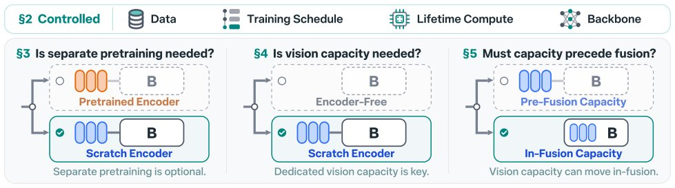

> *Generated by JarvisForResearchers Bot on 2026-11-14*

!!! tip "Why we featured this paper"
    Not yet indexed in S2 — assumed brand-new preprint

## TL;DR
This work systematically isolates the three design choices in multimodal vision encoding—visual prior, dedicated vision capacity, and pre-fusion placement—by training all models from scratch on common data. The primary finding is that dedicated vision capacity, when trained jointly with the backbone, is the critical determinant for visual understanding. Furthermore, a visual prior derived from upstream pretraining is not strictly necessary; a scratch-trained encoder achieves parity with a pretrained one at matched lifetime compute.

## The Problem
The methodology for encoding visual input into large multimodal language models (LMMs) is not settled. Current published models implicitly bundle three distinct design decisions: the reliance on a visual prior established during upstream pretraining, the presence and nature of dedicated vision capacity, and the placement of the vision-to-language fusion mechanism (pre-fusion vs. in-fusion). This bundling prevents rigorous ablation studies, as existing comparisons are confounded by differences in training data, architectural choices, and computational budgets. Specifically, prior art lacks a controlled comparison that isolates the effect of each of these three components. Furthermore, comparisons involving pretrained encoders often treat the encoder pretraining as a free resource, ignoring the substantial compute and data investment required for that initial phase.

## Key Contributions
We present a controlled study designed to unbundle these design choices by training all evaluated models entirely from scratch on a common dataset, utilizing a uniform backbone architecture and optimization recipe. Our contributions are threefold:
1. We execute a controlled study that systematically varies the design choices of multimodal vision encoding one at a time.
2. We demonstrate that the visual prior is not an indispensable component; an encoder trained jointly from scratch achieves performance comparable to a pretrained encoder when evaluated at matched lifetime compute.
3. We establish that dedicated vision capacity is the key factor for visual understanding, evidenced by the performance gap observed when comparing an encoder-free model against a model incorporating a dedicated encoder, even when the backbone is augmented by the encoder's parameter count.

## How It Works


*Figure 1 A controlled study of multimodal vision encoding. (Top) Every recipe shares one backbone architecture (“B”) and
trains all modules from scratch on common data at matched lifetime compute (§2). (Bottom) Each panel unbundles
one vision encoder design choice, marks the favored recipe ( ), and *

The protocol mandates that every model variant is trained entirely from scratch on the shared dataset. This standardization ensures that differences in performance can be attributed directly to the encoding design choice being tested. We fix the backbone architecture—a dense, decoder-only, pre-norm Transformer modeled after Qwen3—and vary the encoding strategy across four primary recipes: Pretrained encoder, Scratch encoder, Encoder-free, and In-fusion. The comparison metric is matched lifetime compute ($\text{Lifetime} = \sum_{s\in S} C_s$), ensuring a fair comparison across different training schedules. The evaluation is conducted on standard visual question answering (VQA) and language benchmarks.

### Backbone
The foundation of all models is a dense, decoder-only, pre-norm Transformer. This architecture incorporates RMSNorm, RoPE, SwiGLU feed-forward layers, and employs grouped-query attention with query–key normalization, mirroring the structure of Qwen3. This provides a consistent, high-capacity language processing core across all experimental setups.

### Scratch Encoder
This component consists of a randomly initialized 27-layer, 0.4B-parameter Vision Transformer, structurally analogous to MoonViT-V2. Its output features are integrated into the backbone via a linear projection layer, representing a dedicated vision processing module trained concurrently with the language model.

### Pretrained Encoder
This architecture shares the exact structure of the Scratch Encoder. The critical difference is that this encoder is subjected to an initial pretraining phase on the common data *before* being integrated into the multimodal training loop. This allows us to isolate the impact of the pretraining knowledge versus the joint training process.

### Encoder-free Model
In this configuration, the model bypasses a separate vision encoder entirely. Image patches are mapped directly into the backbone's latent space using a linear patch embedding layer. This embedding is subsequently processed by RMSNorm and modulated by a learned scalar gate, effectively fusing visual information at the input stage without an intermediate dedicated encoder.

### In-fusion Capacity
This design tests the placement of vision processing. Instead of relying solely on an initial projection or a separate encoder, vision-only modules are strategically inserted *inside* the earliest layers of the backbone Transformer. This tests the hypothesis that integrating visual features deeper into the language model's processing stream is beneficial.

## Results
The comparative analysis across VQA and language tasks yielded several definitive observations regarding the necessity and efficacy of each design choice.

| Metric | Value | Baseline | Source |
| :--- | :--- | :--- | :--- |
| Avg. VQA (%) | On par with pretrained ones (Scratch encoder vs. Pretrained encoder) | Pretrained encoder | Figure 2b |
| Avg. VQA (%) | Trails (Encoder-free vs. Scratch encoder) | Scratch encoder | Figure 3 |
| Avg. Text (%) | Stays comparable (Encoder-free vs. Scratch encoder) | Scratch encoder | Figure 3 |

## Why This Matters
The findings provide a clear architectural directive for LMM development. The data strongly suggests that the *capacity* dedicated to vision processing is the primary driver of visual competence, not merely the total parameter count or the existence of a pretraining history. The equivalence between the Scratch Encoder and the Pretrained Encoder at matched lifetime compute dismantles the necessity of expensive, separate upstream pretraining for the visual component. Furthermore, the performance deficit of the Encoder-free Model confirms that a dedicated, albeit small, vision capacity is necessary for robust visual understanding, even if the backbone is significantly enlarged. The In-fusion Capacity approach also suggests a viable pathway for efficient integration.

## Limitations & Open Questions
The primary limitation of this study lies in the definition of matched lifetime compute, which aggregates computational cost across all training stages. This metric, while necessary for fairness, may not perfectly capture the qualitative difference between pretraining and joint training. Additionally, the results are contingent upon the specific backbone sizes tested (1.7B and 4B) and the scaling ladders employed. Future work should investigate the scaling behavior of the Scratch Encoder versus the Pretrained Encoder across a wider range of model sizes to confirm the robustness of the parity finding.

---

## Citation

**Paper:** [2611.17334](https://arxiv.org/abs/2611.17334)

```bibtex
@article{261117334,
  title   = {Unbundling Multimodal Vision Encoding},
  author  = {Ellis Brown and Chris Hoang and Shengyi Qian and Shang-Wen Li and Mike Lewis and Marjan Ghazvininejad et al.},
  journal = {arXiv preprint arXiv:2611.17334},
  year    = {2026},
  url     = {https://arxiv.org/abs/2611.17334}
}
```
