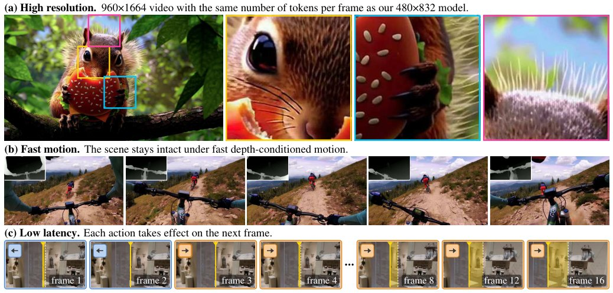

> *Generated by JarvisForResearchers Bot on 2026-11-15*

!!! tip "Why we featured this paper"
    Brand new preprint (2026) — accepted

## TL;DR
PixVid transforms a pretrained latent video diffusion model into a frame-wise pixel-space generator by substituting the VAE decoder with a convolutional detailer head. This architecture enables high-resolution, controllable, and low-latency video synthesis by operating directly on pixel tokens, effectively circumventing the structural limitations inherent in latent space diffusion models.

## The Problem
Frontier video generation models, particularly those leveraging Variational Autoencoder (VAE) latent spaces, face several intrinsic bottlenecks. First, scaling resolution in latent space is computationally prohibitive; doubling the spatial resolution quadruples the number of tokens, leading to quadratic complexity growth. Second, conditioning mechanisms in these latent models often operate on aggregated temporal blocks, meaning controls are applied to groups of frames rather than individual frames. Third, the reliance on block-wise latent processing introduces temporal compression delays, forcing the system to wait for the entire multi-frame block to be processed before any output can be generated, which severely impacts interactive latency.

## Key Contributions
We introduce PixVid, a methodology that effectively lifts a pre-trained latent video diffusion model into a frame-wise pixel-space model while maintaining rapid convergence to competitive quality. We identify and validate several critical design choices: employing a causal convolutional detailer head, which exhibits $9\times$ fewer patch seams compared to a linear head; utilizing $x$-prediction, which results in $80\times$ less pixel noise compared to $v$-prediction; and incorporating a larger noise shift relative to the original latent model. Crucially, PixVid demonstrates that frame-wise pixel generation resolves the three structural limitations of latent models: the constraint on resolution scaling, the difficulty in aligning controls under fast motion, and the inherent control-to-screen latency.

## How It Works


*Figure 1. PixVid lifts a pretrained latent video model into pixel space, enabling: (a) scaling to 960 × 1664 video at minimal extra cost
per frame over 480 × 832, at or above the pretrained latent model’s quality; (b) better motion handling in video editing than its latent
counterpart; and (c) respo*

PixVid preserves the core Diffusion Transformer (DiT) backbone from the original latent video model. The primary modification involves replacing the VAE components. Instead of encoding into a compressed latent space, we use a linear patch embedding to map input pixels directly into tokens. These tokens are then processed by the DiT backbone. The output tokens are finally rendered into pixel space by a lightweight 3D convolutional detailer head. A key architectural decision is that each frame receives its own set of tokens, covering a $1 \times p \times p$ pixel patch, which facilitates frame-wise conditioning. Training is conducted using $x$-prediction, where the network is trained to predict the clean video $\hat{x} = x_{\theta}(x_{\sigma}, \sigma)$ from a noisy input $x_{\sigma}$, minimizing the flow matching loss $L_{flow}$. Temporal smoothness and visual fidelity are enforced via auxiliary losses, $L_{temp}$ and $L_{LPIPS}$.

### DiT backbone
The DiT backbone is directly inherited from the pre-trained latent video model. This allows PixVid to leverage the extensive prior knowledge embedded in the latent diffusion process without retraining the entire transformer structure.

### Linear patch embedding
This component maps the input pixel space directly to the token space required by the DiT. It is initialized using an offline fitted linear map $A$ derived from the VAE encoder of the original latent model, providing a strong initialization point for the pixel-space representation.

### Lightweight 3D convolutional detailer head
This head is responsible for upsampling the token representations back into a high-resolution pixel grid. It is structured as a stack of $L = \log_2 p$ upsampling blocks, where each block performs a $1 \times 2 \times 2$ upsampling operation. Critically, this head is designed to be causal in the temporal dimension, ensuring that generation proceeds sequentially.

### x-prediction
The network is trained using $x$-prediction, meaning the objective is to predict the clean video $\hat{x}$ given the noisy input $x_{\sigma}$. This contrasts with velocity prediction ($v$-prediction) and is instrumental in rendering sharp, clean local structure within the pixel space.

## Results
| Metric | Value | Baseline | Source |
| :--- | :--- | :--- | :--- |
| VBench total | 84.78 | Wan2.1 (84.05) and PixelUMM (83.72) | Table 1 |
| Motion kept (Precise Video Editing) | 98% | 83% (for identically finetuned latent model) | Figure 1 |
| Median latency (Low-Latency Generation) | 34 ms | 495 ms | Figure 1 |

## Why This Matters
PixVid provides a viable pathway to bridge the gap between the high-quality synthesis capabilities of latent diffusion models and the high-resolution, low-latency requirements of real-time or interactive video generation. By moving the generation process to the pixel domain while retaining the powerful DiT backbone, we decouple the generation quality from the quadratic scaling penalty associated with latent token counts. The demonstrated reduction in latency from hundreds of milliseconds to tens of milliseconds is significant for practical applications requiring responsive video synthesis.

## Limitations & Open Questions
One observed limitation is that color fidelity is the only semantic dimension where PixVid trails Wan2.1 by more than one percentage point (81.59 vs. 84.73). Furthermore, the current implementation utilizes single-frame blocks, which, while enabling low latency, necessitates a trade-off in overall throughput compared to fully parallel latent block processing. Future work should investigate how to integrate temporal coherence mechanisms more efficiently without reintroducing the latency penalties of full block processing.

---

## Citation

**Paper:** [2611.17336](https://arxiv.org/abs/2611.17336)

```bibtex
@article{261117336,
  title   = {Back to Pixels: Lifting Latent Video Diffusion into Pixel Space},
  author  = {Yanke Song and Shuo Chen and Chris Rockwell and Guande He and Nan Liu and Desai Xie et al.},
  journal = {arXiv preprint arXiv:2611.17336},
  year    = {2026},
  url     = {https://arxiv.org/abs/2611.17336}
}
```
