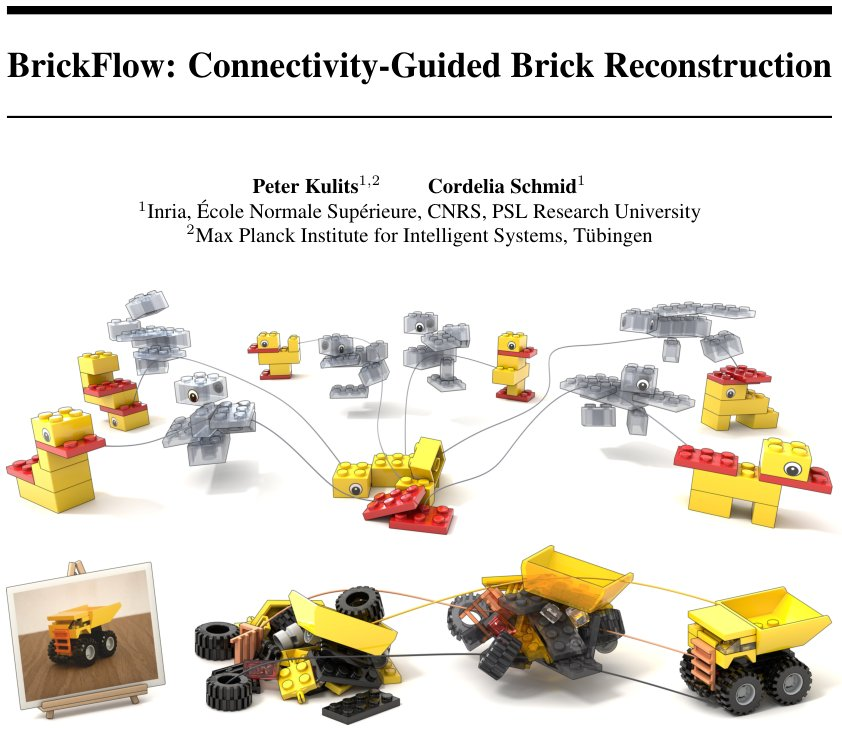

> *Generated by JarvisForResearchers Bot on 2026-11-16*

!!! tip "Why we featured this paper"
    Brand new preprint (2026) — accepted

## TL;DR
BrickFlow leverages an $\text{SE}(3)$ flow model, pre-trained on 100 million procedurally generated LEGO assemblies ($\text{ProcBrick}$), to learn a robust assembly prior. This prior is adapted for single-image reconstruction using minimal fine-tuning and is crucially augmented at test time with $\text{Connectivity-Field Guidance}$. This analytic energy steers the Diffusion Posterior Sampling (DPS) process toward physically valid, connected assemblies, significantly improving structural validity over unguided generative models.

## The Problem
The task of inferring the 6D pose for every component in an assembled object, given only an inventory of available parts and a single image of the final structure, is inherently constrained. We must find a set of poses $\{X_i\}$ such that when transformed, the parts reconstruct the observed image *and* satisfy discrete physical constraints dictated by how LEGO parts connect. Existing approaches struggle because learned generative models, while capable of capturing general geometry, do not inherently guarantee connectivity. The set of configurations that satisfy these discrete connector constraints has measure zero in the continuous space explored by standard generative models. Furthermore, prior work has not addressed inventory-conditioned assembly reconstruction across a full part library, nor has it integrated connectivity constraints differentiably during the inference process.

## Key Contributions
We make three primary contributions to this domain:
1. We train a set-conditioned $\text{SE}(3)$ flow model using $\text{ProcBrick}$ to establish an adaptable, geometry-aware assembly prior.
2. We demonstrate that this prior can be effectively adapted for single-image reconstruction using only $1\%$ of the original pretraining data.
3. We introduce $\text{Connectivity-Field Guidance}$, an analytic energy function applied at test time, which injects known connector structure into the inference loop via DPS, ensuring the output adheres to physical connectivity without requiring retraining.

## How It Works


*Figure 1: Top: We present BrickFlow, an SE(3) flow-matching model trained to take in a known set
of LEGO pieces (pile) with noisy poses (translucent) and denoise them into some valid structure.
Bottom: Using a procedural dataset 1% the size, we adapt it for image-conditioned reconstruction.*

BrickFlow operates in a two-stage process: pretraining for prior learning and finetuning/guidance for image-conditioned inference.

The initial phase involves training the $\text{SE}(3)$ flow model on $\text{ProcBrick}$. This procedural generator synthesizes 100 million structures, each composed of 100 parts, allowing the model to learn the statistical distribution of valid assembly geometries. The $\text{SE}(3)$ flow model, built upon the $\text{DiT}$ backbone, is trained to predict the necessary velocity $(\hat{v}_i, \hat{\omega}_i)$ required to denoise a noisy set of poses $\{X_t\}$ back to a clean configuration, conditioned on the part inventory and the current time step $t$.

For the image-conditioned task, the pre-trained model is finetuned. To incorporate visual evidence, features are extracted from a frozen $\text{DINOv3-L}$ backbone. These high-dimensional features are compressed into a manageable latent space using the $\text{Perceiver Resampler}$ and injected into the $\text{DiT}$ blocks.

The critical step for enforcing physical validity is the introduction of $\text{Connectivity-Field Guidance}$. This is an analytic scalar energy $E(X)$ defined over the joint poses. During inference, we employ Diffusion Posterior Sampling (DPS). Instead of simply sampling from the model's predicted distribution, we reweight the sampling process by incorporating the negative log-likelihood derived from $E(X)$. This gradient-based correction pulls the trajectory of the diffusion process away from geometrically plausible but disconnected states and toward configurations that minimize the connectivity energy, thereby enforcing structural validity at test time.

### SE(3) flow model
This is the generative core. It is trained to map noisy pose distributions to clean pose distributions by predicting the required velocity field $(\hat{v}_i, \hat{\omega}_i) = f_\theta(X_t, t, P, I)$. $P$ denotes the part inventory, and $I$ is the image feature context.

### ProcBrick
This procedural generator is responsible for creating the massive, constraint-rich dataset ($\text{100 million}$ assemblies of $\text{100 parts each}$) necessary to train the initial geometry prior, ensuring the model sees a wide variety of valid structural arrangements.

### DiT (Diffusion-Transformer)
This serves as the architectural backbone for the flow model. It utilizes token embeddings to encode the necessary contextual information, including part type, current pose, and material properties, allowing the diffusion process to operate over structured data.

### Perceiver Resampler
This component bridges the gap between the high-dimensional, fixed features extracted from the frozen $\text{DINOv3-L}$ (specifically, CLS and patch tokens from layer 18 of 24) and the tokenized input space of the $\text{DiT}$. It efficiently compresses the visual context for injection during finetuning.

### Connectivity-Field Guidance
This is the mechanism for enforcing discrete constraints in a continuous sampling framework. $E(X)$ is an analytic energy function calculated over the joint poses $X$. By using $-\log P(X) \propto E(X)$ as a guiding term within DPS, we bias the sampling distribution toward states where the parts are physically connected according to known connector geometries.

## Results
The integration of $\text{Connectivity-Field Guidance}$ yields substantial improvements in structural validity compared to the baseline model lacking this guidance.

| Metric | Value | Baseline | Source |
| :--- | :--- | :--- | :--- |
| Valid (%) | 15.8 [15.2, 16.4] | IC DiT-L (no guidance) | Table 1 |
| Valid (%) | 35.1 [32.0, 38.2] | IC DiT-L (no guidance) | Table 1 |

## Why This Matters
This work demonstrates a powerful paradigm shift for structure inference tasks involving hard, discrete constraints. By decoupling the learning of the general geometric prior (via large-scale procedural data) from the enforcement of specific physical rules (via analytic guidance), we achieve high performance without the prohibitive cost of retraining the entire generative model for every new constraint set. The ability to inject domain knowledge—like connectivity—as a differentiable energy term at test time is a significant methodological advance for robotics and reconstruction tasks where physical feasibility is non-negotiable.

## Limitations & Open Questions
One limitation is that the structures synthesized by $\text{ProcBrick}$ are not necessarily representative of human-designed assemblies; the generator's objective is to span the space of *valid* structures, not to model human *intent* or semantic realism. Furthermore, the $\text{Connectivity-Field Guidance}$ is inherently a test-time operation, which necessitates an additional backward pass during each step of the DPS inference, incurring a computational overhead compared to purely feed-forward generative sampling. Future work should investigate methods to embed this guidance more efficiently into the forward pass or explore hybrid training regimes.

---

## Citation

**Paper:** [2611.17321](https://arxiv.org/abs/2611.17321)

```bibtex
@article{261117321,
  title   = {BrickFlow: Connectivity-Guided Brick Reconstruction},
  author  = {Peter Kulits and Cordelia Schmid},
  journal = {arXiv preprint arXiv:2611.17321},
  year    = {2026},
  url     = {https://arxiv.org/abs/2611.17321}
}
```
