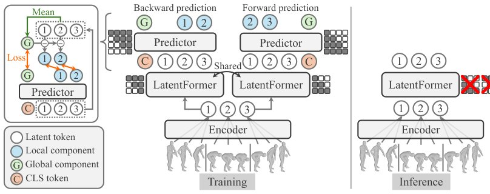

> *Generated by JarvisForResearchers Bot on 2026-11-17*

!!! tip "Why we featured this paper"
    Brand new preprint (2026) — accepted

## TL;DR
BAL introduces a self-supervised framework that learns human movement representations by exploiting the natural ordering structure of behavior through bidirectional autoregressive prediction in a latent space, while mitigating representation collapse via global and local component decomposition.

## The Problem
Learning semantically meaningful human movement representations from 3D pose sequences using self-supervised methods is challenging because existing methods rely on artificial assumptions (e.g., invariance to augmentation or recoverability of masked regions) which introduce heuristic hyperparameters and make learned semantics sensitive to these settings. Specifically, prior work suffers from three main issues: existing self-supervised methods require representations to be invariant under hand-crafted augmentations with chosen strengths (Contrastive methods); masked methods require masked regions to be recoverable from context at a chosen temporal scale (Masked methods); and existing regression-based latent autoregressive methods (like LeWM) require additional hyperparameters (e.g., SIGReg) for stable training and do not sufficiently suppress representation collapse on human movement data.

## Key Contributions
We propose BAL, a self-supervised framework that exploits the natural ordering structure of everyday behavior via autoregressive prediction in a semantically abstract latent space. We implement bidirectional autoregressive prediction (forward and backward in time) to fully leverage ordering constraints while enabling representation extraction using both past and future context at inference. Furthermore, we decompose each prediction target into a global component capturing sequence-level semantics and a local component capturing context-independent movement to suppress representation collapse.

## How It Works


*Figure 1: BAL learns movement representations from 3D pose sequences by bidirectional latent-space
autoregressive prediction. The Encoder consolidates each chunk into a latent token, and a shared
LatentFormer processes these tokens in both directions using causal and reversed causal masks. Two
direc*

BAL divides a 3D pose sequence $X$ into $M$ temporal chunks $X_{1:M}$. An Encoder $f_E$ generates chunk embeddings $h_m$ for each chunk. A LatentFormer $f_L$ then models temporal dependencies across chunks to yield latent tokens $z_{fwd}^m$ (forward) or $z_{bwd}^m$ (backward). The framework uses separate predictors, $g_{fwd}$ and $g_{bwd}$, to autoregressively predict adjacent latent tokens in both directions, minimizing distance losses $L_{fwd}$ and $L_{bwd}$. To prevent representation collapse, each target $z_m$ is decomposed into a global component $z_g$ (the mean across all latent tokens) and a local component $z_l^m$ (the residual). The final objective $L$ balances the local and global losses dynamically.

### Encoder $f_E$
The Encoder $f_E$ initializes a chunk embedding $h_m$ by max pooling over frames in $X_m$ and updates it via alternating self-attention within $X_m$ and cross-attention from the chunk embedding to the frames in $X_m$. This process generates a compact, frame-level representation $h_m$ for each temporal chunk $X_m$.

### LatentFormer $f_L$
The LatentFormer $f_L$ is a Transformer Encoder that models temporal dependencies across chunks. It operates under two distinct masking regimes: a causal mask in the forward direction ($z_{fwd}^m = f_L(h_{\le m})$) and a reversed causal mask in the backward direction ($z_{bwd}^m = f_L(h_{\ge m})$). This structure allows the model to build context-aware latent representations from the sequence of chunk embeddings.

### Forward Predictor $g_{fwd}$
The Forward Predictor $g_{fwd}$ is a Transformer Encoder equipped with causal masking. Its function is to predict the next latent token, $\hat{z}_{fwd}^{m+1} = g_{fwd}(z_{fwd}^{\le m})$, ensuring that the prediction at time $m+1$ is conditioned only on information available up to time $m$.

### Backward Predictor $g_{bwd}$
The Backward Predictor $g_{bwd}$ is a dedicated predictor responsible for predicting the previous latent token, $\hat{z}_{bwd}^{m-1} = g_{bwd}(z_{bwd}^{\ge m})$. This separation is necessary because the conditional distributions governing past- and future-conditioned predictions are fundamentally different.

### Global Component $z_g$
The Global Component $z_g$ is defined as the mean across all latent tokens in the sequence ($\frac{1}{M}\sum_{m=1}^M z_m$). This component is designed to capture the overarching, sequence-level semantics of the entire movement trajectory.

### Local Component $z_l^m$
The Local Component $z_l^m$ is derived as the residual of the latent token from the global mean ($z_l^m = z_m - z_g$). By isolating this residual, the model is forced to learn features specific to the local movement dynamics, independent of the overall sequence context, which aids in preventing representation collapse.

### Learnable [CLS] token
A Learnable [CLS] token is utilized to facilitate the prediction of the global component ($\hat{z}_{g,fwd}$ and $\hat{z}_{g,bwd}$). This token attends to the entire sequence without imposing causal masking, allowing it to aggregate global information necessary for predicting $z_g$.

## Results
| Metric | Value | Baseline | Source |
| :--- | :--- | :--- | :--- |
| Captioning (R-L) | 33.9 | BehaveMAE [36] | Table 1 |
| Captioning (CIDEr) | 38.3 | BehaveMAE [36] | Table 1 |
| Forecasting (mm) | 152.7 | BehaveMAE [36] | Table 1 |
| Interpolation (mm) | 13 | BehaveMAE [36] | Table 1 |

## Why This Matters
The practitioner takeaways highlight that exploiting intrinsic data structure, such as temporal ordering, provides a more principled supervisory signal compared to relying on heuristic augmentations or masking schemes. Furthermore, the decomposition of prediction targets into global and local components offers an effective, hyperparameter-free mechanism to stabilize and prevent representation collapse in autoregressive models. Finally, the bidirectional latent-space prediction capability allows for the extraction of rich, context-aware representations in a single forward pass during inference.

## Limitations & Open Questions
The current framework necessitates decomposing the pose sequence into fixed-length temporal chunks, which introduces a design choice that may constrain the model's ability to capture very long-range dependencies optimally. Additionally, the training objective relies on dynamically balancing local and global losses using $\lambda_{fwd}^m = \text{sg}(L_{l,fwd}^m/L_{g,fwd})$ and $\lambda_{bwd}^m = \text{sg}(L_{l,bwd}^m/L_{g,bwd})$, meaning the relative importance of local versus global features is determined dynamically during training rather than being fixed a priori.

---

## Citation

**Paper:** [2611.18559](https://arxiv.org/abs/2611.18559)

```bibtex
@article{261118559,
  title   = {BAL: Bidirectional Autoregression in Latent Space for Learning Human Movement Representations},
  author  = {Genki Kinoshita and Ko Nishino},
  journal = {arXiv preprint arXiv:2611.18559},
  year    = {2026},
  url     = {https://arxiv.org/abs/2611.18559}
}
```
