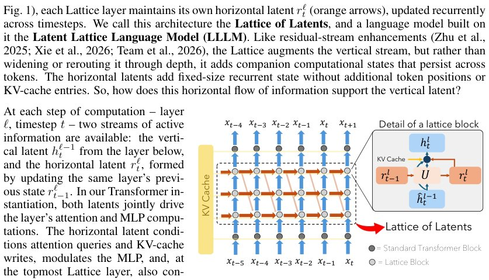

> *Generated by JarvisForResearchers Bot on 2026-11-18*

!!! tip "Why we featured this paper"
    Not yet indexed in S2 — assumed brand-new preprint

## TL;DR
The Lattice of Latents (LLLM) augments standard autoregressive LLMs by introducing recurrent, per-layer horizontal latent streams ($r_{\ell}^t$). These streams operate orthogonally to the standard vertical residual stream ($h_{\ell}^t$), conditioning attention, KV-cache writes, and MLP operations. This dual-stream capacity allocation demonstrates superior performance compared to scaling computation solely within the vertical stream.

## The Problem
Standard autoregressive Large Language Models (LLMs) constrain their active computation to a single residual-stream latent vector per token. This single stream must simultaneously manage reading from memory, writing to memory, and generating the output token. Current research efforts predominantly focus on increasing the computational capacity of this singular stream—either by increasing network depth or by enriching residual connections.

The limitations of this approach are evident when considering prior work: existing methods either deepen the network or enrich the per-token computation path. Hybrid Transformer–SSM architectures utilize recurrent states primarily for sequence mixing within the model's internal memory. Furthermore, prior residual-stream enhancements, such as hyper-connections or attention/value residuals, typically widen or reroute the computation *through* depth but fail to introduce a layer-specific state that persists across sequential tokens.

## Key Contributions
We introduce the Lattice of Latents (LLLM), which comprises a set of per-layer horizontal latent streams ($r_{\ell}^t$) that evolve recurrently across the time dimension ($t$). Crucially, these horizontal latents directly condition the vertical stream's attention mechanism, KV-cache write operations, MLP computation, and final decoding step. Our empirical results confirm that distributing computational capacity across both the vertical and horizontal latents yields performance gains that surpass those achieved by allocating capacity solely to increasing residual-stream width or network depth.

## How It Works


*Figure 1: Latent Lattice Language Model. Blue arrows
denote the vertical latent hℓ
t flowing through depth; orange
arrows denote the horizontal latents rℓ
t, one per Lattice layer,
flowing through time. The arrow from the top Lattice layer
to the bottom layer of the next timestep illustrates the op-*

The LLLM architecture maintains two distinct latent representations at each layer $\ell$: the vertical latent ($h_{\ell}^t$), which propagates through the network depth, and the horizontal latent ($r_{\ell}^t$), which evolves recurrently across timesteps. The horizontal latent is updated based on its previous state ($r_{\ell}^{t-1}$) and the incoming vertical latent from the preceding layer ($h_{\ell-1}^t$). In the Transformer instantiation, both latents jointly govern the layer's attention and MLP computations.

The horizontal latent, denoted $\hat{r}_{\ell}^t$ after normalization, conditions the layer's QKV projections via Feature-wise Linear Modulation (FiLM) and modulates the MLP block. To enrich this horizontal pathway, we incorporate three specific enhancements: input injection, a nonlinear depth-wise readout stream, and top-to-bottom feedback. This structure effectively increases the model's computational capacity by augmenting the primary residual stream with a companion, time-aware state.

### Vertical Latent ($h_{\ell}^t$)
This is the standard per-token latent vector that flows sequentially through the network depth ($\ell \in \{1, \dots, N\}$). Its state is updated iteratively through the attention and MLP blocks within each layer.

### Horizontal Latent ($r_{\ell}^t$)
This is a persistent latent vector residing at a specific layer $\ell$. It evolves recurrently across timesteps ($t$). Its update mechanism integrates information from the previous timestep's horizontal state ($r_{\ell}^{t-1}$) and the current token's vertical latent from the layer below ($h_{\ell-1}^t$).

### Feature-wise Linear Modulation (FiLM)
This mechanism utilizes the normalized horizontal latent ($\hat{r}_{\ell}^t$) to modulate the linear projections for the query, key, and value vectors. This allows the persistent layer state to dynamically steer the attention mechanism based on temporal context.

### Input Injection
This component ensures that the raw token embedding is fed directly into the update mechanism of every layer. This allows the horizontal latent to gain direct access to the current token's input features, independent of the information propagated through the vertical stream.

### Nonlinear Depth-wise Readout Stream
This enhancement introduces cross-layer non-linearity into the horizontal latent pathway. It allows the readout of the horizontal latent at layer $\ell$ to depend not only on its own state but also on the states of the layers situated below it ($\ell' < \ell$).

### Top-to-Bottom Feedback
This mechanism facilitates information flow across the depth dimension in a temporal manner. Specifically, the horizontal latent state from the topmost layer is fed back down to influence the update of the bottom layer's horizontal latent at the subsequent timestep.

## Results
The LLLM architecture demonstrates competitive performance against established baselines across various configurations.

| Metric | Value | Baseline | Source |
| :--- | :--- | :--- | :--- |
| Validation Perplexity (406M-parameter LLLM) | 14.40 | 15.41 | Table 1 |
| Validation Perplexity (LLLM with HC + Input Residuals) | 13.61 | 14.22 | Table 1 |
| Perplexity (LLLM-410 J3) | 13.694 | 14.733 | Table 1 |
| Perplexity (LLLM (1024, 1024)) | 13.443 | 14.018 | Table 1 |

## Why This Matters
The LLLM provides a concrete architectural paradigm for scaling LLM capacity beyond the traditional constraints of depth or stream width. By introducing a persistent, layer-specific state ($r_{\ell}^t$), we provide a complementary axis for computation. The structure effectively conditions not only sequence mixing (as in standard attention) but also the underlying memory operations (KV-cache writes) and the feed-forward network computations. Furthermore, the modularity of the Lattice allows for synergistic composition with existing state-of-the-art residual-stream enhancements, leading to compounded performance gains.

## Limitations & Open Questions
A primary limitation arises from the implementation of the top-to-bottom feedback mechanism. Because this feedback loop is inherently sequential, it compromises token parallelism. To maintain training efficiency, we must approximate this feedback using Jacobi passes, which incurs a computational overhead of approximately $2.6\times$ the FLOPs required for three passes during training. Additionally, the current design necessitates that the horizontal latent width ($d_r$) be selected independently of the vertical latent width ($d_{\text{model}}$), which leaves open the question of an optimal, coupled capacity allocation strategy.

---

## Citation

**Paper:** [2611.21608](https://arxiv.org/abs/2611.21608)

```bibtex
@article{261121608,
  title   = {Latent Lattice Language Models},
  author  = {Shivam Duggal and Zongze Wu and William T. Freeman and Antonio Torralba and Richard Zhang and Eli Shechtman},
  journal = {arXiv preprint arXiv:2611.21608},
  year    = {2026},
  url     = {https://arxiv.org/abs/2611.21608}
}
```
