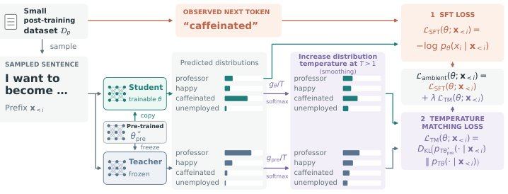

> *Generated by JarvisForResearchers Bot on 2026-11-19*

!!! tip "Why we featured this paper"
    Brand new preprint (2026) — accepted

## TL;DR
Ambient SFT is a data-efficient fine-tuning framework that regularizes post-training by enforcing that the fine-tuned model matches the high-temperature conditional distributions of its pre-trained predecessor. This allows for effective adaptation with limited data by leveraging the inherent knowledge structure of the base model.

## The Problem
Collecting large-scale, diverse, and high-quality post-training datasets for autoregressive language models is challenging. This scarcity forces reliance on Supervised Fine-Tuning (SFT) using small datasets. The consequence of this data limitation is overfitting to specific stylistic patterns or narrow viewpoints present in the limited data, which manifests as catastrophic forgetting of the tails of the original data distribution—a phenomenon often termed the alignment tax.

## Key Contributions
We introduce Ambient SFT, a drop-in replacement for standard SFT. This method regularizes the fine-tuning process by enforcing a match between the student model's conditional distributions and a high-temperature version of the pre-trained model's own distribution. Furthermore, we provide a proof demonstrating that a target distribution can be recovered solely from high-temperature conditionals, and that the conditionals of any two models contract as the temperature parameter increases. Empirically, we demonstrate significant gains across domain adaptation, instruction-tuning, and reasoning tasks, achieving up to 26.7% lower perplexity than the best baseline across five domain-adaptation targets.

## How It Works


*Figure 1: Overview of Ambient SFT for data-efficient post-training. A pre-trained model initializes
a trainable student and a frozen teacher. On the small dataset Dp, SFT fits the observed next token, while
Temperature Matching aligns the two models’ distributions after smoothing. Their weighted sum*

Ambient SFT modifies the standard SFT objective by augmenting it with a Temperature Matching loss, $J_{TM}(\theta; x_{<i}) = D_{KL}(p_{T\theta^*_{pre}}(\cdot | x_{<i}) \parallel p_{T\theta}(\cdot | x_{<i}))$. This loss functions to regularize the post-trained student model $\theta$ such that its conditional distributions align with those of the frozen pre-trained teacher $\theta^*_{pre}$, but sampled at a specific temperature $T$.

The temperature hyperparameter $T$ serves as a control mechanism for the degree of regularization. As $T$ approaches infinity, the influence of the teacher diminishes, and the objective reverts toward standard SFT. Conversely, setting $T=1$ results in a form of Knowledge Distillation. The total objective function optimized is:
$$J_{\lambda,T}(\theta) = J_{SFT}(\theta; x_{<i}) + \lambda J_{TM}(\theta; x_{<i})$$

### Student ($\theta$)
The Student ($\theta$) is the model undergoing fine-tuning. It is initialized using the weights of the pre-trained model, $\theta^*_{pre}$, and is the only set of parameters that is updated during the training process.

### Teacher ($\theta^*_{pre}$)
The Teacher ($\theta^*_{pre}$) is the original, frozen pre-trained model. It acts as a stable, high-temperature source of distributional knowledge, providing the target distribution against which the student is regularized.

### Clean Cross-entropy ($J_{SFT}$)
This component represents the standard SFT loss, defined as $-\log p_\theta(x_i | x_{<i})$. It ensures the student model learns the specific patterns present in the limited fine-tuning dataset.

### Temperature Matching Loss ($J_{TM}$)
This is the regularization term, defined as the Kullback-Leibler divergence: $D_{KL}(p_{T\theta^*_{pre}}(\cdot | x_{<i}) \parallel p_{T\theta}(\cdot | x_{<i}))$. Its purpose is to enforce alignment between the tempered conditional distributions of the teacher and the student, thereby constraining the student's parameter space to remain close to the pre-trained manifold.

## Results
The empirical evaluation demonstrates the efficacy of Ambient SFT across various downstream tasks.

| Metric | Value | Baseline | Source |
| :--- | :--- | :--- | :--- |
| Perplexity reduction (Domain Adaptation) | up to 26.7% lower | best baseline | Table 1 |
| Relative gains (Instruction Tuning) | average relative gains of 8.0% to 20.3% | Standard SFT | Abstract |
| Reasoning Benchmarks | wins on 5/6 benchmarks | Standard SFT | Abstract |

## Why This Matters
Ambient SFT provides a principled mechanism to mitigate the data scarcity inherent in modern LLM alignment. By regularizing the fine-tuning process against the high-temperature conditionals of the pre-trained model, it allows for data-efficient post-training. The temperature parameter $T$ offers a continuous dial to balance the need to learn new task-specific behaviors (SFT) against the need to retain broad, general knowledge (Teacher regularization). This approach is particularly valuable in resource-constrained environments where collecting massive, high-quality instruction datasets is infeasible.

## Limitations & Open Questions
A primary limitation is the increased computational overhead compared to standard SFT, as the method necessitates an additional forward pass through the frozen teacher model. We estimate this overhead to be approximately $1.1\times$ when the probability of selecting the teacher for a given token is $p_c = 0.75$. Theoretically, our analysis relies on the assumption that the prefixes $x_{<t}$ are drawn independently and identically distributed (i.i.d.) from the post-training distribution $p_{\theta^*_{post}}$, which may not hold perfectly in practical sequential generation. Further investigation into the robustness of the theoretical guarantees under non-i.i.d. prefix sampling is warranted.

---

## Citation

**Paper:** [2611.23229](https://arxiv.org/abs/2611.23229)

```bibtex
@article{261123229,
  title   = {Ambient LLMs: Data-Efficient Supervised Fine-tuning via Temperature Matching},
  author  = {Giannis Daras and Marios Papachristou and Adam Klivans and Antonio Torralba and Constantinos Daskalakis},
  journal = {arXiv preprint arXiv:2611.23229},
  year    = {2026},
  url     = {https://arxiv.org/abs/2611.23229}
}
```
