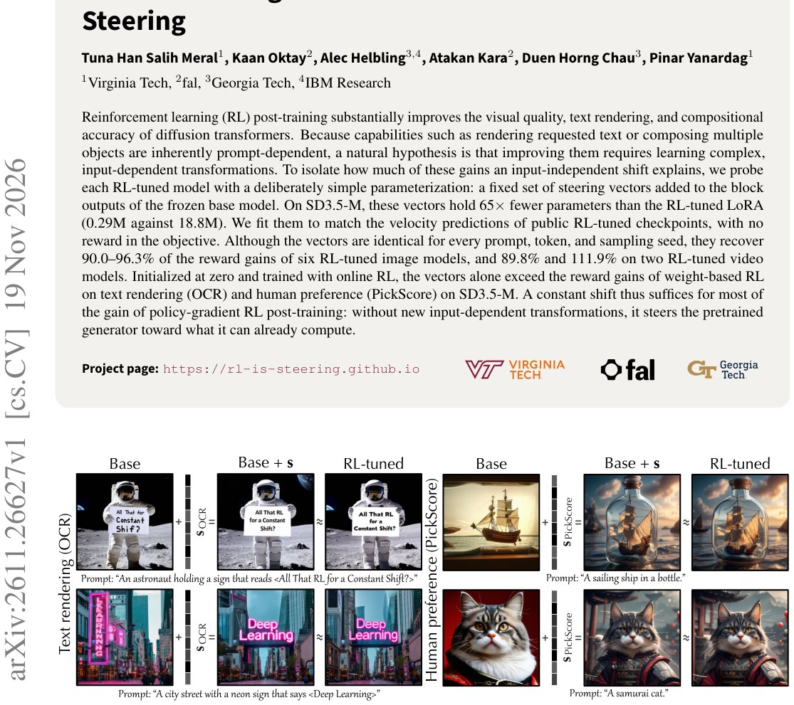

> *Generated by JarvisForResearchers Bot on 2026-11-21*

!!! tip "Why we featured this paper"
    Brand new preprint (2026) — accepted

## TL;DR
We demonstrate that a small set of fixed, input-independent steering vectors, added to the hidden states of a frozen diffusion transformer, can recover 90.0%–96.3% of the performance gains achieved by full Reinforcement Learning (RL) post-training across multiple image models. This suggests that much of the performance uplift from RL can be captured by a constant shift in the latent space, rather than requiring complex, input-dependent weight modifications.

## The Problem
The application of Reinforcement Learning (RL) to large generative models, such as diffusion transformers, has shown significant gains in metrics like text rendering quality, compositional accuracy, and human preference scores. However, the mechanism by which these RL-induced performance improvements manifest within the model's internal representations remains poorly understood. Specifically, we aim to isolate whether the substantial performance gains achieved via RL post-training necessitate complex, input-dependent transformations of the model's activations, or if they can be adequately approximated by a simpler, input-independent shift applied to the frozen base model.

Previous work in activation steering has explored methods involving contrasting prompts or optimizing fixed vectors. Yet, these approaches lacked a systematic investigation into whether a constant, global shift suffices to emulate the effects of full RL fine-tuning. The core uncertainty was whether the observed input dependence in RL-tuned models was a necessary condition for achieving the measured reward improvements.

## Key Contributions
Our work makes three primary contributions:
1. We demonstrate that fixed steering vectors, fitted without reference to the reward model, recover 90.0%–96.3% of the reward gain across six distinct RL-tuned image models.
2. We establish that matching the RL-tuned model’s output velocity predictions yields significantly greater performance recovery than simply using the average activation change as a baseline.
3. We show that training only the steering vectors of a frozen SD3.5-M using Flow-GRPO can surpass the reward gains observed in the RL-tuned OCR and PickScore models.

## How It Works


*Figure 1
A constant shift of a frozen base model recovers 90.0% to 96.3% of the RL reward gain on six image models. Base +
s adds the same steering vectors, sOCR or sPickScore, to the frozen Base SD3.5-M for every prompt, token and seed. Each set (0.29M
parameters, against 18.8M in the rank-32 LoRA)*

The methodology centers on maintaining the integrity of the pretrained diffusion transformer base model ($\vtheta$) by keeping it entirely frozen. We introduce a set of constant steering vectors, $s = \{s_{str}^{\ell,p,k}\}$, which are injected into the hidden states ($h_{str}^{\ell,i}$) at the output of specific transformer blocks. The modified hidden state is defined as $\tilde{h}_{str}^{\ell,i} = h_{str}^{\ell,i} + \alpha s_{str}^{\ell,p,k}(t)$.

Crucially, we move beyond the standard mean-difference baseline ($s_{mean}$). Instead, the vectors ($s_{fit}$) are trained via regression. The objective function minimizes the squared difference between the output velocity of the steered model ($\vtheta,s$) and the velocity of the target RL-tuned model ($\vtheta_{RL}$): $L(s) = E[\vtheta,s(x_t, t, y_p) - \vtheta_{RL}(x_t, t, y_p)]^2$. This fitting process is performed over a distribution encompassing various prompts ($y$), the final samples generated by the RL-tuned model ($x_0$), and different noise levels ($t$), critically, without requiring access to the reward model during the steering vector training phase.

### Base Model ($\vtheta$)
This is the original, pretrained diffusion transformer. It is held constant throughout the entire steering vector fitting procedure, ensuring that the learned steering vectors represent a perturbation applied to a fixed generative capacity.

### Steering Vectors ($s$)
These are the constant vectors, $s_{str}^{\ell,p,k}$, that constitute the learned shift. They are added to the hidden states ($h_{str}^{\ell,i}$) at the output of block $\ell$ in either the image or text stream, following the formulation $\tilde{h}_{str}^{\ell,i} = h_{str}^{\ell,i} + \alpha s_{str}^{\ell,p,k}(t)$.

### Guidance Pass ($p$)
This component dictates which specific steering vector is activated for a given inference step. It selects between the conditional pass ($c$) and the unconditional pass ($\emptyset$), thereby controlling the context under which the shift is applied.

### Step Bin ($k(t)$)
Since the optimal shift may vary with the noise level $t$, we discretize the noise schedule into $K$ contiguous step bins. The function $k(t)$ selects the appropriate steering vector from the set corresponding to that bin, allowing for a level of temporal conditioning without making the vector itself input-dependent.

## Results
The empirical results demonstrate the efficacy of this constant-shift approach:

| Metric | Value | Baseline | Source |
| :--- | :--- | :--- | :--- |
| Recovery of RL reward gain (Image Models) | 90.0%–96.3% | RL-tuned model | Table 1 |
| Recovery of RL reward gain (Video Models) | 89.8% and 111.9% | RL-tuned model | Table 1 |
| Parameter count comparison (SD3.5-M) | 0.29M parameters | RL-tuned LoRA (18.8M) | Figure 1 |
| Velocity matching vs. Averaging (PickScore) | sfit gains +1.416, smean gains +1.231 (rescaled) | smean | Table 1 |

## Why This Matters
The findings suggest a significant simplification in understanding the effect of RL fine-tuning on large generative models. If a constant, low-dimensional shift in the latent space can approximate the performance gains of complex, high-dimensional weight updates (like LoRA or full fine-tuning), it implies that the majority of the reward-aligned behavior is encoded in a general, global directional bias rather than highly specific, input-dependent feature transformations. This has direct implications for efficiency, suggesting that we may bypass computationally expensive RL loops by learning these steering directions directly from the target model's behavior.

## Limitations & Open Questions
A primary limitation is that the steering vectors themselves are inherently devoid of prompt information; they represent a general direction. Any prompt-specific improvements observed in the RL-tuned model must therefore be attributed to the frozen generator's inherent capacity—specifically, its attention mechanisms, normalization layers, and MLP structure—to correctly interpret and utilize this constant shift. Furthermore, the method's success is not universal; for example, the steering vectors derived for the Wan2.1 model demonstrated an ability to exceed the RL-tuned model's gain on the HPSv3 benchmark, indicating that the relationship between steering and reward gain is model-specific.

---

## Citation

**Paper:** [2611.26627](https://arxiv.org/abs/2611.26627)

```bibtex
@article{261126627,
  title   = {RL Post-Training in Diffusion Transformers Is Activation Steering},
  author  = {Tuna Han Salih Meral and Kaan Oktay and Alec Helbling and Atakan Kara and Duen Horng Chau and Pinar Yanardag},
  journal = {arXiv preprint arXiv:2611.26627},
  year    = {2026},
  url     = {https://arxiv.org/abs/2611.26627}
}
```
