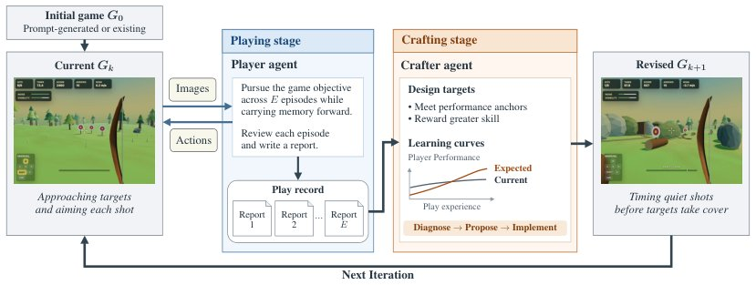

> *Generated by JarvisForResearchers Bot on 2026-11-23*

!!! tip "Why we featured this paper"
    Brand new preprint (2026) — accepted

## TL;DR
PlayCraft is an automated framework that alternates between playing and crafting stages. It utilizes a foundation-model player agent to generate detailed play reports from game interaction, which are then used by a crafter agent to diagnose skill gaps and iteratively revise the game to explicitly support a target player mastery progression.

## The Problem
While contemporary AI systems can generate playable games, the resulting artifacts often lack the necessary structure to promote genuine player mastery. Mastery, by definition, involves the deliberate development of strategies and skills to overcome escalating challenges. Designing for this process typically necessitates extensive, nuanced human playtesting and manual tuning. Existing computational approaches suffer from several limitations: strategies derived from search or game-specific training may not align with human developmental trajectories; many playtesting systems prioritize aggregate game quality metrics over explicit learning pathways; and computational agents, when used without deep introspection, often require prohibitive computational resources to learn unfamiliar environments while offering little insight into their decision-making processes or points of difficulty.

## Key Contributions
We introduce PlayCraft, an automated framework structured around alternating play and craft cycles. Our contributions include:
1. Proposing PlayCraft, an automated framework that alternates between playing and crafting stages.
2. Utilizing a foundation-model player agent that observes rendered frames and retains memory across episodes to generate detailed play reports.
3. Employing a crafter agent to estimate player abilities, predict performance at different proficiency levels, and revise the game to address gaps relative to a target learning progression.

## How It Works


*Figure 1: Overview of PlayCraft. PlayCraft starts from an initial game G0. Each iteration k has
a playing stage and a crafting stage. In the playing stage, the player agent receives a brief game
instruction and plays the current game Gk for E episodes. Within an episode, it observes recent
frame ima*

PlayCraft operates through iterative play-craft cycles, commencing with an initial game $G_0$. During the playing stage, the foundation-model player agent interacts with the current game $G_k$ for $E$ episodes. The agent maintains memory across these episodes and generates a detailed report after each one, documenting its progress, decisions, and observed lessons. This comprehensive play record is then fed into the crafting stage. Here, the crafter agent analyzes the records to diagnose the game's current state. It estimates the baseline abilities of the simulated player and predicts how the player would perform at beginner, intermediate, and expert levels against predefined performance anchors. Based on these diagnoses, the crafter proposes and implements specific revisions to $G_k$, resulting in the next iteration, $G_{k+1}$, with the explicit goal of providing meaningful opportunities for skill improvement.

### Player Agent
The Player Agent is instantiated as a foundation-model agent. Its operational modality involves observing rendered frames from the game environment and executing actions via provided controls. It engages with the game to achieve the objective across $E$ episodes, maintaining a persistent memory state throughout this interaction. Crucially, after each episode, it generates a detailed report summarizing its experience.

### Crafter Agent
The Crafter Agent consumes the play records generated by the Player Agent. Its function is diagnostic: it estimates the player's baseline abilities within the context of the current game. Furthermore, it performs predictive modeling to forecast performance across distinct proficiency tiers (beginner, intermediate, expert) relative to established performance anchors. The final output of this agent is a set of proposed revisions designed to close identified gaps relative to the desired target learning progression.

### Playing Stage
The Playing Stage is the simulation phase where the Player Agent interacts with the game $G_k$. During this stage, the agent captures frames at a frequency $O$ and makes discrete decisions at intervals $W$. The primary output of this stage is the sequence of episode reports detailing the agent's interaction history.

### Crafting Stage
The Crafting Stage is the analytical and generative phase. The Crafter Agent processes the play records. It executes the diagnostic procedures—ability estimation and performance prediction—and subsequently formulates and implements the necessary modifications to the game state to yield $G_{k+1}$.

## Results
The framework demonstrated measurable improvements in learning progression across various configurations.

| Metric | Value | Baseline | Source |
| :--- | :--- | :--- | :--- |
| macro-average learning gain | 2.7 percentage points | Initial games | Section 4.1.1 |
| macro-average learning gain | 14.0 percentage points | Initial games | Section 4.1.1 |
| macro-average learning gain | 21.9 percentage points | Initial games | Section 4.1.1 |
| macro-average learning slope | 2.09 | Not specified | Section 4.1.1 |
| macro-average learning slope | 2.64 | Not specified | Section 4.1.1 |

## Why This Matters
The findings confirm that foundation models, when coupled with a structured, iterative refinement loop, can serve as effective proxies for human game designers focused on pedagogical design. The success of PlayCraft demonstrates that focusing the revision process not merely on overall game quality, but specifically on closing gaps relative to a target mastery curve, yields significant gains in simulated learning. Furthermore, the framework validates the utility of detailed, episodic reports from an agent as a rich source of diagnostic information for automated design.

## Limitations & Open Questions
Two primary limitations must be acknowledged. First, the crafter agent cannot definitively ascertain the 100% reference point directly from the collected records, as the $E$ episodes may be insufficient for the player agent to reach expert-level performance. Second, the entire framework is predicated on the assumption that the learning patterns exhibited by the foundation-model player agent are sufficiently analogous to those observed in human players. Future work must address the robustness of this behavioral assumption and explore methods for bootstrapping the expert reference point more reliably.

---

## Citation

**Paper:** [2611.26624](https://arxiv.org/abs/2611.26624)

```bibtex
@article{261126624,
  title   = {PlayCraft: Designing Engaging Games from Agent Play Experience},
  author  = {Weihao Cheng},
  journal = {arXiv preprint arXiv:2611.26624},
  year    = {2026},
  url     = {https://arxiv.org/abs/2611.26624}
}
```
