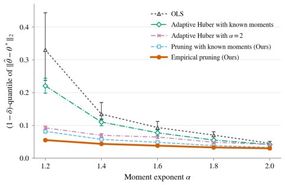

> *Generated by JarvisForResearchers Bot on 2026-11-24*

!!! tip "Why we featured this paper"
    Brand new preprint (2026) — accepted

## TL;DR
We present a black-box reduction that transforms weak-moment linear regression problems—where noise only possesses a finite conditional $\alpha$-moment ($1 < \alpha < 2$)—into equivalent finite-variance regression problems. This is achieved via empirical residual pruning, allowing us to achieve minimax optimal rates without requiring light-tailed assumptions on the covariates.

## The Problem
The established literature on high-probability linear regression often assumes that the regression noise possesses finite second moments (i.e., sub-Gaussian or bounded variance). However, many real-world systems exhibit heavy-tailed noise, meaning the regression error only possesses a finite conditional $\alpha$-moment $\nu$ for some $\alpha \in (1, 2)$. Furthermore, the covariates themselves may only possess finite moments up to a certain order. The existing theoretical framework is underdeveloped in this "below-variance" regime. Prior methods, such as coordinatewise loss approaches, suffer from a multiplicative $\sqrt{d}$ penalty, and there remains an open question regarding the possibility of improving upon the coordinatewise rate $e^{O(\nu^{1/\alpha}\sqrt{d} \lfloor \log(1/\delta)/n \rfloor (\alpha-1)/\alpha)}$ without imposing restrictive light-tailed assumptions on the design matrix.

## Key Contributions
Our work makes three primary contributions:
1. We introduce a black-box reduction framework that converts weak-moment regression into a finite-variance regression problem, crucially remaining agnostic to the specific values of $\alpha$, $\nu$, or the covariance matrix $\Sigma$.
2. Under the condition of a finite fourth-moment on the design, we demonstrate that any finite-variance subroutine capable of achieving a sub-Gaussian rate yields the estimation error rate $\lVert b_{\theta} - \theta^* \rVert_{\Sigma} \lesssim \alpha \nu^{1/\alpha} \lfloor d + \log(1/\delta) / n \rfloor^{(\alpha-1)/\alpha}$ (Eq. (1)).
3. We provide a proof establishing that this derived rate matches the known minimax lower bounds under the same conditions, confirming the optimality of the derived rate up to constant factors.

## How It Works


*Figure 1: Empirical (1 −δ)-quantile of ∥b
θ −θ∗∥2, with δ = 1/ log n ≈0.1316. Error bars show
95% bootstrap confidence intervals for each quantile, computed using 10,000 bootstrap samples of
the 200 estimation errors.*

The methodology hinges on a black-box reduction strategy. The process initiates with a warm-start estimate derived from Algorithm 2 (Least Absolute Deviations, LAD). In subsequent iterative refinement steps governed by Algorithm 1 (Black-Box Weak-Moment Regression), we employ an independent threshold block to estimate a threshold for the absolute residuals relative to the current parameter estimate. Residual pruning then zeros out any residuals exceeding this estimated threshold. This pruning step effectively modifies the sample distribution such that the resulting residuals possess a finite variance. This pruned dataset is then fed into a black-box finite-variance regression subroutine, $\text{EstFV}$, which estimates the necessary correction term. The final updated estimator, $b_{\theta}$, is derived from this correction. The overall computational efficiency of this iterative scheme is contingent upon the efficiency of the $\text{EstFV}$ subroutine.

### Algorithm 1 (Black-Box Weak-Moment Regression)
This is the primary iterative procedure. It manages the sequence of residual pruning steps and orchestrates the calls to the finite-variance estimator, $\text{EstFV}$, to refine the parameter estimate $b_{\theta}$ iteratively.

### Algorithm 2 (InitLAD)
This algorithm serves to establish the initial parameter estimate, $b_{\theta0}$. It operates by computing LAD estimates across several independent subblocks of the data and selecting the candidate estimate that minimizes the median validation LAD loss.

### EstFV
This component is a black-box subroutine. It is assumed to satisfy Assumption 3 and is responsible for estimating the required correction term, but it operates exclusively on the data that has been pruned by Algorithm 1 to ensure finite variance.

### Algorithm 3 (Black-Box Distribution-Free Weak-Moment Regression)
This algorithm is specialized for prediction tasks rather than parameter estimation. It utilizes a pruning mechanism based on the absolute magnitude of the response variable, $|y_i|$, and subsequently invokes a finite-variance prediction routine, $\text{PredFV}$.

## Results
The theoretical analysis yields the following performance guarantees:

| Metric | Value | Baseline | Source |
| :--- | :--- | :--- | :--- |
| Estimation Error (Eq. (1)) | $\lVert b_{\theta} - \theta^* \rVert_{\Sigma} \lesssim \alpha \nu^{1/\alpha} \lfloor d + \log(1/\delta) / n \rfloor^{(\alpha-1)/\alpha}$ | Coordinatewise rate $e^{O(\nu^{1/\alpha}\sqrt{d} \lfloor \log(1/\delta)/n \rfloor (\alpha-1)/\alpha)}$ | Proposition 1 |
| Prediction Error (Eq. (2)) | $\left\langle Ex(b_h(x) -x^\top\theta^*)^2 \right\rangle^{1/2} \lesssim \alpha \nu^{1/\alpha} \lfloor d \log(n/d) + \log(1/\delta) / n \rfloor^{(\alpha-1)/\alpha}$ | N/A (Comparison to finite-variance benchmark) | Proposition 2 |
| Estimation Error (Theorem 1) | $\lVert b_{\theta} - \theta^* \rVert_{\Sigma} \le B_0\nu^{1/\alpha} \lfloor \text{Rest}(n/4, \delta/8)^2 + \log(1/\delta) / n \rfloor^{(\alpha-1)/\alpha}$ | N/A | Theorem 1 |

## Why This Matters
The primary significance of this work lies in its robustness to heavy-tailed noise. By providing a black-box reduction, we decouple the complexity of the weak-moment noise structure ($\alpha, \nu$) from the requirements of the underlying regression solver ($\text{EstFV}$). This means that practitioners can deploy existing, efficient finite-variance regression solvers to tackle problems characterized by heavy-tailed errors, without needing to explicitly model or constrain the noise distribution beyond the $\alpha$-moment condition. Furthermore, by matching the minimax lower bounds, we establish that the derived rate is not merely an upper bound but is asymptotically optimal under the assumption of finite fourth-moments for the design covariates, circumventing the need for stringent light-tailed assumptions on the design matrix.

## Limitations & Open Questions
Two primary limitations must be noted. First, the guarantee for parameter estimation (Eq. (1)) is conditional on the covariates satisfying a finite fourth-moment condition (Assumption 2). Second, the distribution-free prediction guarantee (Eq. (2)) necessitates a stronger assumption—Assumption 4—which requires a weak moment assumption on the full response variable, rather than just the noise moment assumption (Assumption 1). Future work should investigate whether the prediction rate can be improved or if the dependence on $\log(n/d)$ in the prediction error can be mitigated under weaker response moment conditions.

---

## Citation

**Paper:** [2611.27983](https://arxiv.org/abs/2611.27983)

```bibtex
@article{261127983,
  title   = {Optimal Linear Regression Without a Variance},
  author  = {Artin Tajdini and Jasper C. H. Lee and Jonathan Scarlett and Kevin Jamieson},
  journal = {arXiv preprint arXiv:2611.27983},
  year    = {2026},
  url     = {https://arxiv.org/abs/2611.27983}
}
```
